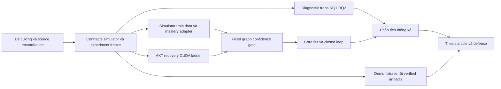

# Lộ trình phục hồi đến 29/12/2026

## Ưu tiên10/11 trong kịch bản chỉ có7ngày

Theo chỉ đạo mới của người dùng, ưu tiên bằng chứng cho ba RQ. Giữ mục tiêu đề cương và hạn29/12, dùng7ngày làm cửa sổ tập trung nghiên cứu. Các công việc engineering chỉ được ưu tiên khi chúng chặn một thí nghiệm cụ thể hoặc có nguy cơ làm sai kết quả/tiêu credit. Root thực hiện tuần tự, dùng các tiến trình tính toán độc lập khi đủ tài nguyên và không mở rộng subagents.

### Những việc phải có

| Ưu tiên | Việc | Đầu ra nghiệm thu | Liên hệ RQ |
|---|---|---|---|
| P0 | Chốt câu hỏi và matrix tối thiểu trước xem kết quả mới | Mỗi phép kiểm có giả thuyết, treatment/control, quần thể, inference unit, metric và cách đọc kết quả âm hoặc bất định | Cả3RQ |
| P0 | Gỡ đúng các blocker chạy mô hình | Một lượt Gate nguồn mới khi đủ RAM, CUDA smoke/bounded lifecycle, reload/resume/export và benchmark đủ tính cost. Chỉ sửa lỗi thật được phát hiện | RQ3 |
| P0 | Thí nghiệm neural chính trên Grade10 đã chuẩn bị | Graph-free/fixed/confidence/gated theo A0–A3, giữ graph expert/learned theo protocol và đủ baseline bắt buộc ở phạm vi so sánh đã chốt | RQ3 và đối chiếu RQ1/RQ2 |
| P0 | Thu audit khoa học khi evaluate | Cùng K/y, xác suất, calibration quanh tiêu chí đã chốt, threshold/mastery/readiness/action changes, confidence/gate và kết quả vòng kín. Phân biệt A0 độc lập với graph-off counterfactual cùng trọng số | RQ1/RQ3 |
| P0 | Tổng hợp Paper1/2 và bổ sung đúng lỗ hổng phân biệt giả thuyết | RQ1 chỉ ra chỗ tín hiệu mất tác động. RQ2 có ability/mechanism controls, Junyi order controls và điều kiện quality/history/noise còn thiếu theo matrix tối thiểu đã đăng ký | RQ1/RQ2 |
| P1 | Viết và trình bày ngay từ kết quả | Bảng kết quả/CI, figure có CSV nguồn, report HTML/MD mạch lạc, phần kết luận/giới hạn trong bản thảo và demo nhỏ dùng fitted traces | Cả3RQ |

Grade10 là môi trường ưu tiên của tuần vì có latent/true/noisy edges và là trọng tâm RQ3 theo feedback. Junyi vẫn là môi trường bắt buộc theo protocol hiện hành. Giữ các kết quả Junyi đã có ở đúng phạm vi và chuẩn bị phần còn thiếu, không lấy checkpoint Junyi áp trực tiếp sang vocabulary Grade10.

Kế thừa code và bằng chứng Paper1/2 theo PDF chuẩn. Các baseline được dùng trong một bảng so sánh chính phải có cùng quần thể/target definition và information boundaries. Kết quả Junyi lịch sử không thay cho fit Grade10. A2 confidence ablation và SAKT/GKT/BKT/GAM/Graph-GAM còn giữ vai trò theo đề cương, không tự bỏ vì thiếu thời gian. Các gates chọn checkpoint, all-selected barrier, refit/calibration và human selection approval của protocol đã chốt vẫn áp dụng.

### Nhịp7ngày

| Ngày | Kết quả ưu tiên |
|---|---|
| 1 | Chốt matrix/claim cần chứng minh và xuất audit khoa học, nghiệm thu Gate/GPU tối thiểu, đo tốc độ và forecast đủ ma trận trước grant Modal |
| 2–3 | Chạy các selected fits chính, baseline nhẹ bằng CPU khi đủ tài nguyên, kiểm exports và bắt đầu bảng prediction/calibration |
| 3–4 | Đóng review đủ điều kiện đã đăng ký, duyệt lựa chọn mô hình, thực hiện refit/calibration theo protocol. Hoàn thiện phần freeze/consumer tối thiểu nếu chính nó chặn bước này |
| 4–5 | Chạy các đối chứng RQ1/RQ2/RQ3 và closed-loop Development được duyệt, thống kê theo learner/seed, giữ kết quả âm và bất định |
| 6 | Hoàn thiện ba bảng trả lời RQ, figure nguồn và bản thảo kết quả/diễn giải. Demo gọn từ fitted traces |
| 7 | Review độc lập từng claim với evidence, sửa sai, đóng gói báo cáo GVHD và liệt kê chính xác phần đề cương còn thiếu |

Đây là mục tiêu cửa sổ nghiên cứu, chưa phải cam kết toàn bộ luận văn đã nghiệm thu sau7ngày. Nếu Gate/GPU chưa qua ngày1 hoặc throughput vượt ngân sách, báo ngay tác động đến RQ3 và tiếp tục các phần RQ1/RQ2/viết có thể làm. Không thay cơ chế kiểm khoa học để giữ lịch.

### Đưa ra ngoài cửa sổ7ngày

- Mở rộng thêm tầng verifier, proof, logging framework hoặc publisher tổng quát khi chưa có thí nghiệm bị chặn. Gói cached review78tests đã chốt, chỉ sửa tiếp lỗi có ảnh hưởng thực tế.
- Tái lập toàn bộ Paper1/2 và chạy lại BKT/GAM lịch sử. Giữ kết quả đã có cùng giới hạn đã công bố.
- Full CV neural diện rộng, nhiều dataset mới, hyperparameter search lớn, thêm architecture ngoài đề cương và tích Descartes mọi factor. Phần nào đề cương bắt buộc chỉ được bỏ sau approval, hoãn trong tuần không phải hủy scope.
- Tối ưu throughput sâu trước benchmark, unexpected-fault framework tổng quát hoặc production cloud orchestration. Giữ checkpoint/reload/resume, watchdog, budget cap và artifact tối thiểu đủ tin cậy.
- Xây lại/merge toàn bộ simulator, tổ chức lại repo, thêm UI/accounts/deployment hoặc làm lại hình thức báo cáo khi nội dung nghiên cứu còn thiếu.

Điều kiện đầu vào của tuần là đủ RAM cho Gate, phiên GPU có thể truy cập và grant chi phí cụ thể nếu dùng Modal.30USD free credits và0USD trả thêm giữ nguyên. Full CV/Holdout/phương pháp mới/final selection hoặc bỏ yêu cầu đề cương tiếp tục có approval riêng. Hoàn tất mô hình không tự động đóng RQ, kết quả graph-disabled hoặc không cải thiện vẫn là kết quả hợp lệ khi evidence đủ.

## Cập nhật điều hành08/11 — thay thế giả định ngân sách và phân công cũ

**Giới hạn đang có là30USD free credits Modal, trả thêm0USD; không phải150/300/600USD.** Các envelope PlanA/B/C bên dưới là kịch bản lịch sử06/11, đã bị giới hạn mới thay thế và không được dùng làm allocation hoặc căn cứ launch. Không tự cộng credit tháng sau/reset07/12; user chỉ cho biết reset tháng kế, chưa xác minh ngày/giờ hoặc số dư qua dashboard. Xem [hồ sơ ngân sách hiện hành](07_GPU_TRAINING_AND_COST_PLAN.md) và [state](INVESTIGATION_STATE.json).

Owner thực thi engineering hiện là Codex theo user, chia subagents theo module; không còn giả định phải đợi một trong hai sinh viên viết code. Quyết định phương pháp/đề cương và xác nhận kết quả cuối vẫn cần người có thẩm quyền. Loop chỉ tiếp tục khi phiên được cấp thực thi; không coi việc máy/ứng dụng tắt là một job cloud đang chạy.

**Khuyến nghị hiện hành:** giữ hướng khoa học tối thiểu của PlanA, giữ đầy đủ baseline/deliverable bắt buộc, song song diagnostic evidence + model readiness + writing/demo; mọi mở rộng của PlanB/C chỉ sau khi evidence bắt buộc đủ và cost đo thực tế còn chỗ. Chưa chứng minh30USD đủ cho phạm vi PlanA. Nếu forecast không khớp giới hạn, phải xin duyệt phân bổ model×environment/protocol hoặc ghi phạm vi chưa đạt, không tự bỏ model hoặc gọi partialCV là5fold.

Đã có RQ1/RQ2 pilot diagnostics và bản thảo phương pháp; Graph-GAM/Paper2 source tái dùng; AKT context worker WindowsCPU và actual-guard toy lifecycle đã được kiểm. Trainer SAKT đạt139 test, AKT simulator toy đạt40 test, Graph-GAM variant factory đạt38 test; các bundle đã đóng và commit riêng. A0/A1 graph-AKT prototype đạt23 test với0 optimizer step; Gate21 đạt757 PASS trong467,14s, trần540s. GKT mới có kernel, demo mới là artifact viewer. Colab CPU đã phân giải44 dependency và tải14 tệp bằng chứng; chưa isolated install hoặc CUDA worker mới. Tất cả các mục này chưa là scientific selected-fit. [Delta đầy đủ](../../research_tracking/reports/model_completion_contract_20261108.md) là snapshot trước batch trainer mới; xem [chỉ mục bằng chứng hiện hành](../../research_tracking/EVIDENCE_INDEX.md) để theo dõi bổ sung mà không đổi snapshot lịch sử.

| Thời hạn kiểm soát | Ưu tiên và dependency | Bằng chứng nghiệm thu / điểm dừng |
|---|---|---|
|08–12/11 |Đóng các batch trainer/masks/role/checkpoint, Graph-GAM variant isolation; chuẩn bị Linux dependency lock; GVHD chốt S01/S04/S05 từ bộ tài liệu đã có |Source-bound tests + toy lifecycle; source ambiguity được ghi; model×environment/estimands/mastery/calibration phải được chốt trước research corpus/fit |
|13–19/11 |IsolatedLinux + actual new-worker CUDA smoke/recovery trên Colabfree khi kết nối; scientific simulator trainer/selection/refit contracts và A0/A1 integration; minimal confidence/gate |Không lấy probev12 hoặc tinyCPUtiming làm throughput; chưa launch Modal khi thiếu runtime/recovery/representative benchmark/caps |
|20–26/11 |Các fits simulator A0–A3 và required comparators theo allocation đã duyệt; tiếp tục trap controls và viết kết quả; Junyi theo cost/authorized protocol |First registered model comparisons cùngpopulation/role identities, negative findings giữ nguyên; không chạy full Cartesian hoặc tune bằngHoldout |
|27/11–03/12 |Hoàn thiện core evidence RQ1–RQ3, required learned/noisygraph và inference families; CV/refit Junyi chỉ từngrun đã được duyệt |03/12 là scientific scope checkpoint: thiếu mandatory evidence phải báo rõ/đề xuất điều chỉnh với GVHD; không chờ đến tuần cuối mới phát hiện thiếu baseline |
|04–10/12 |Đóng so sánh còn được duyệt, CI/Holm/coverage/calibration, demo có selected artifacts và full thesis/article draft |Không mở sweep mới vì kết quả chưa dương; demo viewer hiện có chỉ là fallback đọcpilot |
|11–14/12 |Repro audit, sửa lỗi diễn giải/artifact, GVHD đọc bản đầy đủ |Freeze experiments14/12; mọi ngoại lệ cần lý do khoa học và review |
|15–29/12 |Hoàn chỉnh luận văn/bài báo/demo/slides, rehearsal/defense và nộp |Giữ buffer thực tế; deadline29/12 không dời theo training chậm |

Ngày08/11 còn51ngày đến hạn. Effort58–78person-days và elapsed của bản lịch sử dưới đây chưa được chuyển thành năng suất agent đã đo; không suy ra chạy nhiềuagent sẽ tự bảo đảm lịch. Critical path hiện là **S04/S05→role-aware scientific training contracts + Linux/CUDA acceptance→approved fits→served closed-loop traces/statistics→claims/draft review**, không là BKT→GAM→AKT tuần tự. Writing/demo/diagnostics độc lập tiếp tục trong khi cloud hoặc approval còn chờ.

Trước Modal, reserve chi phí dự kiến startup/CPU/RAM/storage/retry và ngân sách chưa dùng; không chi toàn bộ30USD vào một lệnh train. Chưa tự cấp một tranche cụ thể: stage specification/cost projection và chủ tài khoản phải duyệt. Colab thiếu kết nối/quota không tự cho phép fallback Modal. Nếu authorization/feedback chậm quá12/11, lập impact cụ thể cho milestones sau; tiếp tục phần thuần engineering nhưng không dùng default tự chọn để đóng RQ.

## Snapshot kế hoạch06/11 — giữ để đối chiếu quyết định cũ

Ngày cơ sở06/11, còn53 ngày. Effort là person-days6h tập trung, elapsed gồm queue/debug/review. Capacity assumption hai sinh viên mỗi người4–5 ngày/tuần, cần xác nhận thời gian thực. Không suy deadline chỉ từ GPU hours. Tổng dự kiến PlanB khoảng58–78 person-days, khả năng cao vượt capacity nếu ít hơn4 ngày/tuần hoặc advisor turnaround>3 ngày. Dành margin15–29/12, freeze experiments14/12.

## Quyết định KEEP / REUSE / MODIFY / DEFER

BKT KEEP reference frozen, REUSE CV, DEFER retrain. GAM REUSE graph-free, Graph-GAM REUSE P2 và MODIFY package isolation. Paper1 KEEP historical, MODIFY adapter sau source reconciliation. Paper2 REUSE historical fixtures và MODIFY diagnostic variant. AKT KEEP backbone, MODIFY lifecycle và GPU authorization. Fixed-AKT và CG KEEP essential RQ3. SAKT/GKT KEEP required supporting baselines, không để chúng chặn diagnostic harness. Dataset/splits REUSE frozen, graph processing MODIFY train-only learning/null controls. Shared stats REUSE + MODIFY inference families. Simulator architecture MODIFY selective shared contracts, DEFER unification dynamics. Demo và writing KEEP parallel. Learned neural edge-confidence DEFER, deep hyperparam sweep DEFER, extra dataset DEFER. REMOVE-WITH-APPROVAL chỉ áp model/deliverable mandatory nếu deadline không khả thi, không tự xóa.

## Đồ thị phụ thuộc thực

Junyi AKT full5fold không là dependency kỹ thuật của simulator CG. Nó là comparator/evidence stream theo allocation được duyệt. SAKT/GKT adapters có thể cùng contract với AKT, chưa cần chờ full CV. Dương chuẩn bị simulator, Sang lifecycle và model, đồng thuận interface trước tách nhánh.

## Milestones Plan B khuyến nghị

| Ngày | Sang | Dương | Deliverable/gate | Effort và elapsed |
|---|---|---|---|---|
|06–12/11 |Recovery schema, CUDA wrapper draft, mastery interface |Paper1 revision, graph/env/controller isolation, trap proofs, protocol draft |Advisor freeze methodology+matrix, contracts signed cả hai, evidence E01/E02 |10–14pd,7d |
|13–19/11 |CUDA stages1–6 sau approval, fixed/CG synthetic |Sim log generation/splits, Graph-GAM isolation, negative controls |Accepted lifecycle, throughput forecast, no training lớn trước budget |10–14pd,7d |
|20–26/11 |Core simulator A0–A3, SAKT/GKT adapters, bounded fits |E03–E06 cheap diagnostics, trace QA, Junyi graph learned/null |Core model/train checkpoint + first outcome tables, draft methods |10–14pd,7d |
|27/11–03/12 |Approved Junyi AKT folds và allocated fixed/CG, demo |Paired simulator core50seeds, robustness/noise, stats |Core RQ1–3 evidence đủ, scope checkpoint03/12 |10–14pd,7d + GPU |
|04–10/12 |Complete comparator budget, demo parity, no open sweep |CI/Holm, selection stability, final claims |All mandatory models accounted, results/thesis draft v1 |8–12pd,7d |
|11–14/12 |Fix artifact/demonstration defects |Reproducibility audit + article draft |Experiment freeze14/12, advisor scientific review |4–6pd,4d |
|15–21/12 |Thesis/demo revisions |Tables/source archive and response advisor |Thesis full draft v2, rehearsal |6–8pd,7d |
|22–29/12 |Defense slides, tested demo fallback |Final hashes, appendix, submission checklist |Final submission29/12, reserve3d minimum |4–6pd,8d |

Viết introduction/related work/methods từ06/11, baseline/results limitations từ đầu, kết quả mới điền vào bảng có run_id. Demo fixture từ tuần2, verified artifact loader tuần4. Bản thảo bài báo có từ tuần6 theo đề cương trang5. Không trì hoãn demo/writing đến hết train.

## Ba lựa chọn

| Plan | Phạm vi/evidence | GPU và budget đề xuất | Effort/elapsed | Compromise và fallback |
|---|---|---|---|---|
|A minimum defensible |Tất cả RQ và mandatory model/deliverable, simulator core4variants1seed train+50 paired eval, cheap full trap controls, SAKT/GKT bounded registered comparator, Junyi5fold AKT nếu projection khả thi |L4/A10 oneGPU,150USD envelope conditional measured hours |46–62pd,6–7tuần |Giảm training-seed breadth và Junyi graph-model coverage cần advisor duyệt. Không đủ required comparator benchmark thì chưa proposal-complete, không gọi đơn thuần implemented là evidence |
|B recommended |A+3 training seeds simulator core, modern-model noise ablation nhỏ, Junyi matched AKT và fixed/CG allocation theo measured budget, learned graph, demo+article |300USD envelope, full matrix approval sau stage5 |58–78pd,7tuần+final buffer |Mức overlap baseline dataset allocation cần advisor duyệt. Tránh full Cartesian, model sensitivity conditional inference label rõ |
|C extended |B+5fold mọi neural variant, nhiều train seeds/noise refits, full comparator cả2env và graph-confidence learned |600USD chỉ placeholder, có thể vượt xa theo scenario conservative |85–110pd,10–12tuần |Không phù hợp deadline nếu bắt đầu06/11, chỉ thêm sau mandatory evidence freeze |

PlanB được khuyến nghị như proposal để review, chưa claim feasible đã đo. Nếu stage5 forecast vượt ngân sách/thời gian, chuyển A bằng documented advisor scope decision. Không chọn plan chỉ vì cost envelope thấp, thiếu throughput vẫn chặn approval full training.

## Contingency register

| Trigger | Immediate action | Scientific consequence/scope | Approval |
|---|---|---|---|
|1 forecast vượt budget |Stop launches, retain verified artifacts, prioritize simulator core |Reduce Junyi graph-model matrix, uncertainty rộng hơn |Advisor+budget owner |
|2 throughput thấp hơn p10 projection |Profile loader/padding, compare cost/target L4/A10/L40S bounded |No full forecast until measured, adjust E chỉ sau protocol review |Bounded GPU approval và methodology nếu E đổi |
|3 Modal outage/runtime failure |Persist diagnostics, resume committed checkpoint one manual retry |Same protocol alternative platform nếu image parity |Spend/transfer approval |
|4 CUDA incompatible |Stop at smoke, pin compatible wheel/image, CPU synthetic parity |Delay full jobs, no inference CPU success substitute |Engineering safe, paid retest approval |
|5 resume mismatch |Block stage4+, repair cursor/RNG/durability |Training artifact incomplete chưa scientific result |Engineering then bounded retest |
|6 full AKT CV không kịp |Report completed folds as partial Dev, freeze no metric selection |Reduced evidence, cannot label5fold complete |Advisor approve scope |
|7 historical simulator conclusions invalid |Version diagnosis, keep published tables and discrepancy |New evidence diagnostic-v1, exact reproduction limitation |Advisor scientific decision |
|8 required baseline late |Timebox adapter≤3pd, use pinned trusted upstream if parity |If omitted/reduced evaluation violates agreed matrix |Advisor approval mandatory |
|9 CG không thắng A0 |Keep negative result, inspect gate/noise/control acceptance |RQ3 answered within CI, fallback A0 can be selected on Dev |No approval to report truthful result, final selector approval |
|10 confidence unidentifiable |Use explicit reliability proxy + oracle upper-reference |Deployment claim limited, revise operationalization |Advisor |
|11 DiD assumptions fail |Use paired randomized mechanism factorial |Causal claim simulator-conditional, no observational DiD |Advisor |
|12 Junyi order confounding remains |Report observational predictive, emphasize simulator controls |No real instructional causal claim |Advisor interpretation review |
|13 CI inconclusive |Report CI/MDE/censor/support, no extra seeds chosen by p |Limited conclusions, optional preregistered power extension |Budget+advisor if extension |
|14 shared task late>2d |Use frozen mock contract, handoff minimal adapter |Integration risk, escalate weekly milestone |Both owners, advisor for scope |
|15 advisor requests changes after14/12 |Classify correction vs new study, protect submission |Defer new exploratory work, explain scientific cost |Advisor sign-off |
