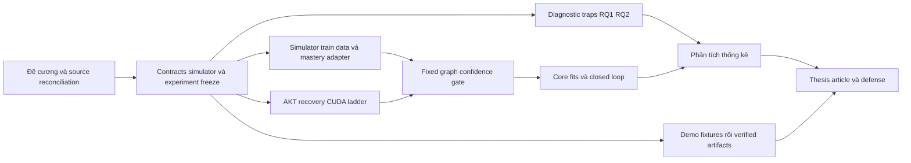

# Lộ trình phục hồi đến 29/12/2026

Ngày cơ sở06/11, còn53 ngày. Effort là person-days6h tập trung, elapsed gồm queue/debug/review. Capacity assumption hai sinh viên mỗi người4–5 ngày/tuần, cần xác nhận thời gian thực. Không suy deadline chỉ từ GPU hours. Tổng dự kiến PlanB khoảng58–78 person-days, khả năng cao vượt capacity nếu ít hơn4 ngày/tuần hoặc advisor turnaround>3 ngày. Dành margin15–29/12, freeze experiments14/12.

## Quyết định KEEP / REUSE / MODIFY / DEFER

BKT KEEP reference frozen, REUSE CV, DEFER retrain. GAM REUSE graph-free, Graph-GAM REUSE P2 và MODIFY package isolation. Paper1 KEEP historical, MODIFY adapter sau source reconciliation. Paper2 REUSE historical fixtures và MODIFY diagnostic variant. AKT KEEP backbone, MODIFY lifecycle và GPU authorization. Fixed-AKT và CG KEEP essential RQ3. SAKT/GKT KEEP required supporting baselines, không để chúng chặn diagnostic harness. Dataset/splits REUSE frozen, graph processing MODIFY train-only learning/null controls. Shared stats REUSE + MODIFY inference families. Simulator architecture MODIFY selective shared contracts, DEFER unification dynamics. Demo và writing KEEP parallel. Learned neural edge-confidence DEFER, deep hyperparam sweep DEFER, extra dataset DEFER. REMOVE-WITH-APPROVAL chỉ áp model/deliverable mandatory nếu deadline không khả thi, không tự xóa.

## Đồ thị phụ thuộc thực

Junyi AKT full5fold không là dependency kỹ thuật của simulator CG. Nó là comparator/evidence stream theo allocation được duyệt. SAKT/GKT adapters có thể cùng contract với AKT, chưa cần chờ full CV. Dương chuẩn bị simulator, Sang lifecycle và model, đồng thuận interface trước tách nhánh.

## Milestones Plan B khuyến nghị

| Ngày | Sang | Dương | Deliverable/gate | Effort và elapsed |
|---|---|---|---|---|
|06–12/11 |Recovery schema, CUDA wrapper draft, mastery interface |Paper1 revision, graph/env/controller isolation, trap proofs, protocol draft |Advisor freeze methodology+matrix, contracts signed cả hai, evidence E01/E02 |10–14pd,7d |
|13–19/11 |CUDA stages1–6 sau approval, fixed/CG synthetic |Sim log generation/splits, Graph-GAM isolation, negative controls |Accepted lifecycle, throughput forecast, no training lớn trước budget |10–14pd,7d |
|20–26/11 |Core simulator A0–A3, SAKT/GKT adapters, bounded fits |E03–E06 cheap diagnostics, trace QA, Junyi graph learned/null |Core model/train checkpoint + first outcome tables, draft methods |10–14pd,7d |
|27/11–03/12 |Approved Junyi AKT folds và allocated fixed/CG, demo |Paired simulator core50seeds, robustness/noise, stats |Core RQ1–3 evidence đủ, scope checkpoint03/12 |10–14pd,7d + GPU |
|04–10/12 |Complete comparator budget, demo parity, no open sweep |CI/Holm, selection stability, final claims |All mandatory models accounted, results/thesis draft v1 |8–12pd,7d |
|11–14/12 |Fix artifact/demonstration defects |Reproducibility audit + article draft |Experiment freeze14/12, advisor scientific review |4–6pd,4d |
|15–21/12 |Thesis/demo revisions |Tables/source archive and response advisor |Thesis full draft v2, rehearsal |6–8pd,7d |
|22–29/12 |Defense slides, tested demo fallback |Final hashes, appendix, submission checklist |Final submission29/12, reserve3d minimum |4–6pd,8d |

Viết introduction/related work/methods từ06/11, baseline/results limitations từ đầu, kết quả mới điền vào bảng có run_id. Demo fixture từ tuần2, verified artifact loader tuần4. Bản thảo bài báo có từ tuần6 theo đề cương trang5. Không trì hoãn demo/writing đến hết train.

## Ba lựa chọn

| Plan | Phạm vi/evidence | GPU và budget đề xuất | Effort/elapsed | Compromise và fallback |
|---|---|---|---|---|
|A minimum defensible |Tất cả RQ và mandatory model/deliverable, simulator core4variants1seed train+50 paired eval, cheap full trap controls, SAKT/GKT bounded registered comparator, Junyi5fold AKT nếu projection khả thi |L4/A10 oneGPU,150USD envelope conditional measured hours |46–62pd,6–7tuần |Giảm training-seed breadth và Junyi graph-model coverage cần advisor duyệt. Không đủ required comparator benchmark thì chưa proposal-complete, không gọi đơn thuần implemented là evidence |
|B recommended |A+3 training seeds simulator core, modern-model noise ablation nhỏ, Junyi matched AKT và fixed/CG allocation theo measured budget, learned graph, demo+article |300USD envelope, full matrix approval sau stage5 |58–78pd,7tuần+final buffer |Mức overlap baseline dataset allocation cần advisor duyệt. Tránh full Cartesian, model sensitivity conditional inference label rõ |
|C extended |B+5fold mọi neural variant, nhiều train seeds/noise refits, full comparator cả2env và graph-confidence learned |600USD chỉ placeholder, có thể vượt xa theo scenario conservative |85–110pd,10–12tuần |Không phù hợp deadline nếu bắt đầu06/11, chỉ thêm sau mandatory evidence freeze |

PlanB được khuyến nghị như proposal để review, chưa claim feasible đã đo. Nếu stage5 forecast vượt ngân sách/thời gian, chuyển A bằng documented advisor scope decision. Không chọn plan chỉ vì cost envelope thấp, thiếu throughput vẫn chặn approval full training.

## Contingency register

| Trigger | Immediate action | Scientific consequence/scope | Approval |
|---|---|---|---|
|1 forecast vượt budget |Stop launches, retain verified artifacts, prioritize simulator core |Reduce Junyi graph-model matrix, uncertainty rộng hơn |Advisor+budget owner |
|2 throughput thấp hơn p10 projection |Profile loader/padding, compare cost/target L4/A10/L40S bounded |No full forecast until measured, adjust E chỉ sau protocol review |Bounded GPU approval và methodology nếu E đổi |
|3 Modal outage/runtime failure |Persist diagnostics, resume committed checkpoint one manual retry |Same protocol alternative platform nếu image parity |Spend/transfer approval |
|4 CUDA incompatible |Stop at smoke, pin compatible wheel/image, CPU synthetic parity |Delay full jobs, no inference CPU success substitute |Engineering safe, paid retest approval |
|5 resume mismatch |Block stage4+, repair cursor/RNG/durability |Training artifact incomplete chưa scientific result |Engineering then bounded retest |
|6 full AKT CV không kịp |Report completed folds as partial Dev, freeze no metric selection |Reduced evidence, cannot label5fold complete |Advisor approve scope |
|7 historical simulator conclusions invalid |Version diagnosis, keep published tables and discrepancy |New evidence diagnostic-v1, exact reproduction limitation |Advisor scientific decision |
|8 required baseline late |Timebox adapter≤3pd, use pinned trusted upstream if parity |If omitted/reduced evaluation violates agreed matrix |Advisor approval mandatory |
|9 CG không thắng A0 |Keep negative result, inspect gate/noise/control acceptance |RQ3 answered within CI, fallback A0 can be selected on Dev |No approval to report truthful result, final selector approval |
|10 confidence unidentifiable |Use explicit reliability proxy + oracle upper-reference |Deployment claim limited, revise operationalization |Advisor |
|11 DiD assumptions fail |Use paired randomized mechanism factorial |Causal claim simulator-conditional, no observational DiD |Advisor |
|12 Junyi order confounding remains |Report observational predictive, emphasize simulator controls |No real instructional causal claim |Advisor interpretation review |
|13 CI inconclusive |Report CI/MDE/censor/support, no extra seeds chosen by p |Limited conclusions, optional preregistered power extension |Budget+advisor if extension |
|14 shared task late>2d |Use frozen mock contract, handoff minimal adapter |Integration risk, escalate weekly milestone |Both owners, advisor for scope |
|15 advisor requests changes after14/12 |Classify correction vs new study, protect submission |Defer new exploratory work, explain scientific cost |Advisor sign-off |
