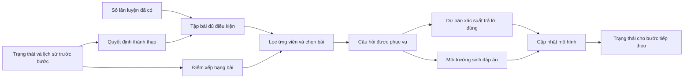

# Những kết quả cốt lõi đã đạt cho RQ1 và RQ2

Ngày 12/11/2026. Nội dung tổng hợp từ thí nghiệm và phân tích đã lưu, dành cho phần kết quả và thảo luận KLTN.

## Từ hai paper đến câu hỏi của KLTN

Paper1 nghiên cứu ảnh hưởng của cấu trúc tiên quyết và chính sách chọn bài đến đường học trong mô phỏng. Paper2 đưa thông tin tiên quyết vào mô hình theo dõi kiến thức, rồi đánh giá cả khả năng dự báo trên cùng luồng tương tác và kết quả khi hệ thống tự chọn bài. KLTN tiếp nối từ câu hỏi vì sao thông tin đồ thị chưa tạo ra cải thiện học tập nhất quán. RQ1 tìm chỗ ảnh hưởng đó bị suy giảm hoặc bị giả định đánh giá che khuất. RQ2 tìm các điều kiện khiến ảnh hưởng thay đổi. PDF Paper1 là nguồn chuẩn được kế thừa. Những phân tích dưới đây làm rõ cơ chế và phạm vi diễn giải của kết quả, đồng thời xác định phần thực nghiệm cần bổ sung cho CG-AKT.

## 1. Một số kết quả có thể suy ra từ quy tắc mô phỏng

Với Paper1, nhóm kiểm trực tiếp khi nào bộ lọc giữ chương bảo đảm không quay lại chương cũ. Nếu đồ thị không có chu trình, mọi cạnh nằm trong cùng chương, khái niệm đã đạt ngưỡng không bị cập nhật giảm trở lại và controller tiếp tục chương đang còn bài đủ điều kiện, hệ thống chỉ rời chương khi mọi khái niệm của chương đã đạt ngưỡng. Khi đó số lần quay lại bằng0 với mọi chuỗi đáp án. Bốn tình huống xác định đã kiểm điều kiện này và ranh giới của nó. Một cạnh liên chương có thể tạo chuỗi A→B→A dù controller vẫn tuân thủ quy tắc. Phân tích tiếp cho thấy dưới chuyển trạng thái chỉ phụ thuộc từng khái niệm, cùng chuỗi ngẫu nhiên riêng cho khái niệm và khi cả hai đường học đều hoàn tất, thay thứ tự không đổi trạng thái cuối của từng khái niệm. Với Paper2, không luyện thêm sau thời điểm kết thúc và luật quên đồng nhất0,06/ngày làm retained **net gain** sau14ngày bằng khoảng0,43171lần net gain cuối. Vì thế hai chỉ tiêu giữ cùng thứ hạng trong điều kiện này. **Đã khép được các kết luận cấu trúc có điều kiện**. Chúng cho biết khi nào re-entry hoặc retention ít cung cấp bằng chứng so sánh bổ sung. Chưa thể suy mọi đồ thị, thời hạn học hoặc cơ chế quên đều có kết quả như vậy. [Điều kiện re-entry](paper1_reentry_mechanism_20261109.md), [bất biến trạng thái cuối](paper1_concept_local_invariance_20261109.md), [fixture retention](../runs/cpu-rq12-20261107-03/retention.json).

## 2. Dự báo thay đổi thường chưa dẫn tới lựa chọn khác

Để tìm điểm ảnh hưởng đồ thị bị suy giảm, nhóm giữ cùng câu hỏi, đáp án và lịch sử, rồi so mô hình không đồ thị với toàn gói Graph-GAM của Paper2. Pilot gồm3seed×3profile×120bước, tạo1.080cặp thời điểm. Xác suất trả lời đúng của câu đang xét thay đổi ở964/1.080cặp, nhưng trong964cặp ấy có944cặp giữ nguyên lựa chọn khái niệm thăm dò. Điểm số kiến thức thay đổi ở cả1.080cặp, trong khi990cặp giữ quyết định thành thạo và1.058cặp giữ lựa chọn. Có90thời điểm đổi ít nhất một quyết định thành thạo,60thời điểm đổi tập bài đủ điều kiện và22thời điểm đổi khái niệm thăm dò. Để biết dự báo có tốt hơn, nhóm dùng cùng Log Loss và Brier như hướng đánh giá baseline, vì hai chỉ tiêu xét cả độ tự tin của dự báo đúng và sai. Log Loss gộp giảm nhẹ khoảng0,000694, nhưng riêng profilePG lại tăng trong cả3seed-profile. **Đã khép claim mô tả rằng thay đổi dự báo và điểm số thường chưa chuyển thành quyết định khác trong pilot này**. Ba seed là phạm vi độc lập nhỏ, lựa chọn thăm dò được hỏi trên bản sao policy, và toàn gói còn chứa thành phần điều chỉnh ngoài cạnh đồ thị. Những số đếm này chưa xác nhận lợi ích học tập hay tác động riêng của từng cạnh. [Bảng điều kiện từng thời điểm](../runs/cpu-rq1-transitions-20261108-01/analysis.json), [điểm số và chất lượng dự báo](rq1_score_vector_diagnostic_20261108.md).

## 3. Quy tắc mở bài có một đường đi ngoài quyết định thành thạo

Paper2 cho phép học tiếp khi mọi tiên quyết đã được mô hình đánh dấu thành thạo **hoặc** đã được chọn ít nhất6lần. Nhóm định lượng việc sử dụng quy tắc có sẵn này trên3.240hành động đã phục vụ trong27quỹ đạo. Sau khi tách500hành động ở khái niệm gốc không có tiên quyết, còn2.740hành động cần xét điều kiện tiên quyết. Trong đó699hành động có mọi tiên quyết được đánh dấu thành thạo, còn2.041hành động cần ngoại lệ đủ số lần chọn. **Đã khép claim rằng readiness trong trace này không chỉ phụ thuộc quyết định thành thạo**. Khi ngoại lệ đã được thỏa, thay đổi nhãn thành thạo có thể chưa đổi điều kiện mở bài. Chưa đo được bao nhiêu ảnh hưởng đồ thị thực sự bị ngoại lệ này hấp thụ, cũng chưa biết bỏ ngoại lệ sẽ làm người học tiến bộ hơn hay kém hơn. Điều đó cần đối chứng cùng trạng thái hoặc can thiệp controller riêng. [Bảng và mẫu số](rq1_ready_set_exposure_results_20261108.md), [aggregate nguồn](../runs/rq1-ready-set-exposure-20261108-01/summary.json).

### Đối chứng bổ sung trên cùng trạng thái ngày12/11

Nhóm giữ nguyên quyết định thành thạo, số lần luyện và đồ thị tại3.240thời điểm, rồi chỉ bỏ ngoại lệ đủ số lần luyện khỏi điều kiện mở bài. Tập bài đủ điều kiện thay đổi ở2.557thời điểm, loại18.520trong30.572lượt thành viên. Tuy vậy, cả3.240thời điểm vẫn còn ít nhất một khái niệm thỏa điều kiện thành thạo nghiêm ngặt. Các khái niệm này thuộc tập sơ bộ trước các bộ lọc chống lặp, cân bằng phủ nội dung và xếp hạng. Chưa biết chúng còn được giữ sau các bộ lọc đó hay có giúp người học tiến sang nội dung mới. Kết luận được giới hạn ở điều kiện mở bài tại cùng trạng thái. Đây là kết quả mới bổ sung cho footprint trước. Chưa biết selector đầy đủ sẽ chọn bài nào khi thay điều kiện, vì trace thiếu điểm số của các ứng viên mới. Các bước tiếp theo cũng sẽ phân kỳ nếu áp dụng quy tắc này qua thời gian. [Phân tích và kiểm độc lập](../runs/rq1-strict-readiness-shadow-20261112-01/README.md).

Luồng thực thi Paper2 giúp giải thích vì sao cần phân biệt dự báo cho câu được chọn với thông tin dùng để chọn câu. Controller đọc trạng thái kiến thức, quyết định thành thạo, số lần luyện và điểm xếp hạng trước khi chọn bài. Sau đó mô hình mới dự báo xác suất của câu đã chọn. Dự báo này cùng đáp án đi vào cập nhật cho bước sau. Vì vậy, chuỗi RQ1 được khảo sát qua diễn tiến nhiều bước và qua các đối chứng cùng trạng thái. Các tổng số nêu trên không tạo thành một funnel nhân quả lồng nhau. [Snapshot nguồn và parity](../runs/rq1-closed-loop-reconstruction-20261108-02/accepted_fast__parity.json), [phân tích thứ tự thực thi](rq1_closed_loop_reconstruction_20261108.md).

## 4. Đã tách ảnh hưởng nguồn đồ thị khỏi một cơ chế năng lực trong mô phỏng

Một chênh lệch giữa hai đồ thị có thể xuất hiện vì người học ở mức năng lực khác nhau hoặc vì cơ chế thiếu tiên quyết của simulator. Nhóm tạo10block khởi tạo mới, mỗi block giữ cùng trạng thái nền và nguồn ngẫu nhiên giữa các nhánh. Trong mỗi block, thí nghiệm thay nguồn đồ thị của bộ ước lượng giữa expert và một learned graph cố định, bật/tắt cơ chế phạt thiếu tiên quyết và xét3mức khởi tạo. Tổng cộng120world×120bước đã hoàn tất. Trước hết lấy chênh lệch gain expert−learned khi cơ chế bật, rồi trừ chênh lệch tương ứng khi cơ chế tắt. Tương tác trung bình lần lượt khoảng+0,004496và+0,024530điểmElo ở mức1000và1150, nhưng từng block có cả dấu dương lẫn âm. Ở mức1300, tương tác bằng0 trong10/10block theo điều kiện bất hoạt đã dự kiến, trong khi chênh lệch trực tiếp giữa hai graph vẫn khác0. **Đã khép claim rằng đổi nguồn đồ thị còn tác động qua các đường khác ngoài riêng cơ chế phạt**. Khoảng bootstrap thăm dò của hiệu tương tác1150−1000chứa0, nên chưa kết luận hai mức năng lực có hiệu ứng khác nhau. Đây là factorial điều khiển trong simulator, với block làm đơn vị suy luận và một learned graph cố định. Chưa xác lập quy luật về năng lực người học thật. [Thiết kế và kết quả120world](rq2_fresh_graph_source_replication_20261110.md), [bất định theo block](rq2_fresh_block_uncertainty_20261110.md).

## 5. Đối chứng đồ thị Junyi hiện có chưa đủ để kết luận đồ thị giúp dự báo

Junyi có thứ tự luyện chịu ảnh hưởng của bản đồ kiến thức. Nếu đồ thị thật phù hợp hơn với thứ tự log, so nó với đồ thị ngẫu nhiên có thể trộn thông tin tiên quyết với đặc điểm thứ tự và tần suất tiếp xúc. Nhóm đã kiểm256learner inner-train, tối đa300tương tác mỗi learner, thu12.575tương tác. Sau khi giữ cùng cơ hội learner–khái niệm và mẫu số,239learner đóng góp1.361cơ hội. Ba đối chứng giữ degree và các nhóm đặc trưng của cạnh nhưng chỉ làm thay đổi điểm exposure “parent đã xuất hiện trước” ở lần lượt1/239,7/239và1/239learner. Khi chỉ giữ cơ hội đồng quan sát phù hợp giữa hai graph, khoảng41% cơ hội còn lại. **Đã khép claim rằng số cạnh bị thay đổi chưa bảo đảm người học được tiếp xúc với một đối chứng khác có đủ thông tin**. Các run này đo thứ tự và coverage, chưa đo dự báo, nên chưa chứng minh đã xảy ra dương tính giả của metric. Bước còn thiếu là đối chiếu dự báo trên cùng logged targets với graph-free, catalog, matched null và đồ thị chỉ học thứ tự từ TRAIN, giữ nguyên ranh giới thông tin. Kết luận Junyi vẫn có phạm vi dự báo quan sát được trong log. [Common-population aggregate](../runs/cpu-junyi-common-20261107-01/common_population.json), [tổng hợp order-controls](rq12_evidence_synthesis_20261107.md).

## RQ đã được trả lời đến đâu

Năm kết quả trên tạo được phần lập luận chẩn đoán cho RQ1 và RQ2, gồm các kết quả cấu trúc, ảnh hưởng bị suy giảm qua quyết định, ngoại lệ của controller, đối chứng cơ chế trong mô phỏng và giới hạn đối chứng thứ tự Junyi. Chúng đã đủ nguồn để trình bày cùng điều kiện áp dụng. RQ1 còn cần đánh giá calibration/mastery đúng hợp đồng và kết quả học của mô hình đã fit trên dữ liệu đánh giá độc lập. RQ2 còn cần điều kiện nhiễu cạnh, lịch sử, support huấn luyện và nội/liên chương theo protocol chính, cùng predictive order-controls Junyi. Các phép đo còn thiếu nên được ghép vào thí nghiệm CG-AKT để cùng trả lời ba RQ. Chi tiết nghiệm thu từng thiếu hụt nằm trong [ma trận khép bằng chứng](RQ12_CLOSURE_MATRIX_20261112.md).

## Các artifact chính để trích dẫn

| Nội dung | Artifact số liệu / cơ chế | Đơn vị và phạm vi |
|---|---|---|
| Điều kiện re-entry và ranh giới | [proof và4fixtures](../runs/paper1-reentry-mechanism-20261109-01/README.md), [bất biến local](../runs/paper1-concept-local-invariance-20261109-01/README.md), [retention fixture](../runs/cpu-rq12-20261107-03/retention.json) | Chứng minh có điều kiện và kiểm xác định |
| Dự báo–quyết định | [transition aggregate](../runs/cpu-rq1-transitions-20261108-01/analysis.json), [score aggregate](../runs/rq1-score-vector-20261108-01/analysis.json) | 1.080paired snapshots,3seedfamilies |
| Ngoại lệ exposure | [summary](../runs/rq1-ready-set-exposure-20261108-01/summary.json), [validation](../runs/rq1-ready-set-exposure-20261108-01/validation.json) | 3.240served actions,27trajectories từ3seedfamilies |
| Năng lực và cơ chế | [descriptive aggregate](../runs/rq2-fresh-graph-source-analysis-20261110-01/descriptive_statistics.json), [bootstrap aggregate](../runs/rq2-fresh-block-uncertainty-20261110-01/summary.json) | 10pairedseedblocks,120worlds |
| Junyi order-controls | [common-population aggregate](../runs/cpu-junyi-common-20261107-01/common_population.json) | 239eligiblelearners,1.361opportunities |

[Hồ sơ đối chiếu số liệu của bản tổng hợp](RQ12_CORE_FINDINGS_20261112.check.json) đã kiểm lại8JSONaggregate bằng thư viện chuẩn Python, gồm các tổng số, mẫu số và khoảng tương tác được trích ở đây. Đây là kiểm số liệu của báo cáo, không phát sinh mẫu nghiên cứu, training hoặc mô phỏng mới.
