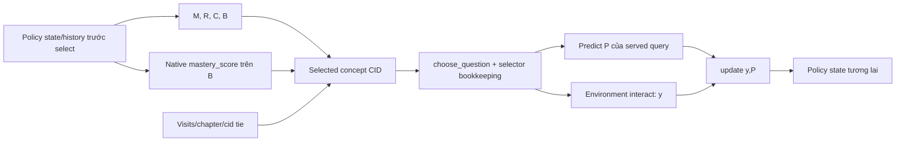

# RQ1: closed-loop observability từ current-source reconstruction — 08/11/2026

**PROPOSED — chờ parent duyệt báo cáo và dry inventory trước đóng bundle.** Raw reconstruction đã qua [parent review](../runs/rq1-closed-loop-reconstruction-20261108-02/prep__parent-closed-loop-fast-review02.json); phần ranking post-hoc đã qua [independent raw/key review](../runs/rq1-closed-loop-reconstruction-20261108-02/prep__parent-ranking-review.json). Đây là chẩn đoán nguồn trong cùng pilot, không kết quả efficacy, causal mediation, edge-only benefit hoặc hoàn tất RQ1. Các bước phân tích không gọi lại native policy/model/RNG.

## 1. Điều gì đã được tái dựng, và điều gì chưa tìm thấy?

Historical run `cpu-closedloop-20261107-01` dùng seeds20000–20002 × profilesPG/PY/PYH ×3variants ×120steps:27trajectories/3.240events mỗi pass. Hai passes control/observed giữ exact từng stored legacy event và27outcome aggregates, cùng27final policy/environment fingerprint pairs và9uniform-array fingerprint pairs. Observed thêm3.240metadata rows có explicit M28/R/C/B, actual query/served tuple, native B-score calls và phase-tagged state hashes. Cả4gzip streams EOF/CRC hợp lệ; control metadata stream rỗng là chủ đích.

**Chưa recover nguyên runner lịch sử SHA `a585d5f3…`.** Candidate current runner `d8892fc3…`, function `closed_loop_pilot` lines31–65, được pin riêng. Exact stored legacy projection không thay thế source identity và không chứng minh tìm lại original revision. Tên đúng là **current-source diagnostic reconstruction**, không “exact historical/same-source reproduction”. Notebook353f487a…/14definition SHA và4simulator-input byte SHA khớp provenance; [static source snapshot](../runs/rq1-closed-loop-reconstruction-20261108-02/prep__closed_loop_native_source_snapshot.json) chỉ trích definitions, không execute notebook. Gap này cũng không đóng Paper1 revision/S01.

Graph-free/full-package/empty-estimator-package giữ cùng environment G và controller G; loader bind `CoverageAwareSelectorMixin` của controller vào estimator policy. `empty_graph_package` chỉ bỏ estimator edges, còn local adaptation/package flag và controller graph không bị thay thành graph-free. Khi chosen items khác nhau thì histories/labels có thể khác. Không ghép ΔP/loss/current-query crossings theo ordinal timestep giữa các quỹ đạo đã diverge. Ba seed families cũ, không27learners độc lập; hai passes không tăng sample size, **new independent N=0**.

## 2. Runtime, failure và bốn nhóm kiểm kỹ thuật khác nhau

| Hồ sơ | Kết quả thực tế | Giới hạn |
|---|---|---|
| Original observer spies |17PASS, pytest0,54s/controller2,052558s | Handwritten spies, không native reconstruction acceptance |
| Original model attempt |**REJECTED_CUMULATIVE_RESOURCE_BOUND**,120,029706s gồm original spies; không parity.json |7raw files/partial gzip giữ nguyên; không retry cùng nguồn/cap, không relabelPASS |
| Fast revision spies + synthetic callback benchmark |10PASS; controller3,3778523s; whole command4,907s; charge5s bảo thủ | Benchmark JSON/list/int không dự báo native runtime |
| Accepted fast reconstruction |Revision183,8694935s gồm charge5spy ≤300; worker176,523703s | Control65,0518729s/observed110,9770735s; source/input45bindings nguyên vẹn |
| Ledger old+new |304,0824027s ≤430, gồm old120,029706 + diagnostic0,1832032 + revision183,8694935 | Allocation300 là protective CPU allocation, không reset chi phí thất bại hoặc runtime forecast |
| Descriptive ex-ante analyzer fixtures |12PASS, toàn controller3,0039177s ≤30 | Chỉ source-predefined counts/prefix,0model/RNG/optimizer |
| Explicit post-hoc ranking fixtures |5PASS, toàn controller1,3981095s ≤15 | Exploratory source-local decision explanation, không preregistered effect |

Không cộng17/10/12/5 thành một “broad model test suite”. Reconstruction có native predict/update/interact6.480calls mỗi loại cho hai passes và0optimizer; đây là simulator policy state updates, không NN training. Observed profile ledger đo3.240select/ready/predict/interact/update calls mỗi loại,175.190is_mastered và7.868mastery_score calls vốn có. Control count basis là frozen single-call loop + exact legacy population + native attempt counters. Không extra scoring/RNG để điền metadata. Phân tích, review và packager không rerun model/tests.

[Original failure freeze](../runs/rq1-closed-loop-reconstruction-20261108-02/prep__closed_loop_model_attempt01_frozen.json), [fast raw freeze](../runs/rq1-closed-loop-reconstruction-20261108-02/prep__closed_loop_fast_model_attempt01_frozen.json), [phase/parity receipt](../runs/rq1-closed-loop-reconstruction-20261108-02/accepted_fast__parity.json), [budget ledger](../runs/rq1-closed-loop-reconstruction-20261108-02/prep__closed_loop_fast_budget_ledger.json) giữ riêng từng mức bằng chứng. Các phase receipts persisted sau khi complete stream/phase, không thay overall final parity.

## 3. Thứ tự thực thi: served-item P không đứng trước same-step selection

Native source là `select` line48 → `predict(served query)`49 → `environment.interact`50 → `update(y,P)`54. Trong select, native key là `(mastery_score(c), chapter tie, prior selection_count[c], lexical cid)` trên B. M/R/C/B và B-scores được tính trước selector bookkeeping; P của item được phục vụ được tính sau bookkeeping. P đi vào update và ảnh hưởng state tương lai, không phải đầu vào gây ra chính same-step selection vừa chọn item ấy.

Sơ đồ sau mô tả thứ tự/data dependencies của code, không phải causal estimand hoặc mô hình mediation đã được nhận diện:

Vì vậy linear within-step `P→M→R→A` không diễn đạt đúng luồng này. Fixed-stream probe/preview của [báo cáo trước](rq1_query_observability_reproduction_20261108.md) là phép quan sát khác; gọi predict trước preview cũng không tự là can thiệp vào selector. Calibration/mastery contract S04 phải phân biệt reference probes/global S, native candidate B-score và served-item P, không dùng chúng thay nhau.

## 4. Descriptive analysis đã định trước khi đọc M/R/C/B quantities

[Analyzer source/plan freeze](../runs/rq1-closed-loop-reconstruction-20261108-02/prep__closed_loop_descriptive_source_inventory.json) có trước quantity reads; source/test/inventory giữ nguyên sau execution. Toàn bộ27trajectories và18comparisons dưới đây được giữ, kể cả zero/negative controls. R→C setdiff và order-onlydiff đếm riêng; C→B setdiff, selected outside R/M=true, size histograms và pre/postselect hash change không được diễn giải thành learning benefit.

## Toàn bộ trajectories

| Seed | Profile | Variant | Events | R→C set | R→C order only | C→B set | Selected ngoài R | Selected M=true | Hash đổi quanh select |
|---|---|---|---:|---:|---:|---:|---:|---:|---:|
| 20000 | PG | graph_free | 120 | 15 | 0 | 107 | 0 | 0 | 120 |
| 20000 | PG | graph_package | 120 | 12 | 0 | 107 | 0 | 0 | 120 |
| 20000 | PG | empty_graph_package | 120 | 15 | 0 | 107 | 0 | 0 | 120 |
| 20000 | PY | graph_free | 120 | 14 | 0 | 111 | 0 | 0 | 120 |
| 20000 | PY | graph_package | 120 | 13 | 0 | 111 | 0 | 0 | 120 |
| 20000 | PY | empty_graph_package | 120 | 14 | 0 | 111 | 0 | 0 | 120 |
| 20000 | PYH | graph_free | 120 | 10 | 0 | 111 | 0 | 0 | 120 |
| 20000 | PYH | graph_package | 120 | 10 | 0 | 111 | 0 | 0 | 120 |
| 20000 | PYH | empty_graph_package | 120 | 10 | 0 | 111 | 0 | 0 | 120 |
| 20001 | PG | graph_free | 120 | 12 | 0 | 112 | 0 | 0 | 120 |
| 20001 | PG | graph_package | 120 | 11 | 0 | 112 | 0 | 0 | 120 |
| 20001 | PG | empty_graph_package | 120 | 12 | 0 | 112 | 0 | 0 | 120 |
| 20001 | PY | graph_free | 120 | 11 | 0 | 112 | 0 | 0 | 120 |
| 20001 | PY | graph_package | 120 | 14 | 0 | 113 | 0 | 0 | 120 |
| 20001 | PY | empty_graph_package | 120 | 11 | 0 | 112 | 0 | 0 | 120 |
| 20001 | PYH | graph_free | 120 | 14 | 0 | 112 | 0 | 0 | 120 |
| 20001 | PYH | graph_package | 120 | 14 | 0 | 112 | 0 | 0 | 120 |
| 20001 | PYH | empty_graph_package | 120 | 14 | 0 | 112 | 0 | 0 | 120 |
| 20002 | PG | graph_free | 120 | 12 | 0 | 112 | 0 | 0 | 120 |
| 20002 | PG | graph_package | 120 | 10 | 0 | 113 | 0 | 0 | 120 |
| 20002 | PG | empty_graph_package | 120 | 12 | 0 | 112 | 0 | 0 | 120 |
| 20002 | PY | graph_free | 120 | 14 | 0 | 113 | 0 | 0 | 120 |
| 20002 | PY | graph_package | 120 | 13 | 0 | 113 | 0 | 0 | 120 |
| 20002 | PY | empty_graph_package | 120 | 14 | 0 | 113 | 0 | 0 | 120 |
| 20002 | PYH | graph_free | 120 | 10 | 0 | 113 | 0 | 0 | 120 |
| 20002 | PYH | graph_package | 120 | 10 | 0 | 113 | 0 | 0 | 120 |
| 20002 | PYH | empty_graph_package | 120 | 10 | 0 | 113 | 0 | 0 | 120 |

R/C/B size histograms đủ từng trajectory nằm trong [analysis.json](../runs/rq1-closed-loop-reconstruction-20261108-02/descriptive__analysis.json); không lấy mean sizes che mất phân bố. Mọi selected thuộc B⊆C đã được kiểm trên toàn bộ rows. Selected ngoài raw R có thể là escape; selected M=true có thể là review/fallback của nguồn, không tự chứng minh lỗi hoặc vi phạm prerequisite. Empty chỉ là **empty estimator graph**: loader vẫn bind selector vào controller G chung (paper2_reference.py87–92), môi trường G giữ nguyên. Không suy R khác nhau nghĩa là controller graph bị đổi.

## Prefix có cùng toàn bộ lịch sử trước current event

Prefix chỉ còn common khi mọi actual served tuple +timestamp+y trước đó đều giống; một lần diverge thì không mở lại. Snapshot gây break vẫn có common-before=true. M/R/C/B so bằng sets, action bằng returned tuple ba trường; current label chỉ xác định prefix sau event. First action difference được lưu riêng trên toàn bộ quỹ đạo, kể cả sau label-only break.

| Seed | Profile | Candidate | Common-before | Common-after | M/R/C/B setdiff trên common-before | Tuple diff trên common-before | First break | First tuple diff |
|---|---|---|---:|---:|---|---:|---|---|
| 20000 | PG | graph_package | 62 | 61 | 0/0/0/0 | 1 | 61:served_tuple | 61:concept,question |
| 20000 | PG | empty_graph_package | 120 | 120 | 0/0/0/0 | 0 | none | none |
| 20000 | PY | graph_package | 68 | 67 | 0/0/0/0 | 1 | 67:served_tuple | 67:concept,question |
| 20000 | PY | empty_graph_package | 120 | 120 | 0/0/0/0 | 0 | none | none |
| 20000 | PYH | graph_package | 66 | 65 | 0/0/0/0 | 1 | 65:served_tuple | 65:concept,question |
| 20000 | PYH | empty_graph_package | 120 | 120 | 0/0/0/0 | 0 | none | none |
| 20001 | PG | graph_package | 24 | 23 | 0/0/0/0 | 1 | 23:served_tuple | 23:concept,question |
| 20001 | PG | empty_graph_package | 120 | 120 | 0/0/0/0 | 0 | none | none |
| 20001 | PY | graph_package | 28 | 27 | 1/1/1/1 | 1 | 27:served_tuple | 27:concept,question |
| 20001 | PY | empty_graph_package | 115 | 114 | 0/0/0/0 | 1 | 114:served_tuple | 114:concept,question |
| 20001 | PYH | graph_package | 68 | 67 | 0/0/0/0 | 1 | 67:served_tuple | 67:concept,question |
| 20001 | PYH | empty_graph_package | 120 | 120 | 0/0/0/0 | 0 | none | none |
| 20002 | PG | graph_package | 28 | 27 | 0/0/0/0 | 1 | 27:served_tuple | 27:concept,question |
| 20002 | PG | empty_graph_package | 120 | 120 | 0/0/0/0 | 0 | none | none |
| 20002 | PY | graph_package | 36 | 35 | 0/0/0/0 | 1 | 35:served_tuple | 35:concept,question |
| 20002 | PY | empty_graph_package | 120 | 120 | 0/0/0/0 | 0 | none | none |
| 20002 | PYH | graph_package | 35 | 34 | 0/0/0/0 | 1 | 34:served_tuple | 34:concept,question |
| 20002 | PYH | empty_graph_package | 84 | 83 | 0/0/0/0 | 1 | 83:served_tuple,label | 83:concept,question |

## 5. Tách riêng: exploratory post-hoc source-level concept ranking

Phần này được yêu cầu **sau** descriptive analysis, source/tests được freeze trước khi đọc actual B-scores và được parent kiểm độc lập trên raw. [Candidate JSON](../runs/rq1-closed-loop-reconstruction-20261108-02/posthoc__ranking_candidate.json) giữ nguyên nhãn generated-while-review-pending; [parent review sau đó](../runs/rq1-closed-loop-reconstruction-20261108-02/prep__parent-ranking-review.json) mới ghi reviewPASS. Không sửa hoặc giả thành ex-ante/preregistered effect.

Đã kiểm captured mastery_score calls uniquely/order-exactly cover B ở toàn bộ3.240events. Visits được dựng từ ALLprior served concepts, previous chapter từ fixed source map; `_init_selector` khởi tạo zero/None, chỉ native select thay counter/chapter. Exact Python min của logged native key khớp chosenCID ở3.240/3.240events, unsupported0. Trên common-before prefixes, prior visits/chapter tie context giống nhau ở cả18comparisons.

Ở8full-package first breaks có cùng M/R/C/B membership và2empty-package breaks cùng membership, các non-score keys giữ nhưng captured B-score vectors khác; replay key cho đúng hai selectedCID khác nhau. Đây là lời giải thích execution-local của **concept choice**. Ninth full case có membership khác, không gọi score-only. Bảy empty cases không có tuple break trong120steps vẫn được giữ.

Điều chỉnh giới hạn trước đó: **full S28 không cần cho lời giải thích ranking cục bộ trên B đã log đầy đủ**. Full S28/reference calibration vẫn thiếu cho các câu hỏi khác. Không replay `choose_question`, không quy toàn bộ qid/difficulty rule cho B-score, và không biến key replay thành causal mediation, learning benefit hay isolated edge effect.

| Seed | Profile | Candidate | First prefix break step | M/R/C/B sets | Local explanation / negative |
|---|---|---|---:|---|---|
| 20000 | PG | graph_package | 61 | same/same/same/same | B-score key → CID (source-local) |
| 20000 | PG | empty_graph_package | none | same prefix | No tuple break/120 (negative) |
| 20000 | PY | graph_package | 67 | same/same/same/same | B-score key → CID (source-local) |
| 20000 | PY | empty_graph_package | none | same prefix | No tuple break/120 (negative) |
| 20000 | PYH | graph_package | 65 | same/same/same/same | B-score key → CID (source-local) |
| 20000 | PYH | empty_graph_package | none | same prefix | No tuple break/120 (negative) |
| 20001 | PG | graph_package | 23 | same/same/same/same | B-score key → CID (source-local) |
| 20001 | PG | empty_graph_package | none | same prefix | No tuple break/120 (negative) |
| 20001 | PY | graph_package | 27 | diff/diff/diff/diff | Membership diff; no score-only claim |
| 20001 | PY | empty_graph_package | 114 | same/same/same/same | B-score key → CID (source-local) |
| 20001 | PYH | graph_package | 67 | same/same/same/same | B-score key → CID (source-local) |
| 20001 | PYH | empty_graph_package | none | same prefix | No tuple break/120 (negative) |
| 20002 | PG | graph_package | 27 | same/same/same/same | B-score key → CID (source-local) |
| 20002 | PG | empty_graph_package | none | same prefix | No tuple break/120 (negative) |
| 20002 | PY | graph_package | 35 | same/same/same/same | B-score key → CID (source-local) |
| 20002 | PY | empty_graph_package | none | same prefix | No tuple break/120 (negative) |
| 20002 | PYH | graph_package | 34 | same/same/same/same | B-score key → CID (source-local) |
| 20002 | PYH | empty_graph_package | 83 | same/same/same/same | B-score key → CID (source-local) |

## 6. Kết luận giới hạn và phần còn mở

Raw reconstruction đóng lỗ quan sát M/R/candidates/served tuple của current-source closed loop và giữ exact stored legacy projection. Nó cho phép phân biệt frontier/candidate filtering với native score ranking mà không thêm model calls; không hoàn tất RQ1 hoặc chứng minh graph giúp học tập. Selected∈B⊆C ở3.240events và các zero counts chỉ là quan sát của source/bank/histories này, không bảo đảm phổ quát.

Còn thiếu: original runner a585; independent confirmation của source/protocol khi cần; calibrated mastery/reference/probe definition; scientific S04/S05 và interventions cô lập edge/local/controller; independent evaluation. Full S/global calibration không được thay bằng native candidate score, và same-prefix exposure restriction không thành randomized intervention. Không Junyi/Holdout/realdata, new seed/graph/model condition, CI/p-value, GPU/cloud/install hoặc paid compute trong gói này.

Báo cáo đang PROPOSED, proposed bundle `rq1-closed-loop-reconstruction-20261108-02` chưa được đóng tại thời điểm viết. Các link artifact hiện trỏ planned member aliases của bundle -02, chưa materialize trước closure; bundle sau duyệt sẽ snapshot các file có SHA cùng copy inventory trước/sau. Parent duyệt report+dryinventory là bước cuối trước closure; không tự chấp thuận methodology từ archive integrity.

## 7. Chú thích vận hành — archive -01 FAILED, đề xuất -02

Closure đầu tiên đã copy artifacts nhưng fail ở bước Git ignore vì packager dùng `-z` không có `--stdin`. Helper đóng **FAILED116outputs** tại [manifest vận hành -01](../runs/rq1-closed-loop-reconstruction-20261108-02/operational_failed01__manifest.json), SHA `07dd5de2…76928`; đây là **archiver option bug, không phải native reconstruction failure**. Raw model PASS, timeout120s trước, ex-ante và post-hoc không bị đổi verdict. Bản report54a74842…1d803 và packager8e4b361b…ecd183 trước sửa được giữ byte-identical trong FAILED-01.

Revision vận hành mới [packager v2](../runs/rq1-closed-loop-reconstruction-20261108-02/pack_closed_loop_reconstruction_v2.py) dùng argv batch verbose không `-z`, reject tab/LF/CR trong paths và kiểm exact returned members; stderr/argv được persist nếu Git fail. [Một real readonly Git query](../runs/rq1-closed-loop-reconstruction-20261108-02/prep__closed_loop_git_ignore_argv_test01.json) xác nhận một owned ignored path và một nonignored path,0,0387562s≤5s/0model hoặc research tests. [Diagnostic -01](../runs/rq1-closed-loop-reconstruction-20261108-02/prep__closed_loop_archive_failure_diagnostic01.json) là normalized receipt từ actual fatal stderr, không fabricated original logfile.

Public report links được remap bằng chính source→copy aliases trong new dry inventory, để trỏ committed members của proposed bundle `-02`; chúng **chưa materialize trước closure**, chưa coi là kiểm tồn tại. Root sẽ kiểm tất cả sau closure. Snapshot report trong bundle giữ canonical-relative links; README trỏ lại public report. Thay đổi hiện tại chỉ pointer/link portability và chú thích vận hành, không thay số liệu hoặc claim khoa học ở sections1–6.
