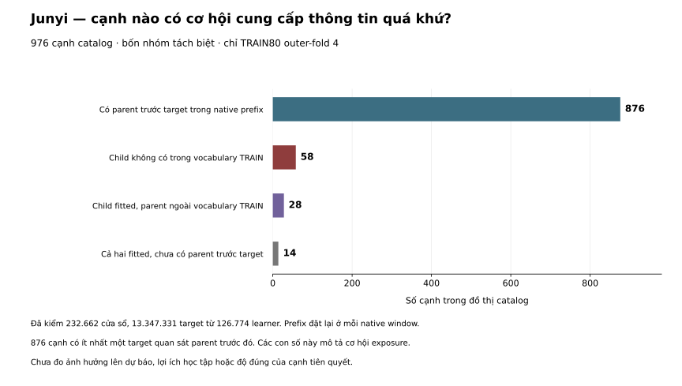

# Junyi — đồ thị có thực sự gặp lịch sử tiên quyết trong cửa sổ AKT?

Ngày12/11/2026. Phân tích RQ2, bẫy thứ tự luyện trên log. Chỉ dùng metadata và exercise IDs của TRAIN80 outer-fold4, không đọc correctness hoặc chạy mô hình.

## Từ đồ thị trên giấy đến thông tin mô hình được nhìn thấy

Một cạnh parent→child chỉ có cơ hội cung cấp thông tin quá khứ cho AKT khi parent đã xuất hiện trước target của child trong đúng cửa sổ mà mô hình nhận. Việc hai exercise tồn tại trong dataset, hoặc từng được cùng learner làm ở đâu đó, chưa xác nhận điều kiện này. Vì thế nhóm đã kiểm toàn bộ232.662nativewindows,13.347.331targets của126.774TRAINlearners. Prefix được đặt lại ở đầu từng window và chỉ xét các vị trí trước target. Context100/targetblock100 được giữ nguyên từ cache chính, không thay bằng toàn lịch sử learner hoặc một rollingwindow tự đặt.

## Bốn nhóm cạnh tách biệt

| Nhóm trong catalog | Số cạnh /976 | Diễn giải trong TRAIN80 hiện hành |
|---|---|---|
| Có parent trong prefix trước ít nhất một childtarget |876|Có ít nhất một cơ hội để graphaugmentation dùng thông tin parent đã quan sát |
| Child không có trong vocabulary TRAIN |58|Không có childtarget fitted tương ứng trong phép phân tích |
| Child fitted, parent ngoài vocabulary TRAIN |28|Child có dữ liệu nhưng parent không xuất hiện dưới vocabulary đã fit |
| Cả hai fitted, không có parent trước childtarget trong nativeprefix |14|Hai endpoint có dữ liệu nhưng chưa tạo exposure đúng điều kiện cửa sổ |
| **Tổng** |**976**|Giữ nguyên toàn topology catalog |

Đã xác định100/976cạnh không có parent-prefix exposure trong phạm vi này và phân biệt rõ86cạnh bị giới hạn bởi vocabulary với14cạnh còn thiếu exposure dù cả hai endpoint fitted. Kết quả giúp thiết kế đối chứng graphquality có cùng support và báo đúng giới hạn của cạnh chưa được quan sát. Cạnh có exposure chưa chắc đã làm prediction khác đi, còn cạnh chưa có exposure cũng chưa thể được gọi là cạnh sai. Graph module vẫn có thể dùng cấu trúc hoặc các đặc trưng khác khi parent thiếu quan sát. Phép đo này chỉ xét nguồn thông tin parent quan sát được trong prefix.

Một childtarget có thể có nhiều parent, nên bảng đếm theo edge–target có18.061.909cơ hội trên976cạnh. Trong đó5.933.011edge–target có parent đã xuất hiện trước. Đây là tổng theo từng cạnh. Không chia5.933.011cho13.347.331để suy tỷ lệ target duy nhất nhận graphcontext, cũng không coi số edge–target là mẫu độc lập. Để tính tỷ lệ target duy nhất cần thêm phép union theo target, chưa được tính ở đây.

## Mức xác nhận và giới hạn

Lượt fullscan do nhánh chính thực hiện đã đối chiếu đủ909shards,232.662windows,13.347.331targets và126.774learners. Runtime21,35giây, peakRSS49.938.432byte, không Torch hoặc cloud. Kiểm bổ sung độc lập đọc64windows cố định từ8shards trải từ đầu đến cuối cache, gồm3.827targets. Thuật toán seen-set theo thời gian cho kết quả từng edge/window khớp thuật toán bitset. Checker cũng tái tính bốn nhóm và hai tổng edge–target từCSVfull. Kiểm64windows không phải tái lập độc lập toàn bộ13triệu target.

Phân tích tạo thêm bằng chứng về coverage thực sự của đồ thị trong input AKT và chuẩn bị điều kiện cho đối chứng Junyi. Chưa đánh giá lợi thế dự báo, chưa xác nhận dương tính giả, chưa đo lợi ích dạy học hoặc độ đúng của cạnh. Ba matchedcontrols cũ được dựng từ outerfold0innertrainprefix vẫn chỉ là nguồn sensitivity kế thừa. Chúng chưa được đưa vào benchmark outer4TRAIN80 hiện hành. Bước tiếp theo là freeze controls đúng ranh giới TRAIN, kiểm changed-edge exposure rồi mới so dự báo trên cùng logged targets.

## Nguồn kết quả

- [Fullscan receipt](full01/result.json) và [edge–target table976rows](full01/edge-exposure.csv).
- [Checker độc lập64windows và tổngCSV](independent-full-check.json), [checker source](check_exposure.py).
- [Dữ liệu figure](figure-data.csv), [source dựng figure](build_figure.py), [PNG](junyi-native-window-edge-coverage.png) và [PDF](junyi-native-window-edge-coverage.pdf).
- [Đầu vào/pins và diễn tiến thực hiện](README.md), [metadata preflight](metadata-check.json).
