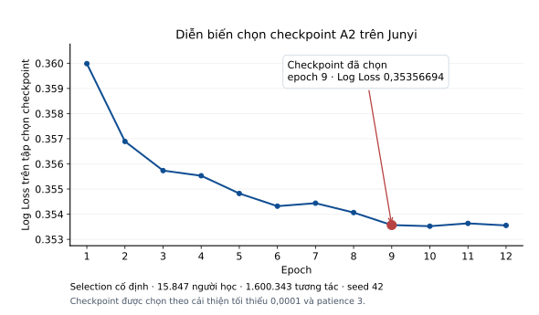
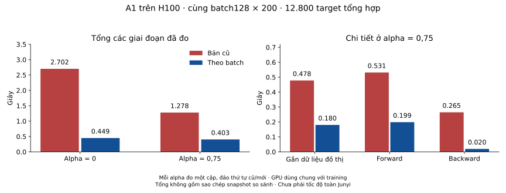
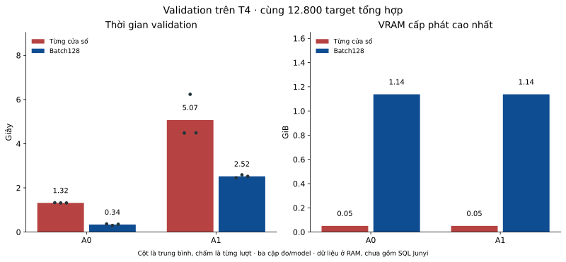
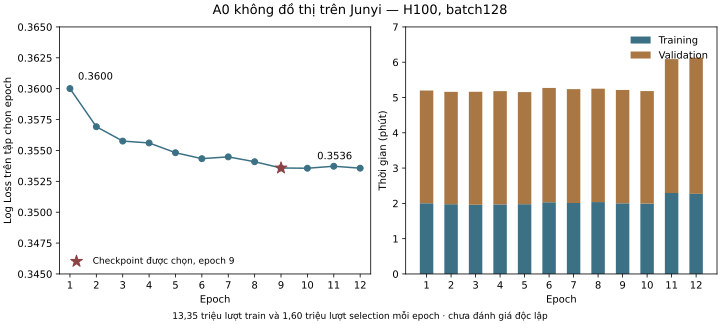
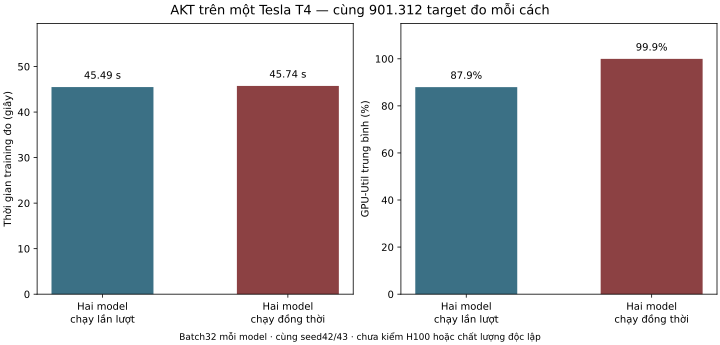

# Báo cáo tiến độ khóa luận — cập nhật 14/11/2026

## 14/11 — A2 hoàn tất bước chọn checkpoint trên Junyi

Để kiểm tra độ tin cậy từng cạnh có giúp mô hình dự báo tốt hơn hay không trong RQ3, đã hoàn tất huấn luyện A2 trên Junyi. A2 bổ sung trọng số độ tin cậy vào AKT NonRasch. Bộ trọng số được ước lượng từ TRAIN80 trước khi học mô hình. Lượt này dùng Development outer fold 4 theo protocol đã chốt. Tập train gồm 126.774 người học và 13.347.331 lượt trả lời, tập chọn checkpoint gồm 15.847 người học và 1.600.343 lượt trả lời. Các nhóm người học được tách riêng và giữ đúng ranh giới dữ liệu của A0/A1.

Sau mỗi epoch, mô hình dự đoán trên nhóm chọn checkpoint. Log Loss theo dõi mức phù hợp của xác suất dự báo với câu trả lời thực tế và phạt mạnh các dự đoán sai nhưng quá tự tin. A2 đã chạy 12 epoch, chọn checkpoint epoch 9 và nạp lại thành công. Toàn bộ 1.600.343 dự đoán xuất ra khớp quần thể và thứ tự thời gian, không có bài tập OOV.

Epoch 10 có điểm thấp hơn epoch 9 khoảng 0,000045, chưa vượt mức cải thiện tối thiểu 0,0001 đã chốt. Vì vậy bộ chọn giữ epoch 9 và dừng sau ba epoch chưa cải thiện đủ. Đây là kết quả của cùng quy tắc chọn checkpoint được áp dụng cho các biến thể AKT.

| Mô hình | Cấu hình | Log Loss chọn checkpoint |
|---|---|---|
| A0 | AKT không đồ thị | 0,353580 |
| A1 | AKT đồ thị cố định | 0,353562 |
| A2 | AKT theo độ tin cậy cạnh | 0,353567 |

Các điểm chọn checkpoint của A0, A1 và A2 hiện rất gần nhau. Quan sát này chưa cho thấy một khác biệt lớn về dự báo do thêm độ tin cậy cạnh trên nhóm selection. Cần đánh giá độc lập và lượng hóa độ bất định trước khi kết luận hơn kém. A0 đã được chấm lại tại checkpoint epoch 9 bằng batch 128, phần đối chiếu lại toàn bộ lịch sử chọn epoch A0 còn chờ.

Đã tải và kiểm đủ 210 artifact của lượt cuối, lưu checkpoint, dự đoán và log trên ổ D. Gói model A2 gồm một file .pt cùng cấu hình, graph, confidence và nguồn để dựng lại. Nhánh Junyi hiện có A0, A1 và A2 đã hoàn tất selected-fit. A3 có thêm cổng điều chỉnh ảnh hưởng đồ thị, refit, calibration và đánh giá độc lập còn chờ. Kết quả hiện tại bổ sung bằng chứng triển khai và dự báo, chưa hoàn tất phần quyết định lộ trình và mô phỏng vòng kín của RQ3.

| Metric trên selection | A2 | Mục đích |
|---|---|---|
| AUC | 0,805993 | Khả năng phân biệt câu trả lời đúng và sai |
| Log Loss | 0,353567 | Độ phù hợp của xác suất dự báo với kết quả |
| Brier | 0,107698 | Sai lệch bình phương của xác suất |
| ECE | 0,004138 | Độ khớp xác suất và tỷ lệ đúng trong 15 nhóm |

Hai lượt H100 dùng tổng cộng 47 phút 19 giây trong function, trung bình pha train khoảng 3 phút 03 giây mỗi epoch. Trung bình 1.320 mẫu NVML là 32,23%, VRAM đỉnh khoảng 5,65 GiB. Mục tiêu GPU trên 50% chưa đạt. Chuẩn bị input, upload và tải/nén artifact chạy ngoài thời gian thuê GPU. Mức CPU bảo đảm được tăng từ 0,25 lên 2 vCPU ở lượt tiếp tục, cùng hai luồng Torch, chưa có đối chứng xác nhận tăng tốc. Modal báo tổng metered toàn workspace khoảng 19,10 USD ở lần đọc sau training, billed cost bằng 0. Trần toàn KLTN vẫn là 30 USD.

[Hồ sơ nghiệm thu A2](../../../runs/junyi-confidence-completion-20261114-01/a2-final-acceptance.json), [bằng chứng và giới hạn](../../../runs/junyi-confidence-completion-20261114-01/README.md), [gói model trên D](../../../../experiments/akt/results/model-export-a2-batch128-20261114-01/README.md).

## 14/11 — Hoàn tất confidence TRAIN80 cho A2/A3

Sau khi kiểm được luồng tính A2/A3 trên T4, đã ước lượng xong độ tin cậy từ TRAIN80 thật để hai mô hình dùng chung. Đã kiểm đủ 13.347.331 lượt trả lời của 126.774 người học trong phần dữ liệu huấn luyện TRAIN80. Toàn bộ 736 khái niệm con đã fit xong; đã đối chiếu SHA, số target và nguồn của từng checkpoint, không phát hiện ngoại lệ từ solver.

Bộ trọng số cuối bao phủ đủ 976 cạnh. Có 708 cạnh đủ điều kiện ước lượng và 268 cạnh thiếu hỗ trợ được giữ lý do, đặt trọng số vận hành bằng 0. Tổng cộng 700 cạnh có trọng số dương và 276 cạnh có trọng số 0. Các số này mô tả đầu vào đã chuẩn bị. Hiệu quả của cách sử dụng đồ thị sẽ được đánh giá bằng đối chứng A0/A1/A2/A3 sau training.

Độ tin cậy chỉ được fit từ TRAIN80. Cache selection mới đã xây và kiểm nối đủ 1.600.343 target, cùng định danh quần thể với A0. Chương trình cũng đã qua 2.614 ca kiểm Linux, gồm kiểm kết quả khi chạy liên tục so với ngắt rồi phục hồi và xuất dự đoán. Log của cả lượt lỗi và lượt đạt được giữ. Hai lượt CPU có tổng mức dự phòng 0,30 USD; chi phí riêng thực tế chưa tách được.

Hiện đang tạo cache đồ thị train/selection cho A2 và A3 trên CPU từ artifact confidence thật. Sau đó còn kiểm snapshot đầu vào và dự toán lượt GPU. Huấn luyện các mô hình AKT A2/A3 trên Junyi, refit và đánh giá độc lập còn chờ.

[Hồ sơ confidence và chuẩn bị A2/A3](../../../runs/junyi-confidence-completion-20261114-01/README.md).

## Trước đó 14/11 — A2/A3 đã qua kiểm CUDA và phục hồi checkpoint trên T4

Để tránh thuê GPU trong lúc chuẩn bị dữ liệu, đã nối cache đồ thị train/selection cùng hồ sơ kiểm CPU vào luồng thực thi A2/A3. Cache được tạo trên máy local trước khi gửi sang Colab. Luồng gọi GPU yêu cầu đủ đầu vào đã kiểm và giữ kiểm tra định danh dữ liệu khi nhận lại.

Trên T4 miễn phí, A2 và A3 đã cho dự đoán khớp hoàn toàn giữa cách tính trực tiếp và cache. Gradient, cập nhật model/Adam và checkpoint/resume đều qua đối chiếu. Một lỗi vị trí bộ đếm Adam khi đọc checkpoint CUDA đã được phát hiện, sửa và kiểm lại thành công. Bộ hồi quy local đạt 102 ca; kiểm mở rộng hợp đồng cache đạt 39 ca, trong đó có 10 ca bổ sung.

Phép đo ngắn gồm hai block đổi thứ tự chạy cho mỗi biến thể. Cache giảm khoảng 4,7% thời gian A2, còn A3 gần như ngang nhau. Chưa có bằng chứng tăng tốc ổn định cho cả epoch hoặc GPU luôn trên 50%. Việc chuẩn bị cache ngoài function GPU đã được thực hiện; đọc batch, kiểm danh tính và ghi checkpoint vẫn cần CPU trong lúc học.

Lượt kiểm dùng các giá trị độ tin cậy cố định để kiểm luồng tính toán. Confidence TRAIN80 thật, cache toàn bộ dữ liệu, Gate Linux của source cuối và kiểm ranh giới thực thi trên Modal còn chờ. Chưa chạy training chính A2/A3 Junyi, chưa bổ sung kết luận về lợi ích đồ thị cho RQ3. Đã lưu đủ 45 file, gồm 12 checkpoint kiểm kỹ thuật, trên ổ D và đối chiếu từng file. Colab đã nhận lệnh trả runtime T4. Đợt này chưa dùng credit Modal.

[Hồ sơ kiểm T4 và kết quả gốc](../../../runs/junyi-gpu-boundary-t4-20261114-01/README.md).

## 14/11 — Chuẩn bị độ tin cậy từng cạnh cho A2/A3

Đã cài đặt bước ước lượng confidence từ TRAIN80 để A2/A3 dùng chung, với kiểm chéo theo người học và lưu tiến độ trên ổ D. SQLite đã lưu đủ số target theo checkpoint duyệt dữ liệu, tương ứng 13.347.331 tương tác. Bước kiểm/niêm phong corpus còn thiếu và chưa fit các child, nên hiện chưa có bộ confidence hoàn chỉnh.

Source trước thay đổi cache mới đã đạt 2.590 ca kiểm trên Linux CPU. Phần cache đặc trưng graph A2/A3 tiếp tục đạt 38 ca local, gồm so dự đoán và cập nhật Adam với cách tính trực tiếp. Phần nối cache selection mới còn dang dở và chưa kiểm. Cần hoàn thiện luồng CPU chuẩn bị, kiểm CUDA và xác nhận checkpoint/ranh giới CPU–GPU trên Modal thật trước training chính. Chưa có kết quả A2/A3 Junyi để kết luận hiệu quả RQ3.

## 14/11 — Chuẩn bị A2/A3 với chi phí GPU được tách khỏi xử lý ngoài training

Sau khi A0 và A1 đã hoàn tất bước chọn checkpoint Junyi, bước tiếp theo là A2 dùng độ tin cậy từng cạnh và A3 có thêm cổng điều chỉnh ảnh hưởng đồ thị. Trước khi thuê GPU tiếp, đã triển khai luồng CPU local chuẩn bị dữ liệu và upload, function GPU chạy học và validation, sau đó CPU local nhận và đóng gói kết quả khi GPU đã dừng.

Đã đối chiếu 27 trường cấu hình học, cấu hình số học và định danh dữ liệu với model A0/A1 đã lưu. Bộ kiểm local đạt 71 ca, bao gồm gián đoạn, checkpoint và tải artifact sai byte. Chưa dùng thêm credit trong đợt này. Đây là tiến bộ về độ sẵn sàng thực thi RQ3, chưa bổ sung kết quả thực nghiệm để kết luận đồ thị có ích.

Trước training A2/A3 còn phải fit confidence từ TRAIN80, nghiệm thu source mới trên Linux và kiểm ngắn CUDA/resume. A0 lịch sử chọn epoch bằng validation batch 1, chỉ epoch 9 đã được replay batch 128, nên vẫn giữ giới hạn khi diễn giải so sánh. Đọc batch và lưu checkpoint vẫn cần thời gian trong function GPU. Chưa đo mức tiết kiệm thực tế của luồng mới.

## 13/11 — Chuẩn bị A2/A3 và chuyển kiểm dữ liệu sang CPU

A2 và A3 đã nối được độ tin cậy từng cạnh, có đường tính message và gate theo batch trên nhánh Junyi. Bộ hồi quy CPU gộp đạt 339 ca, gồm kiểm A1 cũ, tắt đồ thị, confidence bằng 0, đối chiếu dự đoán/gradient/Adam với đường tham chiếu và checkpoint/resume. Chưa có confidence fit trên Junyi thật hoặc training A2/A3.

Toàn bộ cache train gồm 13.347.331 lượt trả lời đã được kiểm trên CPU trước phiên GPU, lượt cuối mất khoảng 285 giây. Nhận lại cache bằng hồ sơ đã ghim và kiểm toàn SHA các shard mất 3,13 giây trên Windows. Các kiểm bổ sung phát hiện nguồn validator thay đổi trong hoặc sau bước chuẩn bị đều đạt. Thời gian và tính tương đương trên GPU/Linux còn chờ kiểm. Quy trình Modal tách CPU chuẩn bị, GPU tính toán, CPU đóng gói đang ở bước tích hợp tiếp theo. Đợt chuẩn bị này dùng 0 USD Modal.

## 13/11 — A1 hoàn tất chọn checkpoint Junyi với dữ liệu so sánh đã kiểm

Điểm còn thiếu trước đợt này là checkpoint A1 đã học đủ một epoch nhưng chưa hoàn tất validation. Đường chuẩn bị thông tin đồ thị làm H100 chờ CPU nhiều. Nhóm tập trung giảm thời gian đọc và chuẩn bị dữ liệu, đồng thời kiểm khả năng giữ lại epoch đã học để tiếp tục thí nghiệm.

Phần dữ liệu selection được đối chiếu trên toàn bộ 1.600.343 lượt trả lời của 15.847 người học, giữ nguyên input, nhãn, thứ tự và tập target so với tham chiếu A0. Cache selection trên đĩa vẫn chậm hơn đường raw trong phép kiểm CPU đầy đủ. Cấu hình H100 hiện dùng compact A1 và đọc trước dữ liệu có giới hạn. Cache trên đĩa được giữ ở mức thử nghiệm. Bộ kiểm nguồn Linux cuối đạt 2.528 ca.

Checkpoint A1 thật được đối chiếu giữa source2 và compact trên CPU, sau đó kiểm trực tiếp trên H100 với các window có thông tin đồ thị. Loss, gradient, trọng số, Adam và RNG khớp hoàn toàn trong phần kiểm. Sau khi chạy validation epoch1 trên đủ selection, toàn bộ model, optimizer và RNG vẫn bằng trạng thái checkpoint gốc. Bước học của epoch1 được giữ lại và counters ghi đúng 13.347.331 target, 1.818 bước.

A1 dùng đồ thị cố định đã hoàn tất bước chọn checkpoint trên Junyi, học 12 epoch và chọn epoch 9. Mỗi epoch dùng đủ 13.347.331 lượt trả lời của 126.774 người học train; selection gồm 1.600.343 lượt của 15.847 người học tách biệt, cùng 717 mã bài tập. Split, input, target và cấu hình batch128 được giữ theo hợp đồng so sánh A0. Log Loss được dùng để chọn epoch vì phạt dự đoán tự tin nhưng sai. Epoch 9 đạt 0,35356185. Quy tắc cố định yêu cầu cải thiện ít nhất 0,0001 và dừng sau ba epoch liên tiếp không đạt mức này. Epoch 12 có giá trị số học thấp hơn một chút, 0,35352761, nhưng mức giảm 0,00003424 chưa đạt tiêu chí đổi checkpoint. Vì vậy checkpoint được giữ ở epoch 9.

Sau khi nối nguồn đã kiểm, các epoch 2–6 mất khoảng 202–206 giây train. Các epoch 8–12 mất 182–194 giây, cộng 32–34 giây validation toàn selection, tổng khoảng 3,6–3,8 phút. Epoch 1 của bản cài đặt trước tối ưu mất 1.343,56 giây. So sánh này dùng các epoch khác nhau trên H100. GPU-Util trong các cửa sổ đang training khoảng 35–38%, VRAM khoảng 5,8 GiB. Trung bình toàn khoảng lấy mẫu của hai lượt H100 khoảng 27,7%, gồm cả admission, validation và xuất dự đoán; số này thấp hơn trung bình các cửa sổ đang train. GPU còn chờ CPU ở một số bước. Kiểm đầu vào, chuyển tensor về CPU để kiểm lặp và đóng gói artifact là các phần cần tiếp tục tách khỏi thời gian giữ GPU. Việc tách này chưa áp dụng vào lượt vừa chạy.

Checkpoint epoch 9 đã được nạp lại và chấm lại đủ selection. Tập target, xác suất và Log Loss khớp lượt validation đã dùng chọn checkpoint. Toàn bộ checkpoint, 1.600.343 dự đoán selection và logs đã tải về ổ D, kiểm toàn vẹn; H100 đã dừng. Một lượt nối gặp lỗi đường dẫn khi import bộ khởi chạy, được dừng và sửa trước lượt thành công. Bước chọn epoch A1 đã hoàn tất. Refit, hiệu chỉnh xác suất, đánh giá độc lập và các điều kiện Junyi A2/A3 còn chờ. Kết quả selection này chưa đủ kết luận đồ thị cải thiện RQ3. A0 chọn epoch bằng validation batch 1, A1 bằng batch 128. Checkpoint A0 epoch 9 đã chấm lại đủ selection bằng batch 128 với cùng Log Loss. Thứ hạng toàn bộ 12 epoch A0 bằng batch 128 còn chưa được kiểm lại; đây là giới hạn cần ghi nhận khi so sánh lựa chọn checkpoint.

[Hồ sơ nối A1 và số liệu nguồn](../../../runs/junyi-a1-selection-cache-20261113-01/README.md)

## 13/11 — cache A1 đã khớp trên T4, tiếp tục ưu tiên phần tốn thời gian thực

Từ kết quả A1 dạng gọn trên Junyi thật, nhóm kiểm tiếp việc tính trước thông tin đồ thị để giảm thời gian GPU chờ CPU. Cache đã nối vào đường training A1, kèm kiểm dữ liệu thay đổi và phục hồi checkpoint. Phép chia người học, batch128 và phép tính FP32 được giữ theo cấu hình đã chốt.

Bộ kiểm local đạt 62 ca. Trên T4 miễn phí, hai mức ảnh hưởng đồ thị cho loss, gradient, Adam và RNG khớp hoàn toàn giữa bản có cache và bản dựng trực tiếp. Dự đoán trên 4.440 target selection và kiểm nạp lại file trạng thái cũng có sai lệch bằng 0. Đây là kiểm kỹ thuật trên mẫu Junyi, chưa hoàn tất training A1 hoặc trả lời kết quả học tập của RQ3.

Trong hai block khoảng10giây mỗi phương án, thông lượng tăng từ khoảng14.957 lên15.232 target/giây, tương ứng1,84%. GPU-Util theo mẫu là67,3% và70,8%, gồm cả hai bước làm nóng mỗi block. Chênh lệch thời gian còn nhỏ so với dao động giữa các block, nên cache giữ ở chế độ tùy chọn. Chưa kết luận cache giúp rút ngắn đáng kể một epoch H100.

Nhóm đã rà14bước trong một epoch. Hai hướng cần ưu tiên đo tiếp là đọc/giải mã dữ liệu lặp lại và dựng lại dữ liệu selection mỗi epoch. Các phần phụ thuộc trọng số đang học vẫn phải tính theo từng bước. Bộ nhớ RAM, thứ tự shuffle, OOV và biên dữ liệu được ghi thành điều kiện kiểm trước khi thay pipeline.

Checkpoint benchmark, cache và log đã tải về ổ D và kiểm toàn vẹn. Figure cùng số liệu nguồn được lưu riêng để trích dẫn. Runtime T4 đã trả sau khi lưu xong artifact. Chi phí Modal của đợt này là0USD. Trước khi chạy tiếp H100 còn cần kiểm source/runtime cho producer cuối và hồ sơ chuyển tiếp checkpoint A1 epoch1 cũ.

[Hồ sơ cache A1 và rà toàn epoch](../../../runs/junyi-a1-graph-cache-20261113-01/README.md)

## 13/11 — đo Junyi thật, xác nhận tải GPU và thử cache

Sau phép kiểm dữ liệu tổng hợp, nhóm kiểm tiếp trên Junyi thật để tránh suy ra tốc độ training từ một mẫu đơn giản. Mẫu được lấy bằng seed cố định từ tám shard TRAIN80, gồm 256 cửa sổ của 204 người học; phần selection riêng có 88 cửa sổ của 64 người học. Vocabulary 717 exercise và đồ thị 976 cạnh được giữ theo nguồn hiện hành. Người học được đổi mã trước khi chuyển sang Colab, membership theo phép chia đã có. Không dùng Holdout hoặc chọn cấu hình mô hình trong lượt này.

Đối chiếu ngắn trên T4 cho thấy bản A1 gọn nhanh hơn bản tham chiếu 2,14 lần khi tính cả đọc mẫu, chuẩn bị batch và bước học. Loss, gradient, trạng thái sau Adam và xác suất selection khớp trong phạm vi đã kiểm. Mức sử dụng GPU trung bình của đoạn ngắn là 48,5%, thấp hơn kết quả đo trên dữ liệu tổng hợp. Nhóm giữ kết quả này và đo thêm chuỗi dài sau làm nóng để kiểm mức sử dụng trong khi optimizer chạy liên tục.

Trong chuỗi khoảng 15 giây mỗi điều kiện, A1 đạt khoảng 14.842 target/giây và GPU trung bình 69,7% qua 27 mẫu. A0 đo trên cùng cohort đạt khoảng 17.747 target/giây và GPU 80,0%, giúp đối chiếu phần chi phí chung. Khi tái dùng dữ liệu đã giải mã trong RAM, A1 đạt khoảng 16.314 target/giây và GPU 75,4%, tăng thêm khoảng 9,9% throughput. Hai lượt ngắn và dài có warm-up, thời lượng lấy mẫu và cách khởi tạo optimizer khác nhau; mức GPU cao hơn ở lượt dài chưa được quy cho một sửa code mới.

Trace CPU/CUDA đã được lưu để tách việc chuẩn bị dữ liệu khỏi phần GPU thực sự tính toán. Dựng thông tin đồ thị mất khoảng 36 ms/batch trong đoạn profiler. Có thể tính trước phần này khi lịch sử log và đồ thị đã cố định. Các đại lượng phụ thuộc trọng số đang học như alpha, gate output, dự đoán và gradient vẫn phải tính trong model. Trong mô phỏng vòng kín, cache chỉ được dùng thông tin đến lịch sử đã quan sát.

Đã thử cache theo từng cửa sổ trên CPU. Bản kiểm lặp toàn bộ mỗi entry chưa tăng tốc. Bản kiểm dữ liệu khi tạo cache rồi xác minh bytes bất biến khi dùng lại nhanh hơn khoảng 1,65 lần ở riêng phần context, với digest khớp khi đổi thứ tự và cách ghép batch. Đây là prototype CPU; cache graph cho toàn TRAIN80 và tích hợp training chính còn chưa hoàn tất.

Quy đổi riêng thông lượng chuỗi dài cho tập train hiện có cho khoảng 15 phút mỗi epoch T4 ở điều kiện giống mẫu, hoặc khoảng 13,6 phút khi input đã giải mã sẵn. Chưa chạy toàn epoch, chưa gồm full admission, checkpoint và validation đầy đủ; kết quả chưa dự báo thời gian H100. Model trạng thái benchmark, logs, dữ liệu dựng hình và trace đã tải về D, kiểm toàn vẹn. Runtime Colab đã trả và bridge đã đóng. Tổng Modal sử dụng trong đợt này là 0 USD.

Phần chuẩn bị thực thi RQ3 đã tiến thêm bằng chứng về đúng số học và hiệu năng trên dữ liệu thật. So sánh khoa học giữa các mô hình vẫn cần hoàn tất training theo protocol, chuyển tiếp checkpoint A1 epoch1 thật có hồ sơ nguồn, refit, calibration và đánh giá độc lập. Các kết quả throughput này chưa là bằng chứng mô hình cải thiện kết quả học tập.

[Hồ sơ Junyi thật, profiler và cache](../../../runs/junyi-a1-real-t4-20261113-01/README.md)

## 13/11 — A1 đã giảm thời gian cả bước học trên T4

Sau thí nghiệm biểu diễn gọn trên CPU, nhóm đã nối cách chuẩn bị dữ liệu này vào adapter và bước training A1. Phần dữ liệu đồ thị được giữ thành các mảng số và bytes bất biến, giúp giảm tạo lại nhiều đối tượng Python. Các kiểm về vai người học, thứ tự thời gian, target và dữ liệu thay đổi vẫn được duy trì. Bước gọi selected-fit A1 đã được nối với đường thực thi mới.

Trên T4 miễn phí, cùng mẫu tổng hợp và cấu hình FP32/batch128, tổng thời gian chuẩn bị batch và tám bước học giảm từ 13,79 xuống 3,39 giây, nhanh hơn 4,07 lần. Mức sử dụng GPU trung bình theo mẫu tăng từ 15,0% lên 76,0%, VRAM đỉnh khoảng 5.305 MiB. Lượt kiểm kéo dài 34 giây. Loss, gradient, trọng số sau bước Adam, trạng thái optimizer và RNG khớp ở hai điều kiện đã kiểm. Bộ kiểm local đạt tổng 69 ca, gồm dự đoán và chạy ngắt rồi phục hồi cùng backend.

CPU được kiểm thêm trên 128 cửa sổ Junyi TRAIN80 thật với 5.527 target. Riêng phần chuẩn bị context và kiểm tính toàn vẹn giảm từ 0,838 xuống 0,065 giây. Message FP32 và mặt nạ áp dụng khớp hoàn toàn. Hai phép đo CPU và T4 bổ sung bằng chứng rằng phần chuẩn bị dữ liệu đồ thị là một nút thắt có thể giảm bằng tổ chức lại thực thi.

Phép đo T4 dùng dữ liệu tổng hợp, gồm hai đoạn bốn bước mỗi bản theo thứ tự đối chiếu đảo chiều. Chưa đo toàn producer với I/O, validation, checkpoint hoặc toàn epoch Junyi/H100. Mức 76% thuộc đoạn kiểm ngắn, chưa là mức GPU trung bình của training nghiên cứu. Bước tiếp theo là kiểm nguồn cuối và chuyển tiếp checkpoint A1 epoch1 thật có provenance, rồi đo workload đại diện. Checkpoint lịch sử đã được giữ nguyên. Đợt này dùng 0 USD Modal, artifacts và figure đã tải về D, runtime Colab đã được yêu cầu trả và bridge đã đóng.

[Hồ sơ CPU và T4](../../../runs/junyi-a1-compact-adapter-20261113-01/README.md)

## 13/11 — kiểm hướng biểu diễn ngữ cảnh đồ thị gọn

Sau cải tiến nhỏ đã kiểm trên T4, nhóm thử giảm phần dựng dữ liệu đồ thị trước khi GPU tính toán. Trên 128 cửa sổ Junyi TRAIN80 thật, gồm 5.527 target, prototype chuyển thông tin quá khứ thành message dạng mảng số và mặt nạ áp dụng. Cả hai khớp hoàn toàn với cách tính A1 hiện hành sau chuyển FP32. Giữ kiểm vai người học, cấu trúc cửa sổ và biên thời gian. Thay đáp án ở phía sau giữ nguyên thông tin cho các target phía trước.

Thời gian chuẩn bị context và bốn lần kiểm tính toàn vẹn giảm từ 0,826 xuống 0,251 giây, tương ứng tăng tốc 3,29 lần cho riêng thành phần CPU đã đo. Có hai lượt mỗi bản trong cùng tiến trình. Lượt kiểm mất khoảng 8 giây, dùng khoảng 221 MiB RAM và 0 USD Modal. Đây là hướng triển khai tiếp theo để giảm CPU chờ trước GPU.

Prototype còn tách khỏi trainer và chưa tạo cache trên đĩa. Cần nối adapter/model, kiểm gradient và phục hồi checkpoint, rồi đo toàn pipeline trên T4. Chưa có số tăng tốc toàn epoch Junyi hoặc bằng chứng GPU đạt 50%. Các checkpoint nghiên cứu hiện có được giữ nguyên. Mức hoàn tất bằng chứng RQ3 chưa thay đổi từ phép kiểm kỹ thuật này.

[Hồ sơ và hình đo CPU](../../../runs/junyi-a1-compact-context-20261113-01/README.md)

## 13/11 — kiểm nhanh giảm xử lý CPU của A1 trên T4

Sau khi đối chiếu cơ sở thiết kế, nhóm giữ công thức A1 và sửa riêng cách tạo mã kiểm tra tính toàn vẹn của dữ liệu đồ thị. Mục tiêu là giảm chuyển đổi dữ liệu Python lặp trước khi GPU tính toán. Phép kiểm Tesla T4 miễn phí kéo dài 28,62 giây. Loss, xác suất, gradient, trọng số sau một bước Adam và trạng thái optimizer khớp hoàn toàn ở hai điều kiện đã kiểm. Bộ kiểm helper trên Colab đạt 19 ca, kiểm hồi quy local đạt 74 ca, có cả adapter Junyi và Grade10.

Chuỗi đo gồm sáu bước mỗi bản trên dữ liệu tổng hợp, prefix được dựng trước. Thông lượng tăng 1,26 lần và thời gian giảm 20,5%. GPU-Util trung bình đo được tăng từ 26,5% lên 37,8%, vẫn dưới mục tiêu 50% trong lượt ngắn này. Cần kiểm toàn pipeline và tính tương thích khi nối checkpoint trước khi dùng nguồn mới cho lượt H100 tiếp theo. Kết quả này bổ sung bằng chứng kỹ thuật chuẩn bị AKT. Thực nghiệm kết luận RQ3, validation A1 epoch1 và selected fit còn đang chờ.

Logs, số liệu, hình SVG/PDF/PNG và archive đã được tải về ổ D, kiểm tính toàn vẹn. Đã gửi lệnh trả runtime Colab và đóng bridge sau khi lấy bằng chứng. Đợt này dùng 0 USD Modal.

[Hồ sơ kiểm T4](../../../runs/junyi-a1-fastpath-t4-20261113-01/README.md)

## 13/11 — đối chiếu cơ sở thiết kế A1

Sau khi xác nhận nút thắt CPU, nhóm đối chiếu cơ sở thiết kế A1 với các nghiên cứu graph/relation-aware KT và source tham khảo. RKT cung cấp cơ chế đưa quan hệ bài tập vào attention, GKT cung cấp cách tổng hợp graph theo tensor và pyKT cung cấp khung đối chiếu benchmark. A1 residual hiện tại là lựa chọn thiết kế của nhóm. Hai hướng đang được xem xét là tổ chức lại phép tính hiện hành hoặc phát triển phần tích hợp quan hệ vào attention có đối chiếu nguồn. Chưa áp dụng kiến trúc mới hoặc chạy lại GPU. Checkpoint epoch1 được giữ nguyên.

[Nguồn thiết kế RKT](https://arxiv.org/abs/2008.12736), [source GKT](https://github.com/jhljx/GKT), [nghiên cứu benchmark pyKT](https://proceedings.nips.cc/paper_files/paper/2022/hash/75ca2b23d9794f02a92449af65a57556-Abstract-Datasets_and_Benchmarks.html).

## 13/11 — kiểm checkpoint A0 trên H100 và triển khai A1

Sau phép kiểm CPU, đã đối chiếu checkpoint A0 epoch 9 thật trên H100 bằng validation batch128. Toàn bộ 1.600.343 target selection khớp dữ liệu và thứ tự lịch sử, 0 OOV. Log Loss bằng giá trị validation cũ 0,3535801768 trong độ chính xác đã lưu. Lượt dự đoán mất 25,11 giây, trọng số giữ nguyên. Checkpoint này vốn được train bằng batch128. Chưa kiểm lại cách chọn epoch trên đủ 12 checkpoint. Kết quả mới xác nhận validation batch128 cho checkpoint được chọn trên selection thật.

A1 bản tối ưu đã hoàn tất phần training epoch 1 trên toàn bộ13.347.331target,1.818bước optimizer, mất22phút24giây. Checkpoint trước validation cùng optimizer, RNG và trạng thái sampler đã tải về D, kiểm toàn vẹn. Validation bị ngắt khi dừng H100, chưa có kết quả lựa chọn epoch hoặc dự báo A1 để kết luận so sánh mô hình. Đã phục hồi archive đầy đủ ba checkpoint và logs. H100 đã dừng, server xác nhận0container. Số đo trong giai đoạn training ghi GPU trung bình4,98%, VRAM cao nhất5.789/81.559MiB, tiến trình chiếm gần một lõi CPU. Mức sử dụng này chưa đạt mục tiêu ít nhất50% do người dùng đặt. Cache mới chưa triển khai; việc sửa pipeline CPU/graph và kiểm lại hiệu năng là bước tiếp theo.

Bản tối ưu đã kiểm trên H100 với dữ liệu tổng hợp. Loss, xác suất và tham số sau một bước Adam khớp bản cũ trong hai điều kiện đã kiểm; sai lệch gradient lớn nhất khoảng6,52×10⁻⁹. Phép kiểm kéo dài9,02giây, chưa chứng minh cả quỹ đạo training giống từng bit. Trên Junyi thật,500bước đầu bản mới mất khoảng6phút07giây, bản cũ khoảng10phút03giây trên cùng số target. Còn chờ nghiệm thu epoch đầy đủ. Checkpoint bản cũ đã được giữ; lượt chính mới bắt đầu lại từ cùng seed42 theo quyết định vận hành của agent.

## 13/11 — chuẩn bị tối ưu validation

Validation trước đây xử lý lần lượt từng cửa sổ lịch sử, khiến GPU phải nhận nhiều lượt nhỏ. Đã nối cách gom tối đa 128 cửa sổ độc lập và kiểm trên T4 miễn phí của Colab. Bộ kiểm Linux đạt 126 ca. Phép đo dùng 64 người học tổng hợp, 12.800 lượt dự báo, mỗi mô hình đo ba cặp để đối chiếu thời gian và kết quả. Đây là kiểm dự đoán, không cập nhật trọng số.

| Mô hình | Từng cửa sổ | Batch128 | Tăng tốc |
|---|---:|---:|---:|
| A0 — AKT không đồ thị | 1,32 giây | 0,34 giây | 3,88 lần |
| A1 — AKT đồ thị cố định | 5,07 giây | 2,52 giây | 2,01 lần |

Trung bình ba lượt trên bộ tổng hợp có tín hiệu đồ thị.

Target, nhãn và thứ tự khớp hoàn toàn. Sai lệch xác suất lớn nhất khoảng 1,2×10⁻⁷. VRAM do PyTorch cấp phát cao nhất khoảng 1,14 GiB. Đã giữ cả phép kiểm tín hiệu đồ thị triệt tiêu và phép kiểm có tín hiệu khác 0. Hai chương trình kiểm GPU chạy tổng khoảng 84 giây. Chưa kiểm lại toàn selection bằng checkpoint A0 đã train hoặc đo chi phí đọc dữ liệu Junyi. Vì vậy, số đo này xác nhận tăng tốc dự đoán trên dữ liệu tổng hợp, còn việc giữ nguyên chọn epoch A0 và mức tăng tốc toàn pipeline cần kiểm tiếp. Artifact đã tải về ổ D, kiểm toàn vẹn, gửi lệnh giải phóng runtime và đóng cầu nối. Lượt này dùng 0 USD Modal.

**Kiểm checkpoint đã train tiếp theo.** Kiểm tiếp bằng checkpoint A0 epoch 9 thật trên CPU với 3.538 target tổng hợp đã xác nhận nạp đúng trọng số, target/thứ tự khớp và model không đổi. Sai lệch xác suất lớn nhất 0,0000224 vượt ngưỡng kiểm đã đặt, dù chênh lệch Log Loss chỉ khoảng 0,0000000218. Giữ nguyên ngưỡng kiểm, chưa nghiệm thu batch128 cho training chính. Cần đối chiếu checkpoint này trên CUDA và selection Junyi thật. Lượt kiểm dùng 0 USD Modal.

## 13/11 — lõi confidence Junyi đã kiểm CPU

Đã cài lõi chuẩn bị đặc trưng và crossfit confidence cho Junyi, có kiểm vocabulary717. Đặc trưng chỉ dùng quá khứ trong đúng cửa sổ AKT. Fitter tái dùng solver và learner bootstrap của Method24, fit theo từng child để hỗ trợ xử lý giới hạn RAM. Kiểm CPU với solver thật xác nhận loại người học thuộc fold đánh giá khỏi dữ liệu fit và giữ confidence null khi thiếu hỗ trợ. Đây là kiểm trên dữ liệu tổng hợp. Worker train80, artifact confidence và tích hợp A2/A3 còn cần hoàn thiện trước training chính.

## 13/11 — kiểm được gắn vào luồng training chính

Đã nối kiểm tương thích vào luồng training graph chính. Trước bước optimizer đầu tiên, producer đối chiếu đầu vào thực, cấu hình và khởi tạo backbone với tham chiếu A0. Main còn kiểm lại cache trước khi dựng model. Mỗi validation đối chiếu target population với A0 và checkpoint ghi tham chiếu để bảo vệ resume. Bộ hồi quy CPU đạt77ca. Một lượt SQL độc lập đã kiểm đủ1.600.343target selection của15.847người học,0OOV và khớp từng khóa cùng thứ tự với A0 H100. Confidence và producer A2/A3 Junyi cùng dự toán toàn ma trận vẫn đang cần hoàn thiện trước main GPU.

## 13/11 — kiểm tính tương thích trước training các biến thể

Đã đối chiếu split A0 với assignments BKT/GAM-KT, tái dựng đúng bốn nhóm người học và kiểm hash cache train/selection cùng vocabulary 717. Colab đạt 156 ca kiểm trên Linux. Kiểm CUDA tổng hợp A0/A1 trên T4 dùng batch128, chiều dài200 và vocabulary717 đã đạt trong khoảng14giây, VRAM cấp phát cao nhất4,70GiB. Backbone khởi tạo khớp chính xác với A0 H100, graph-off khớp A0 và nhãn hiện tại/tương lai giữ đúng ranh giới nhân quả. Model và Adam sau phục hồi khớp chạy liên tục. Checkpoint, dự báo kiểm, runtime và logs đã tải về D, đối chiếu SHA/CRC/inventory.

Mốc này xác nhận thêm độ tin cậy kỹ thuật cho A0/A1. A2/A3 Junyi còn thiếu confidence fitted đúng train80 và tích hợp producer. Hợp đồng so sánh mới đã có kiểm âm, còn cần nối bắt buộc vào các entrypoint trước training chính. Các variant cần cùng batch128, split/vocabulary, cửa sổ, khởi tạo backbone và quy tắc tối đa20epoch/patience3/min_delta0,0001. Epoch tốt nhất có thể khác nhau. Đề xuất giới hạn9epoch và bỏrefit trong hội thoại chưa được áp dụng vào protocol.

BKT/GAM-KT lịch sử dùng toàn outer-train, còn A0 hiện fit train80. Metric selection A0 phục vụ chọn checkpoint. Bảng so sánh chính thức cần cùng outer-validation, target identity và coverage, đồng thời công khai khác biệt dữ liệu train hoặc thực hiện matched baseline fit riêng. Các công thức AUC/LogLoss/Brier/ECE15bins được giữ tương ứng. Cả ma trận fit/refit/calibration/inference còn cần dự toán trong credits còn lại trước lượt H100 tiếp theo.

## Chốt 13/11 — A0 H100 đã chọn checkpoint epoch 9

A0 không đồ thị trên Junyi đã hoàn tất 12 epoch H100 batch128 và chọn checkpoint epoch 9 theo patience 3, min_delta 0,0001. Mỗi epoch có 13.347.331 target train và 1.600.343 target selection, 0 OOV. Đã tải và kiểm ba archive, nạp lại checkpoint được chọn, xuất đủ dự báo và model chính về D. Cả ba App đã dừng, snapshot server ghi 0 container.

Log Loss selection của checkpoint được chọn là 0,353580, AUC 0,805990, Brier 0,107700 và ECE 0,004270. Đây là tập dùng chọn epoch, đánh giá độc lập và so sánh chính thức với BKT/GAM-KT còn ở bước tiếp theo. Refit90 và calibration chưa thực hiện. Training trung bình 2 phút 03 giây và validation 3 phút 18 giây/epoch. Telemetry toàn quá trình xử lý ghi GPU trung bình 26,49%, cao nhất 74%, VRAM cao nhất 5.793 MiB. Còn dư địa tối ưu validation.

Ba phiên H100 ghi credits tăng khoảng 5,39 USD, tổng KLTN đã dùng 8,67 USD và còn 21,33 USD tại snapshot cuối, billed 0 USD. Mọi lần tiếp tục cần dự toán trong phần ngân sách còn lại.

[Báo cáo riêng quá trình training](../../2026-11-13/BAO_CAO_A0_H100.html).

## Cập nhật12/11 — đã kiểm ý tưởng chạy đồng thời hai model

Sau khi tăng batch giúpT4 hoạt động đều hơn, tiếp tục kiểm liệu hai model có thể dùng chungGPU để hoàn thành sớm hơn. Hai cách chạy dùng cùng dữ liệu, cùng seed vàbatch32 cho từng model. Kết quả hai model chạy lần lượt mất45.49giây, chạy đồng thời mất45.74giây. Mức hoạt độngGPU tăng từ87,9% lên99,9%, tổng tốc độ xử lý gần như ngang nhau. Giữ phương án một tiến trình trênT4 cho bước tiếp theo.

Bốn checkpoint đã được lưu, kiểm toàn vẹn và phục hồi đúng. Kết quả từng model khớp giữa hai cách chạy. Phép kiểm dùng dữ liệu train nhỏ lặp lại, chưa xác nhận chất lượng trên toànJunyi hoặc hiệu quả trênH100. Các kết quả nghiên cứuRQ1–RQ3 hiện có được giữ nguyên.

## Cập nhật12/11 lúc20giờ59 — batch32 đạt mục tiêu tài nguyên GPU

Đã hoàn tất lượt kiểm batch32 trên T4 bằng source AKT hiện có. Trong 115 mẫu nvidia-smi qua khoảng65giây training ổn định, GPU-Util trung bình87,5%, thấp nhất76% và cao nhất90%. VRAM đang dùng1.541/15.360MiB, công suất trung bình67,7W và tốc độ khoảng19.792target/giây. Mục tiêu sử dụng GPU trên50% đã đạt trong khoảng đo.

Checkpoint đã tải về, kiểm toàn vẹn, nạp lại và cập nhật Adam tiếp theo khớp model, optimizer, RNG và metric. Lượt kiểm lặp một packet TRAIN80 để đo tài nguyên. Chất lượng trên toàn Junyi và thời gian hội tụ còn cần đánh giá trước khi tiếp nhận batch32 cho các so sánh nghiên cứu. A0 chính vẫn giữ6epoch batch4 đã lưu, chưa thay cấu hình giữa lượt.

## Cập nhật 12/11 lúc 20 giờ 07 — sáu epoch A0 và kết quả kiểm tăng tốc

Bản AKT không đồ thị trên Junyi đã hoàn tất sáu lượt học toàn tập TRAIN80 đã cố định và sáu lần kiểm trên tập selection riêng biệt. Mỗi lượt gồm 13.347.331 tương tác train và 1.600.343 tương tác selection. Checkpoint và archive đã được tải về, kiểm tính toàn vẹn và xác nhận dừng App. Bước chọn epoch cuối, refit, calibration và đánh giá độc lập còn phải thực hiện.

Log Loss selection ở epoch5 là0,354982644 và epoch6 là0,354906797. Mức giảm ở epoch6 nhỏ hơn ngưỡng cải thiện tối thiểu0,0001 đã đặt, nên checkpoint tốt nhất tạm thời theo quy tắc dừng vẫn ở epoch5. Nếu epoch7–8 tiếp tục thiếu cải thiện đủ, mô hình sẽ dừng ở8 và refit5 epoch. Đây là điều kiện dự kiến, số epoch cuối chưa được chốt.

Đã đo GPU trực tiếp và thực hiện hai đối chiếu tăng tốc trên cùng dữ liệu, batch và khởi tạo. Cả hai giữ nguyên model, Adam và RNG, nhưng chưa đạt tiêu chí tăng tốc đã đặt nên chưa đưa vào training chính. Một candidate cache đã khớp CPU, lượt đo cloud hết giới hạn thời gian và đã dừng. Cần xác nhận hiệu quả trên GPU và tính lại dự toán toàn ma trận trước lượt training dài tiếp theo.

## Cập nhật 12/11 lúc 18 giờ 53 — tiến độ A0 và kiểm tài nguyên

A0 Junyi đã hoàn tất bốn epoch trên cùng tập train. Log Loss selection lần lượt là 0,359648, 0,356651, 0,355651 và 0,356488. Epoch4 kém epoch3, checkpoint tốt nhất tạm thời vẫn ở epoch3. Chưa chốt epoch cuối, refit, calibration hoặc đánh giá độc lập. Execution05 hết thời gian kiểm runtime trước training. Sau khi tăng riêng thời gian chờ kiểm môi trường, execution06 tiếp tục từ checkpoint epoch5 đã lưu.

Đã kiểm trực tiếp GPU trong 30 mẫu gần một phút ở epoch5. GPU-Util trung bình43,9% (39–49%), VRAM459/15.360MiB, thông lượng khoảng8.519 tương tác được chấm mỗi giây. Cấu hình hiện tại còn dư VRAM và thời gian GPU chưa chạy kernel. Chưa đủ bằng chứng khẳng định đã tối ưu. Cần so thời gian và chi phí để đạt cùng chất lượng trước khi chọn cấu hình nhanh hơn.

**Đề tài:** Nghiên cứu và phát triển hệ thống học tập thích ứng cá nhân hóa dựa trên mô hình hóa tri thức và tối ưu hóa lộ trình.

**GVHD:** TS. Lê Văn Tuấn. **Sinh viên:** Phạm Triều Dương và Hồ Nguyễn Minh Sang.

[Báo cáo chi tiết: diễn tiến nghiên cứu, số liệu và biểu đồ](BAO_CAO_NGHIEN_CUU.html).

## Mốc training mới lúc 17:50 ngày 12/11

A0 Junyi đã hoàn tất ba epoch trên cùng tập train, mỗi epoch 13.347.331 tương tác. Log Loss selection lần lượt 0,359648 → 0,356651 → 0,355651. Epoch 3 mất khoảng 29 phút 14 giây train và 4 phút 26 giây validation. Cả ba lượt validation cùng 1.600.343 target, không có OOV. Archive execution03 khoảng 2,13 GB đã được tải về, kiểm toàn vẹn và xác nhận App dừng. Epoch 4 tiếp tục từ checkpoint bước 15.016 với cùng nguồn, dữ liệu và cấu hình. Đây là tiến độ chọn epoch, còn refit, calibration và đánh giá độc lập.

## Phát hiện bổ sung RQ2 ngày 12/11 — điều kiện để mô hình nhận tín hiệu tiên quyết

Đã kiểm toàn bộ 13.347.331 tương tác cần dự báo trong232.662 cửa sổ của126.774 người học TRAIN80 Junyi. Trong 976 cạnh catalog, 876 cạnh có ít nhất một lần tiên quyết xuất hiện trước bài phụ thuộc trong đúng cửa sổAKT. Có 100 cạnh thiếu cơ hội đó, gồm 58 cạnh có bài phụ thuộc ngoài tập bài của dữ liệu huấn luyện,28 cạnh có tiên quyết ngoài tập bài của dữ liệu huấn luyện và14 cạnh có cả hai bài trong tập huấn luyện nhưng chưa gặp đúng thứ tự trong cửa sổ. Phân tích CPU mất 21,35 giây và dùng khoảng 49,9 MB RAM, chỉ đọc các array không chứa nhãn đáp án. Đã kiểm độc lập trên 64 cửa sổ và tổngCSV. Đây là bằng chứng về cơ hội quan sát thông tin trước so sánh đồ thị. Chưa đo ảnh hưởng thực lên dự báo, gate hoặc lợi ích học tập. [Bằng chứng vàfigure](../../../runs/rq2-junyi-window-exposure-preflight-20261112-01/FINDINGS.md).

## Phát hiện bổ sung RQ1 ngày 12/11

Sau footprint ngoại lệ đủ6 lần luyện, nhóm đã kiểm điều kiện mở bài trên cùng3.240 trạng thái đã lưu. Khi chỉ chấp nhận tiên quyết được mô hình đánh dấu thành thạo, tập bài thay đổi ở2.557 thời điểm. Có18.520/30.572lượt thành viên bị loại, còn12.052. Tuy vậy, cả3.240 thời điểm vẫn còn ít nhất một bài thỏa điều kiện nghiêm ngặt. Các bài này thuộc tập sơ bộ trước các bộ lọc chống lặp, phủ nội dung và xếp hạng. Chưa xác định chúng có còn được giữ sau các bộ lọc đó hoặc giúp tiến sang nội dung mới. Chưa xác định hành động thay thế hoặc lợi ích học tập vì thiếu toàn bộ điểm xếp hạng và chưa rollout quy tắc mới. Có CSV, kiểm độc lập, figureSVG/PDF/PNG và nguồn dựng lại. [Bằng chứng](../../../runs/rq1-strict-readiness-shadow-20261112-01/README.md).

## Đợt tiếp tục12/11 — khép lập luận RQ1–RQ2 trong lúc huấn luyện AKT

Đã hoàn thiện bản tổng hợp năm phát hiện từ artifact hiện có, đối chiếu lại tám JSON aggregate. Các phát hiện gồm điều kiện controller/retention, sự suy giảm thay đổi dự báo sang quyết định, ngoại lệ đủ số lần luyện, đối chứng nguồn đồ thị–cơ chế năng lực và giới hạn exposure của đối chứng Junyi. Đây là hoàn thiện lập luận và kiểm số liệu đã có. Các phép đo calibration/mastery, robustness và predictive order-controls còn mở. [Nội dung để đưa vào luận văn](../../../reports/RQ12_CORE_FINDINGS_20261112.md).

Phép đo batch T4 đã nghiệm thu đủ4/8/16/32 trên cùng56.332 target, checkpoint đều reload khớp. Thông lượng lần lượt khoảng7.328/13.649/17.025/18.769 target mỗi giây. Khi bỏ batch đầu, speedup của batch16/32 khoảng2,11×/2,43× so batch4. Chưa đo số epoch để đạt chất lượng tương đương, nên dự toán toàn ma trận chưa giảm theo tỷ lệ này. Lượt A0 tiếp tục từ checkpoint epoch 3 bước 29 với source/split/batch4 giữ nguyên. [Bằng chứng và figure](../../../runs/junyi-batch-throughput-20261112-01/README.md).

## Mức đáp ứng đề cương đến hiện tại

Đề cương có sáu mục tiêu cụ thể. Cả sáu đã có triển khai hoặc bằng chứng, chưa mục nào được nghiệm thu toàn phạm vi. RQ1/RQ2 đã có kết quả chẩn đoán về tác động dự báo tới lựa chọn, điều kiện controller, retention và đối chứng ability. RQ3 đã có bảy selected fits Grade10 và ba epoch A0 Junyi, còn so sánh độc lập và closed-loop của mô hình mới.

Paper1 được kế thừa theo PDF. Phiên bản theo đặc tả đã có kiểm tích hợp hai episode trên domain28, cùng172feedback trong coupling đã khai báo, và chứng minh cơ chế có điều kiện. Paper2 có frozen artifact và tái hiện chính xác pilot fixed-stream chẩn đoán. Chưa hoàn tất tái chạy toàn bộ các bảng chính của hai paper. [Đối chiếu chi tiết theo sáu mục tiêu](../../../reports/PROPOSAL_COVERAGE_20261112.md).

## Bảng tiến độ training AKT được đối chiếu ngày 12/11

| Môi trường | Đã hoàn tất | Số epoch và thời gian | Còn thiếu |
|---|---|---|---|
| Grade10 | Bảy điều kiện A0–A3 đã chọn checkpoint, giữ30 checkpoint và1.260 dự báo mỗi điều kiện | A0/A1 expert chạy8, chọn5. Năm điều kiện còn lại chạy7, chọn4. Tổng51 epoch, controller khoảng30 phút | Refit tổng30 epoch, calibration, đánh giá độc lập và closed-loop |
| Junyi A0 | Sáu epoch đầy đủ, mỗi epoch13.347.331 target, selection1.600.343 target | Khoảng27–29phút train và4phút selection mỗi epoch | Chốt epoch, refit, calibration và đánh giá độc lập |
| Junyi A1/A2/A3 | A1 đã có producer và kiểm CPU. Sáu điều kiện chưa fit toàn Junyi | Chưa có epoch train chính | Confidence/topology train-only, kiểm CUDA, selected và refit |

Log Loss selection ở epoch5 là0,354982644 và epoch6 là0,354906797. Mức giảm ở epoch6 nhỏ hơn ngưỡng cải thiện tối thiểu0,0001 đã đặt, nên checkpoint tốt nhất tạm thời theo quy tắc dừng vẫn ở epoch5. Nếu epoch7–8 tiếp tục thiếu cải thiện đủ, mô hình sẽ dừng ở8 và refit5 epoch. Đây là điều kiện dự kiến, số epoch cuối chưa được chốt.

Ước lượng18–28giờ GPU trước đây dựa trên giả định chỉ1–2epoch refit đã không còn phù hợp với diễn tiến A0. Thời gian và ngân sách còn lại cần được tính lại từ số epoch thực và tốc độ từng biến thể đồ thị. Các mô hình bắt buộc, đánh giá độc lập và mô phỏng vòng kín vẫn được giữ trong phạm vi cần hoàn tất.

**Mốc hiện tại ngày 12/11.** Bản AKT không đồ thị trên Junyi đã hoàn tất sáu lượt học toàn tập TRAIN80 đã cố định và sáu lần kiểm trên tập selection riêng biệt. Mỗi lượt gồm 13.347.331 tương tác train và 1.600.343 tương tác selection. Checkpoint và archive đã được tải về, kiểm tính toàn vẹn và xác nhận dừng App. Bước chọn epoch cuối, refit, calibration và đánh giá độc lập còn phải thực hiện.

Lượt chạy đầu bị Modal thu hồi giữa epoch. Checkpoint bước 46.000 đã giữ trạng thái sau 10.598.159 tương tác. Nhóm tiếp tục từ checkpoint đó và hoàn tất đúng quần thể epoch đầu. Kiểm độc lập số cửa sổ và padding cũng khớp kế hoạch đã tạo trước training. Hai file metadata khởi tạo bị mất được tái dựng có ghi rõ nguồn gốc. Các checkpoint và nhật ký phục hồi đã được lưu để truy vết.

**Ngày 12/11 — AKT đã chạy trên dữ liệu Junyi thực.** Sau bảy lượt chọn checkpoint trên mô phỏng, nhóm chuyển sang kiểm riêng môi trường dữ liệu thực. Nhóm256 học viên train và32 học viên selection được chọn theo ID, độc lập đáp án, giữ learner-disjoint và vocabulary chỉ học từ train. Một epoch trên NVIDIA A10 đã xử lý11.833 tương tác/79 lần cập nhật. Đã lưu checkpoint, nạp vào mô hình mới và xác nhận toàn bộ dự đoán khớp chính xác; bản lưu bền vững trên Modal cũng đã được đọc lại để đối chiếu. Xuất đủ1.530 tương tác selection, gồm1.405 có dự đoán và125 bài ngoài vocabulary được ghi rõ. Bộ kiểm Linux của nguồn này đạt2.037 ca. Đây là bước nghiệm thu kỹ thuật trên cohort giới hạn300 tương tác/người. Training Junyi chính, chọn epoch, refit, hiệu chỉnh xác suất, đánh giá độc lập và các biến thể đồ thị Junyi còn phải thực hiện. Tập train chính đã đếm có 13.347.331 tương tác, selection 1.600.343tương tác. Ngân sách full cần dự toán từ phép đo có xét chuỗi dài và I/O.

**Cập nhật kỹ thuật ngày 12/11.** Đã chuyển bước kiểm AKT sang Modal và xác nhận môi trường CUDA chạy được trên L4. Trong quá trình chuyển, đã sửa các lỗi đường dẫn và vị trí lưu kết quả, đồng thời giữ lại các lượt thất bại để truy vết. Kiểm phục hồi checkpoint còn chưa hoàn tất do giới hạn RAM ban đầu và lần chờ cấp GPU tiếp theo hết hạn. Các App đã dừng, chi phí tổng kỳ ghi nhận gần nhất khoảng 0,021 USD, được bù bằng credits/allowance. Bước kế tiếp là hoàn tất kiểm phục hồi và đo tốc độ trước huấn luyện nghiên cứu chính. Chưa bổ sung bằng chứng so sánh chất lượng mô hình cho RQ3.

**Tiếp tục ngày 12/11 — kiểm môi trường thuê GPU.** Bộ kiểm trên Modal đã đạt đủ 1.994 ca sau khi sửa cách đóng gói nguồn để giữ đúng dữ liệu mô phỏng đã tạo. AKT không đồ thị đã chạy được trên T4, qua đó phát hiện cấu hình lưu checkpoint của runner chưa phù hợp. Sau khi sửa lưu trữ, phép kiểm trên GPU đã hoàn tất cho AKT không đồ thị và CG-AKT có gate, gồm 16 bước cập nhật và bốn checkpoint. Chạy liên tục và chạy phục hồi cho cùng trọng số, trạng thái bộ tối ưu, luồng ngẫu nhiên và dự báo. Các checkpoint đã được tải về và đọc lại từ nơi lưu bền vững để đối chiếu. Đây là kiểm kỹ thuật trên dữ liệu dựng sẵn; huấn luyện trên corpus nghiên cứu và so sánh chất lượng các biến thể vẫn phải thực hiện.

**Ngày 12/11 — đã huấn luyện baseline AKT không đồ thị trên GPU Modal.** Sau khi kiểm trọn quy trình trên nhóm nhỏ, đã chạy corpus nghiên cứu Grade 10 gồm 60 học viên, với 48 người huấn luyện, 6 người chọn epoch và 6 người dành riêng cho hiệu chỉnh. Lượt A0 hoàn tất 8 epoch và 288 bước cập nhật, chọn checkpoint epoch 5, nạp lại rồi xuất đủ 1.260 dự báo trên 6 người của tập selection. Năm checkpoint cùng log và archive khoảng 124 MB đã được giữ; file kết quả, mã kiểm toàn vẹn, danh tính dự báo và hai phép tính Log Loss/Brier đã được đối chiếu độc lập sau khi tải về. Tổng chi phí sử dụng của workspace tại lần đọc sau lượt này khoảng 0,171 USD, được bù bằng credits/allowance; số liệu có thể cập nhật trễ. Tập selection đã dùng chọn epoch, vì vậy cần tiếp tục các bản đồ thị, bước refit/hiệu chỉnh và đánh giá độc lập trước khi kết luận về lợi ích của CG-AKT. Chưa có kết quả Junyi từ lượt này.

[Figure diễn tiến chọn checkpoint A0](../../../runs/figures4papers-akt-20261112-01/revision02/akt-a0-checkpoint-selection.svg). Đường cong A0 trên tập selection cho thấy sai số dự báo giảm tới epoch 5 rồi tăng ở ba epoch tiếp theo. Vì mục tiêu chọn checkpoint là Log Loss, pipeline giữ epoch 5 và dừng sau ba epoch không cải thiện đủ. AUC giúp theo dõi khả năng phân biệt câu đúng và sai. Các số liệu này mô tả quá trình chọn mô hình trên sáu học viên selection. Bước đánh giá độc lập và so sánh với các bản đồ thị vẫn còn cần thực hiện.

## Từ A0 đến CG-AKT trên cùng corpus mô phỏng

Tiếp tục ngày 12/11 — đã có checkpoint được chọn cho cả bốn biến thể AKT trên mô phỏng. Sau baseline A0, nhóm đã huấn luyện lần lượt đồ thị cố định (A1), trọng số cạnh theo độ tin cậy (A2), và độ tin cậy kết hợp gate điều tiết ảnh hưởng đồ thị (A3). Mỗi bản đồ thị được chạy với nguồn chuyên gia và nguồn học từ dữ liệu train. Cả bảy điều kiện dùng cùng 48 học viên train, 6 học viên chọn epoch và cùng backbone khởi tạo. Sáu lượt mới đều hoàn tất trên GPU, qua nạp lại checkpoint tốt nhất và xuất đủ 1.260 dự báo mỗi điều kiện. Đã lưu tổng cộng 30 checkpoint của bảy lượt, cùng cấu hình, log và dự báo. Đây là mốc hoàn tất bước chọn checkpoint trên corpus mô phỏng, còn refit, hiệu chỉnh và đánh giá độc lập cần tiếp tục.

Để kiểm ảnh hưởng của từng cách dùng đồ thị lên dự báo, trước hết giữ chung người học và câu cần dự báo. Log Loss đo mức phù hợp của xác suất với đáp án và là tiêu chí chọn epoch. Brier bổ sung mức sai số của xác suất. Trên tập selection này, các sai khác rất nhỏ, với độ lệch Log Loss so với A0 lớn nhất khoảng 0,000186. Tập này đã được dùng chọn epoch, nên các con số mô tả quá trình phát triển mô hình. Chưa đủ cơ sở kết luận CG-AKT cải thiện dự báo độc lập hoặc kết quả học tập. Những lượt này có một seed, sáu học viên selection, và GPU T4/A10 tùy cấp phát.

| Biến thể | Nguồn đồ thị | Epoch chọn | Log Loss selection | Brier selection |
|---|---|---:|---:|---:|
| A0 | Tắt đồ thị | 5 | 0.5993101 | 0.2064428 |
| A1 | Chuyên gia | 5 | 0.5993439 | 0.2064606 |
| A1 | Học từ dữ liệu | 4 | 0.5993931 | 0.2065655 |
| A2 | Chuyên gia | 4 | 0.5993342 | 0.2065313 |
| A2 | Học từ dữ liệu | 4 | 0.5993099 | 0.2065221 |
| A3 | Chuyên gia | 4 | 0.5993952 | 0.2065627 |
| A3 | Học từ dữ liệu | 4 | 0.5994965 | 0.2066019 |

Junyi đang được chuẩn bị riêng. Metadata xác nhận có 198.084 học viên Development. Giữ outer fold4 với 39.616 học viên đánh giá, phần còn lại đã được chia thành 126.774 train, 15.847 chọn epoch và 15.847 calibration. Bảy kiểm local của bộ chia đạt, không sửa fold lịch sử và chưa đọc sự kiện để training trong bước này. Cần nối các role vào trainer, tạo vocabulary/graph phù hợp Junyi, nghiệm thu CUDA và đo chi phí trước lượt huấn luyện Junyi. Những checkpoint Grade 10 ở trên chưa là kết quả Junyi.

Tổng Modal tại lần đọc sau đợt ghi nhận khoảng 0,641 USD, tăng khoảng 0,470 USD so với trước sáu lượt đồ thị. Credits và allowance bù chi phí ghi nhận, net billed bằng0. API có thể cập nhật trễ. Các App của đợt đã dừng, checkpoint giữ bản local và bản trên Volume.

## Kiểm cấu hình và độ đầy đủ của benchmark

Audit ngày 12/11 — đã đối chiếu lại cấu hình và dữ liệu của bảy lượt AKT. Kiểm độc lập từ archive xác nhận cùng backbone khởi tạo, cùng cách chia 48/6/6, bộ mã hóa bài tập chỉ fit từ 48 người train, đúng câu cần dự báo và nhãn của 1.260 dự báo mỗi model và đúng quy tắc chọn epoch. Cả năm chỉ số Log Loss, Brier, AUC, ECE và Accuracy đã được tính lại. Các kiểm dữ liệu, cửa sổ, ngữ cảnh đồ thị và gài lỗi cấu hình trên nguồn hiện hành đạt 182 ca. Chưa phát hiện rò rỉ dữ liệu trong phạm vi các lượt đã kiểm. Junyi đã tái dựng đúng danh sách người học theo vai trò, còn pipeline huấn luyện, huấn luyện lại và hiệu chỉnh xác suất và đánh giá độc lập cần tiếp tục.

Đã xác định các đầu ra cần bổ sung trước benchmark kết luận. Xác suất dự báo gốc và nhãn hiện có đủ để tái tính các chỉ số dự báo và dựng biểu đồ hiệu chỉnh xác suất. Để giải thích gate vàhiệu quả lộ trình cần thêm nhật ký suy luận về mức ảnh hưởng của đồ thị, quyết định thành thạo, tập sẵn sàng, bài được chọn và mức tăng năng lực ẩn trong mô phỏng. Các kiểm tra này phục vụ ba bẫy đánh giá của RQ1/RQ2 và phương pháp CG-AKT của RQ3. Những kết quả trên tập chọn epoch hiện tại tiếp tục mang nhãn phát triển.

## Điểm xuất phát và tiến độ hiện tại

Paper 1 được kế thừa theo bản PDF phát triển dùng để nộp, là nguồn chuẩn về thiết kế và kết quả, còn notebook trong repository là bản tiền kỳ. Theo PDF, tính liên tục của lộ trình chịu ảnh hưởng của cách chọn bài, trong khi đồ thị mở rộng chưa cải thiện ổn định mức thành thạo. Paper 2 quan sát cải thiện dự báo nhỏ ở một số nhóm mô phỏng nhưng chưa phát hiện lợi ích rõ ở kết quả học tập chính. Khóa luận đi tiếp từ khoảng trống này: vì sao đồ thị chưa giúp ổn định, khi nào nó có ích và liệu CG-AKT sử dụng độ tin cậy cạnh có cải thiện được không?

**Đã có bằng chứng chẩn đoán mới cho RQ1–RQ2, gồm phép đo trực tiếp hai điều kiện xét thành thạo; RQ3 đã có dữ liệu, bước ước lượng cạnh, lõi CG-AKT được kiểm tính toán và quy trình chọn checkpoint AKT không đồ thị chạy thành công trên corpus nhỏ. Chưa RQ nào hoàn tất; chưa có kết quả CG-AKT đã huấn luyện để kết luận mô hình này tốt hơn.**

**Mốc chẩn đoán thành thạo trước đó.** Đã giải thích đủ 30 thời điểm nhãn thành thạo khác nhau nhưng tập sẵn sàng ban đầu giống nhau, với phần trùng nhau giữa các điều kiện được kiểm riêng.

**Đã giải thích vì sao hai đường đi khác nhau cùng dừng ở 172 lượt trong ví dụ Paper 1. Khi giữ cùng trạng thái ban đầu và cùng số ngẫu nhiên ở từng lần luyện của mỗi khái niệm, nếu cả hai nhánh đều hoàn tất, tổng lượt và trạng thái cuối bằng nhau dù thứ tự chương có thể khác. Sáu tình huống dựng tay đã kiểm cả điều kiện này và giới hạn khi dừng sớm hoặc chạm trần trạng thái.**

**Mốc mới cho RQ2.** Đã mở rộng đối chứng sang đồ thị học từ dữ liệu. Cả 18 cặp đổi chuỗi bài. Ở nhóm năng lực cao có cơ chế thiếu tiên quyết bất hoạt, đổi nguồn đồ thị vẫn làm kết quả học khác nhau, còn bật mức phạt giữ nguyên lịch sử và trạng thái cuối. Điều này tách được một chênh lệch ngoài cơ chế phạt thiếu nền tảng; khả năng khái quát và thứ hạng đồ thị còn phải kiểm tiếp.

Ở mốc kiểm trước, AKT đạt 299 kiểm hợp đồng và 18 kiểm checkpoint thật trên CPU. Bộ nghiệm thu tích hợp tại mốc trước đã đạt 1.913 ca, bao gồm nhiều kiểm đã chạy riêng trước đó. Mốc này kiểm sự phối hợp của các thành phần trước khi dùng tài nguyên huấn luyện lớn. GKT đã đạt 11 kiểm mô hình và 8 kiểm trainer trên dữ liệu dựng sẵn. Phần lưu và nạp trạng thái cuối vòng huấn luyện cũng đã qua 28 kiểm trên CPU, vòng học kế tiếp khớp đối chứng trong phạm vi đã kiểm. Đã kiểm thêm dừng chủ động AKT sau epoch 5 rồi chạy tiếp đến epoch 7 qua pipeline thật. Checkpoint tốt nhất ở epoch 4 được giữ riêng với trạng thái mới nhất ở epoch 5. Cả lịch sử huấn luyện và 84 dự báo xuất cuối khớp lượt chạy liền mạch. Các mốc này kiểm độ tin cậy của quy trình trên CPU, còn phục hồi khi lỗi bất ngờ, CUDA và so sánh nghiên cứu vẫn cần thực hiện. Phần xem lại minh chứng trong demo đã cho đổi khối mô phỏng, mức khởi tạo và cơ chế phạt để đọc số liệu tương ứng. Các mô hình đã huấn luyện và luồng chọn bài cho người học mới vẫn còn cần được nối.

**Mốc cập nhật ngày 10/11, phép đối chứng nguồn đồ thị đã hoàn tất 120 ca trên mười khối mô phỏng mới. Kết quả cho thấy phần thay đổi do bật cơ chế phạt còn đổi dấu giữa các khối ở mức khởi tạo thấp và trung bình. Đối chứng năng lực cao tiếp tục tách được tác động ngoài riêng cơ chế phạt. Đây là bằng chứng chẩn đoán mới, chưa là kết luận mô hình nào tốt hơn một cách ổn định.**

**Cập nhật phân tích bất định.** Đã kiểm ba so sánh trên cùng mười khối. Khoảng thăm dò ở mức 1150 nằm phía dương, nhưng chênh lệch tác động giữa mức 1150 và 1000 vẫn chưa phân biệt rõ với 0. Kết quả bổ sung sau khi xem dữ liệu được giữ ở mức thăm dò.

**Phát hiện mới về cách đo thành thạo.** Trên ba lịch sử cùng một khối, quan sát toàn bộ 28 khái niệm cho thấy nhật ký chỉ gồm câu đang giao bỏ ngoài 215 công nhận đúng và 5 công nhận nhầm ở những khái niệm khác tại cùng thời điểm. Đã kiểm độc lập trạng thái dựng lại ở mọi bước. Các con số là lần đo lặp, chưa là bằng chứng khái quát qua nhiều người học.

### Chuẩn bị mô hình cho thí nghiệm tiếp theo

SAKT đã hoàn tất một vòng đời kiểm kỹ thuật CPU trên bộ dữ liệu mô phỏng nhỏ gồm 8 người học huấn luyện, 1 người học chọn vòng và 1 người học dành riêng cho hiệu chỉnh. Lượt kiểm chạy 6 vòng học, chọn checkpoint vòng 1, nạp lại checkpoint và xuất đủ 84 dự báo của tập chọn vòng. Tập hiệu chỉnh chưa được dùng để tối ưu hoặc đánh giá mô hình. Đây là bằng chứng pipeline hoạt động trên bộ dữ liệu kiểm kỹ thuật, chưa là kết quả so sánh SAKT trong thí nghiệm chính.

Đường chạy AKT có đồ thị cố định cũng đã hoàn tất kiểm kỹ thuật trên cùng bộ dữ liệu mô phỏng nhỏ. Nhóm giữ cùng dữ liệu và cấu hình học với AKT không đồ thị, kiểm phần AKT gốc có cùng trạng thái khởi tạo, rồi chạy đủ quy trình huấn luyện, chọn checkpoint, nạp lại và xuất 84 dự báo. Kết quả này xác nhận thêm một đường so sánh đã hoạt động bằng mô hình thật. GKT được kiểm tiếp bằng cấu hình riêng đã cố định. Lượt kiểm hoàn tất 11 vòng học, chọn vòng 6, nạp lại checkpoint và xuất đủ 84 dự báo. Thí nghiệm chính, độ tin cậy cạnh và cơ chế điều tiết ảnh hưởng đồ thị, huấn luyện lại, hiệu chỉnh xác suất và đánh giá học tập vòng kín vẫn còn phải thực hiện.

Để chuẩn bị thí nghiệm chính, nhóm đã kiểm cách ghép đầu ra của chín điều kiện so sánh trên dữ liệu giả ở quy mô 1.260 lượt trả lời. Bước này kiểm việc đối chiếu đúng người học, câu hỏi, lịch sử và nhãn, để kết quả sau huấn luyện có thể so sánh trên cùng quần thể. Bộ kiểm tổng thể cần chạy lại trên nguồn mới trước lượt GPU. Huấn luyện GPU chính thức, kiểm phục hồi khi lỗi bất ngờ và các so sánh neural trên corpus nghiên cứu vẫn còn phải thực hiện.

## Quá trình đã thực hiện

**Trước hết, nhóm kiểm lại nền thí nghiệm.** Đã dựng phản ví dụ quay lại chương trên notebook tiền kỳ của Paper 1 và chỉ dùng kết quả để mô tả quy tắc của bản tiền kỳ đó. Thiết kế và kết quả kế thừa lấy theo PDF chuẩn. Các mô phỏng mới tiếp nối Paper 1 cần bám PDF, ghi rõ phiên bản và tiêu chí đối chiếu hành vi. Cần kiểm chứng riêng trước khi gọi là tái lập chính xác thí nghiệm gốc. Đã làm rõ khi tiến bộ ròng sau 14 ngày chỉ tỷ lệ với tiến bộ cuối lịch; điều này không chứng minh hai kết quả chính của Paper 2 dư thừa. Trên Junyi, đã lượng hóa trường hợp tỷ lệ khớp thứ tự tăng dù số trường hợp phù hợp giảm, do mẫu số thay đổi. Những kiểm tra này giúp tránh coi giả định mô phỏng hoặc thứ tự luyện là bằng chứng đồ thị dạy tốt.

**Sau đó, nhóm tách riêng đầu vào cạnh trên cùng tình huống.** Trong 1.080 câu hỏi/nhãn được giữ chung, 963 dự báo thay đổi nhưng 943 trong số đó giữ đề xuất khái niệm xem trước; chỉ 22 đề xuất thử đầy đủ thay đổi. Tác động dự báo khác chiều giữa các hồ sơ. Phân tích bản tái dựng quỹ đạo còn cho thấy 2.041/2.740 lượt chọn khái niệm có tiên quyết cần ngoại lệ đã luyện đủ lần, thay vì mọi kiến thức nền được đánh dấu thành thạo. Đã xác định được cơ chế cụ thể trong quyết định cho phép học; chưa chứng minh cơ chế này gây lợi, gây hại hoặc che khuất bao nhiêu tác động của đồ thị.

**Trở lại 1.080 tình huống giữ chung câu hỏi, nhóm kiểm nơi quyết định được giữ lại.** Có 55 lần tập cho phép thay đổi nhưng đề xuất thử giữ nguyên; 17 lần đề xuất thử đổi dù cả tập thành thạo và tập cho phép giữ nguyên. Trong 5 lần cả ba đầu ra cùng đổi, khái niệm full chọn nằm ngoài tập cho phép đã ghi của empty. Đây là đề xuất thử, chưa là bài giao cho người học; tập ghi lại chưa phản ánh mọi bước lọc của bộ chọn bài và không cho phép quy riêng cho điểm xếp hạng. Phân tích đọc lại mẫu cũ, không tăng số người học hay mẫu độc lập.

**Tái dựng các bước lọc giúp giải thích cụ thể hơn.** Trong 55 lần tập cho phép đổi nhưng đề xuất giữ nguyên, 4 lần khác biệt bị loại khỏi tập cuối sau cân bằng số lượt; 51 lần tập cuối vẫn khác nhưng cùng khái niệm thắng. 17 lần đổi khái niệm trong cùng tập cuối khớp khóa xếp hạng của nguồn. Đây là giải thích quyết định thử từ dữ liệu đã lưu, không phải các tập ứng viên ghi trực tiếp, thành thạo đã hiệu chuẩn hoặc lợi ích học tập; không thêm mẫu độc lập.

**Tiếp theo, nhóm kiểm điều kiện người học.** Đối chứng thay lượng lịch sử không cho một chiều tác động đều. Đối chứng năng lực chung và mức phạt thiếu nền tảng không cho lợi thế đồ thị tăng nhất quán khi bật mức phạt. Đây là kết quả hữu hạn trong mô phỏng với ba khối ngẫu nhiên dùng lại, chưa phải quy luật về học sinh thật hoặc đánh giá đầy đủ các mức nhiễu đồ thị.

**Từ đó, nhóm chuẩn bị phép kiểm CG-AKT.** Đã tạo corpus mô phỏng riêng gồm 60 người học ×210 lượt, phân vai 48 huấn luyện /6 chọn số vòng học /6 hiệu chỉnh xác suất. Bước ước lượng cạnh từ TRAIN đã hoàn tất 2.352 lần khớp mô hình CPU và tạo đồ thị ứng viên 31 cạnh theo quy tắc định trước. Điểm cạnh phản ánh mức ổn định của lợi ích dự báo, không phải xác suất tiên quyết đúng; chưa chứng minh khôi phục đúng đồ thị hoặc cải thiện CG-AKT. Điểm của 31 cạnh đã được đọc lại theo đúng hợp đồng dữ liệu; cầu tính toán SAKT cũng đã được kiểm tra trên dữ liệu nhỏ. Đây là chuẩn bị phần mềm, chưa là kết quả SAKT hoặc CG-AKT đã huấn luyện trên corpus nghiên cứu.

**Cuối cùng, nhóm quay lại đo trực tiếp quyết định thành thạo.** Đã phát lại đủ 18 lượt trên chín lịch sử cũ, khớp toàn bộ 2.160 thời điểm với kết quả đã lưu. Trên 30.240 cặp khái niệm–thời điểm, có 3.428 cặp khác điều kiện bất định nhưng vẫn cùng đánh giá chưa thành thạo, vì điểm kiến thức ước lượng của cả hai dưới ngưỡng. Cả 90 cặp khác quyết định thành thạo đều khác điều kiện kiến thức, khi hai phía cùng đạt điều kiện bất định. Đây là bất đồng giữa cấu hình ở cùng thời điểm, không phải 90 lần học vượt ngưỡng. Đã xác định thêm nơi tác động bị giữ lại; chưa nói được đánh giá nào đúng hơn hay giúp học tốt hơn.

**Ghép tiếp với khái niệm đang được hỏi cho thấy hai con số 22 không ứng với cùng một nhóm tình huống.** Trong cùng 1.080 cặp full–empty, tiêu chí dựa trên xác suất trung bình của ba câu tham chiếu và khái niệm được đề xuất thử đều khác nhau ở 22 tình huống, nhưng chỉ trùng 2 tình huống. Cả 5 bất đồng đánh giá thành thạo riêng của khái niệm đang được hỏi đều không đi kèm đổi khái niệm đề xuất. Điều này không mâu thuẫn với 90 bất đồng tập thành thạo ở trên: câu đang hỏi chỉ gắn với một khái niệm, còn tập thành thạo xét cả 28 và bộ chọn có thể đề xuất khái niệm khác. Tiêu chí xác suất chưa được hiệu chỉnh; đề xuất xem trước chưa là bài thực giao. Đây là đọc lại cùng mẫu cũ, không thêm người học hay chứng minh xác suất thay đổi gây đổi bài.

**Lõi CG-AKT đầu tiên cũng đã được kiểm bằng tính toán và gradient thật trên CPU.** Có confidence theo cạnh, gate điều chỉnh ảnh hưởng và đường tắt graph; dữ liệu kiểm được dựng sẵn. Chưa huấn luyện trên corpus nghiên cứu, chưa chứng minh các biến thể hoặc hệ thống chọn bài tốt hơn. Phần lưu và nạp lại trạng thái huấn luyện đã được kiểm qua hai tiến trình độc lập trên CPU. Chạy lại trọn vòng dữ liệu kế tiếp cho cùng thứ tự mẫu và cùng trạng thái mô hình. Đây là kiểm khả năng khôi phục ở cuối một vòng huấn luyện trên dữ liệu dựng sẵn; workflow huấn luyện trên corpus nghiên cứu, lựa chọn mô hình, đánh giá vòng kín và CUDA vẫn còn phải hoàn thiện.

**Tiếp đó, nhóm kiểm tra vì sao thay cơ chế học trong mô phỏng chưa chắc làm đổi lịch sử bài làm.** Nhóm đọc lại đủ 14.400 lượt của pilot cũ, gồm 10 khối ngẫu nhiên ×3 hồ sơ ×4 điều kiện. Khi giữ cùng cấu hình mô hình và bật/tắt mức phạt thiếu kiến thức nền, 58/60 cặp giữ nguyên toàn bộ đáp án quan sát và 59/60 cặp giữ nguyên chuỗi bài. Khi đổi hai cơ chế dùng thông tin cha của GAM, cả 60/60 cặp có chuỗi bài khác. Mỗi cặp so hai quỹ đạo dùng chung điều kiện ban đầu; các cặp lặp bên trong 10 khối, không phải 60 người học độc lập.

Phát hiện này phân biệt **kiến thức thật thay đổi trong simulator** với **phản hồi mà mô hình nhận được**. Mức học liên tục có thể thay đổi dù người học vẫn trả lời giống nhau trên cùng bài. Bởi vậy, chỉ thấy chuỗi bài gần như giữ nguyên chưa đủ để kết luận cơ chế thiếu nền tảng không ảnh hưởng học tập. Nhóm đã nối từng quỹ đạo với các kết quả cuối cũ và giữ cả trường hợp bất lợi; chưa tách được tác động riêng của năng lực chung hoặc chứng minh lợi ích của đồ thị trên người học thật. Đây là phân tích bổ sung trên dữ liệu đã xem, không phải thí nghiệm xác nhận mới.

**Từ lịch sử quan sát ấy, nhóm kiểm tiếp mức tự tin của dự báo theo từng hồ sơ.** Trên cùng 14.400 lượt đã lưu, mô hình GAM tắt hai cơ chế dùng thông tin cha dự báo trung bình khoảng 55% cho hồ sơ PG, trong khi tỷ lệ đúng quan sát gần 75% và xác suất từ simulator gần 77%. Với hồ sơ PY, ba giá trị tương ứng khoảng 47%, 30% và 31%. Những sai lệch trái chiều có thể bù trừ khi gộp các hồ sơ vào cùng khoảng dự báo. Đã kiểm và lưu đủ các khoảng xác suất cho bốn điều kiện của pilot.

Phân tích mới cho thấy **chỉ số phù hợp xác suất tính gộp có thể che sai lệch lớn ở từng hồ sơ và đảo thứ hạng mô tả giữa cấu hình**. Đây là một lời giải thích cụ thể cần kiểm trong RQ1, bổ sung cho các bảng dự báo tổng hợp của Paper 2. Các cấu hình có thể phục vụ những bài và lịch sử khác nhau, nên kết quả hiện tại chưa xác định cấu hình nào hiệu chỉnh tốt hơn trên cùng tình huống. Bước tiếp theo là đối chiếu trực tiếp quyết định thành thạo với trạng thái thật đã lưu, rồi kiểm một biện pháp hiệu chỉnh trên dữ liệu tách riêng.

**Chuẩn bị huấn luyện AKT đã tiến thêm một mốc kiểm phần mềm.** Sau khi bổ sung khả năng tiếp tục ở cuối một vòng huấn luyện, bộ kiểm hợp đồng hiện hành đã đạt 299/299 ca. Kiểm checkpoint thật theo nguồn hiện hành cũng đã đạt 18/18 ca. Các bước còn lại gồm kiểm đầy đủ khả năng tiếp tục ở cấp pipeline và kiểm CUDA. Kết quả này tăng độ tin cậy của pipeline, chưa bổ sung kết quả so sánh các mô hình cho RQ3.

**Mốc tích hợp mới nhất, AKT đã đi qua quy trình chọn checkpoint thực tế.** Nhóm đã chạy thành công quy trình AKT không đồ thị trên corpus kiểm tích hợp riêng gồm 10 người học ×84 lượt. Tám người dùng để huấn luyện, một người chọn số vòng học và một người được giữ riêng cho hiệu chỉnh. Lượt kiểm hoàn tất 7 vòng học với 14 bước cập nhật, chọn checkpoint ở vòng 4, nạp lại vào mô hình mới và xuất đủ 84 dự báo trên người học chọn vòng. Kết quả sau nạp lại khớp checkpoint đã chọn. Toàn bộ lượt kiểm chạy trên CPU local, chưa dùng credit Modal.

Mốc này xác nhận đường đi dữ liệu → huấn luyện → chọn checkpoint → nạp lại → xuất dự báo của AKT không đồ thị trên corpus nhỏ. Huấn luyện lại, hiệu chỉnh xác suất, khôi phục toàn bộ quy trình, kiểm Linux/CUDA và các so sánh CG-AKT trên corpus nghiên cứu còn phải thực hiện. Bộ kiểm chỉ có một người học chọn vòng, nên chưa cung cấp bằng chứng so sánh chất lượng mô hình cho RQ3.

Song song, nhóm đã nối hồ sơ người học, world, ước lượng Elo và bộ chọn bài thành một lượt mô phỏng riêng theo PDF Paper 1. Bộ kiểm hiện có 85 trường hợp đã đạt, gồm 13 ca mới cho việc sinh dữ liệu theo seed. Bộ đầu vào ứng viên đã nạp thành công, gồm 28 khái niệm, 84 câu và hai đồ thị 25/31 cạnh. Nhóm đã nối bộ sinh riêng theo từng người học, khái niệm và lần luyện với lượt mô phỏng. Hai nhánh có thể dùng lại cùng trạng thái ban đầu và cùng số ngẫu nhiên ở lần luyện tương ứng của khái niệm. Các kiểm tra trên bộ câu dựng tay xác nhận tái tạo được lượt chạy và giữ thứ tự dự đoán–phản hồi–cập nhật. Đã kiểm thêm một lượt trên miền 28 khái niệm và 84 câu, giữ cùng hồ sơ US và bộ số ngẫu nhiên theo lần luyện của từng khái niệm. Trong đúng lượt seed 42 này, hai nhánh đều dừng sau 172 tương tác khi bộ ước lượng đánh dấu đủ 28 khái niệm thành thạo. Đồ thị 25 cạnh có 0 lần quay lại chương, còn đồ thị 31 cạnh có 2 lần. Trạng thái kiến thức ẩn cuối của hai nhánh giống nhau. Ví dụ này nối được lập luận về quy tắc chương với một lượt chạy có đầy đủ dấu vết. Một cặp lượt chạy chưa xác định được thứ hạng đồ thị hoặc lợi ích học tập. Còn phải hoàn thiện các chính sách so sánh và kiểm các điều kiện làm thay đổi kết quả trước thí nghiệm đầy đủ.

**Kiểm tiếp điểm tổng hợp trên cùng lịch sử.** Ở các chặng trước, nhóm đã đọc xác suất trung bình của ba câu tham chiếu để theo dõi một tiêu chí gắn với quyết định. Trước khi dùng điểm này để đánh giá thành thạo, cần biết nó có phù hợp với đáp án hay không. Nhóm kiểm lại trên 1.080 tình huống cũ, nơi câu hỏi được lấy ngẫu nhiên đều từ bộ câu cố định và hai cấu hình nhận cùng lịch sử, câu hỏi, đáp án. Mỗi khái niệm có ba câu tham chiếu, nên trung bình ba dự báo có thể được đánh giá như dự báo cho một câu lấy ngẫu nhiên trong nhóm đó.

Điểm tổng hợp vẫn thấp hơn tỷ lệ đúng ở PG và cao hơn ở PY/PYH. Để kiểm độ phù hợp của xác suất, nhóm gom dự báo vào 15 khoảng cố định, so dự báo trung bình với tỷ lệ đúng trong từng khoảng và tổng hợp độ lệch theo số lượt. Độ lệch tính gộp khoảng 4,3 điểm phần trăm, trong khi ở PG khoảng 26 điểm phần trăm. Như vậy, hiện tượng gộp nhóm che sai lệch còn xuất hiện ở điểm đọc từ ba câu tham chiếu, trên phép so đã giữ chung dòng dữ liệu. Nhận đủ cạnh làm sai lệch nhỏ hơn ở PY/PYH nhưng lớn hơn ở PG; chưa có một chiều cải thiện ổn định.

Phép kiểm dùng lại ba khối ngẫu nhiên với chín lịch sử hồ sơ, không thêm người học hoặc mẫu độc lập. Mỗi đáp án được dùng một lần cho mỗi cấu hình. Kết quả mới đánh giá sự phù hợp với đáp án của điểm tổng hợp; độ đúng của đánh giá thành thạo so với trạng thái thật và tác động lên học tập còn phải kiểm riêng.

**Bổ sung lời giải thích cho kết quả không quay lại chương trong Paper 1.** Từ quy tắc ready và giữ chương, nhóm đã chứng minh một điều kiện đủ. Khi đồ thị chỉ có cạnh nội chương, khái niệm đã đạt ngưỡng được giữ nguyên và chương còn khái niệm chưa đạt luôn có bài được phép học. Bộ chọn vì vậy chỉ rời chương sau khi hoàn tất chương đó. Dưới những giả thiết này, không quay lại chương là hệ quả của quy tắc. Nhóm đã kiểm bốn tình huống nhỏ, gồm cả đáp án sai. Với cạnh liên chương, một phản ví dụ cho chuỗi A → B → A dù bộ chọn vẫn giữ đúng quy tắc. Phần bổ sung xác định ranh giới của cơ chế; hiệu quả học tập còn cần đối chiếu trạng thái kiến thức thật và kết quả cuối.

**Giải thích bước từ thành thạo đến tập sẵn sàng ban đầu.** Trên cùng 1.080 thời điểm, hai cấu hình Graph-GAM-KT nhận 31 và 0 cạnh có 90 thời điểm khác nhãn thành thạo ở một khái niệm. Tập sẵn sàng ban đầu R khác nhau ở 60 thời điểm và giống nhau ở 30 thời điểm. R là đầu vào cho các bước lọc và mở rộng ứng viên tiếp theo của bộ chọn bài. Trong cả 90 thời điểm, chính khái niệm mang nhãn khác nhau đều còn bị điều kiện tiên quyết chặn khỏi R.

Đã giải thích đủ 30 thời điểm có cùng R. Có 18 trường hợp ở khái niệm không có con trực tiếp trong đồ thị của bộ điều khiển, còn 12 trường hợp có khái niệm con đã mang nhãn thành thạo ở cả hai cấu hình. Trong 12 trường hợp sau có 4 trường hợp đồng thời đủ 6 lần luyện ở tiên quyết, nên cần ghi rõ phần trùng nhau khi giải thích. Tất cả 30 trường hợp thuộc hồ sơ PG. Kết quả đã được tính lại trực tiếp từ 18 trace gốc của cùng chín lịch sử. Phần đánh giá độ đúng của nhãn so với kiến thức thật và tác động lên học tập vẫn cần làm tiếp.

## Chặng 12. Vì sao hai đường đi khác nhau cùng dừng ở 172 lượt?

Paper1 tách vai trò của đồ thị và chính sách trong đường đi học. Paper2 còn cho thấy cần phân biệt dự báo, quyết định và kết quả học. Sau ví dụ hai đồ thị cùng dừng ở 172 tương tác nhưng quay lại chương khác nhau, nhóm đặt câu hỏi số lượt bằng nhau có phản ánh hiệu quả tương đương, hay đến từ quy tắc mô phỏng.

Nhóm kiểm lại quy tắc trạng thái của từng khái niệm trong phiên bản Paper1 đang triển khai. Hai nhánh giữ cùng trạng thái ban đầu, bộ câu, quy tắc chọn độ khó và dòng số ngẫu nhiên theo số lần luyện riêng của mỗi khái niệm. Trạng thái chỉ cập nhật ở khái niệm được chọn, không quên theo thời gian hoặc nhận tác động học từ khái niệm khác. Bởi vậy, lần luyện thứ n của một khái niệm có cùng câu hỏi, dự báo, đáp án và cập nhật ở hai nhánh, dù lần luyện đó xuất hiện ở những vị trí khác nhau trên toàn đường đi.

Từ đó có một kết luận có điều kiện. Nếu cả hai lượt đều hoàn tất mọi khái niệm theo ngưỡng của bộ ước lượng, mỗi khái niệm cần cùng số lần luyện để chạm ngưỡng lần đầu. Tổng số tương tác và trạng thái cuối vì vậy bằng nhau, trong khi thứ tự chương và số lần quay lại vẫn có thể khác. Điều này giải thích sự bằng nhau ở 172 trong ví dụ đã chạy dưới các giả thiết được giữ cố định, chưa chứng minh hai đồ thị đem lại kết quả học tương đương ở mọi điều kiện. Các tình huống dựng tay đã kiểm cả đáp án sai, đổi độ khó câu hỏi và mức cập nhật thay đổi theo số lần luyện.

Điều kiện hoàn tất không thể bị bỏ qua. Khi dừng vì hết ngân sách trước lúc hoàn tất, hai đường đi có thể dành số lượt khác nhau cho từng khái niệm. Những đoạn luyện chung của từng khái niệm vẫn giống nhau, nhưng trạng thái cuối của cả bộ khái niệm có thể khác. Một trường hợp nhỏ còn cho thấy vai trò của trần trạng thái 1500. Nếu chỉ có một lượt phản hồi, luyện khái niệm đang ở 1498 làm trạng thái thật tăng 2, còn luyện khái niệm đang ở 1200 làm nó tăng 12. Với cùng số lượt mà mọi cập nhật đều tăng đủ 12, tổng mức tăng bằng 12 nhân số phản hồi, ngay cả khi đáp án và phân bổ lượt luyện khác nhau.

Phần bổ sung làm rõ chỉ tiêu nào có thể đã bị quy tắc của mô phỏng ràng buộc. Nó không biến toàn bộ hai lịch sử thành giống nhau, không xếp hạng đồ thị và không xác nhận lợi ích trên người học thật. Còn phải đối chiếu phân bổ dưới ngân sách hữu hạn, các chính sách so sánh và những cơ chế học khác trước khi kết luận về hiệu quả học.

## Chặng 13. Đổi nguồn đồ thị khi cơ chế thiếu nền tảng bất hoạt

Các chặng trước đã cho thấy kết quả học có thể chịu ảnh hưởng của cơ chế mô phỏng và cách mô hình sử dụng thông tin cha. Từ đây, nhóm đặt câu hỏi tiếp theo cho RQ2. Khi thay đồ thị chuyên gia bằng đồ thị được ước lượng từ dữ liệu, chênh lệch học tập có thực sự đi qua cơ chế thiếu kiến thức nền, hay còn xuất hiện qua những đường khác của hệ thống?

Nhóm dùng đồ thị 31 cạnh đã ước lượng từ phần huấn luyện, chỉ thay đầu vào đồ thị của mô hình GAM. Đồ thị mô tả thế giới và đồ thị của bộ điều khiển giữ nguyên theo chuyên gia. Các cơ chế dùng tín hiệu cha và điều chỉnh theo cha được giữ bật, điều chỉnh cục bộ giữ tắt. Mỗi cặp giữ cùng trạng thái kiến thức thật ban đầu, lịch thời gian và dòng số ngẫu nhiên. Lượt mở rộng có 18 ca mới, tương ứng ba khối ngẫu nhiên, ba mức năng lực và hai mức phạt thiếu nền tảng. Trước đó, một ca đối chứng cũ được chạy lại và khớp đủ 120 lượt cùng trạng thái cuối.

Để đánh giá học thêm được bao nhiêu, nhóm đo mức tăng ròng của kiến thức ẩn trung bình trên 28 khái niệm ở cuối lịch 41 ngày, trên thang Elo của simulator. Đây là đầu ra học tập của thế giới mô phỏng. Các thước đo dự báo đáp án như Log Loss vẫn có vai trò riêng ở bước đánh giá mô hình ước lượng.

Kết quả cho thấy cả 18 cặp chuyên gia–đồ thị học đều có chuỗi câu hỏi khác nhau. Tổng cộng 1.409 trong 2.160 vị trí thứ tự dùng câu hỏi khác, trong đó nhóm năng lực 1300 có 600 trong 720 vị trí. Sau khi đường đi phân kỳ, cùng vị trí thứ tự có thể là hai bài khác nhau, nên cần đọc chênh lệch học tập trong bối cảnh hai lộ trình đã khác.

Ở nhóm năng lực 1300, mô phỏng xác nhận thiếu hụt tiên quyết bằng 0 trong toàn bộ các lượt mới. Với từng đồ thị, bật mức phạt từ 0 lên 0,55 giữ nguyên cả lịch sử và trạng thái cuối. Tuy vậy, khi đổi nguồn đồ thị, mức tăng kiến thức vẫn khác. Chênh lệch giữa hai đồ thị ở ba khối lần lượt là −0,197266, +0,181461 và +0,076440 Elo, và giữ nguyên khi bật mức phạt. Như vậy, chênh lệch tổng thể còn có thể xuất hiện qua đường ước lượng và chọn bài khi cơ chế phạt thiếu nền tảng đang bất hoạt.

Nhóm lấy mức tăng của cấu hình chuyên gia trừ cấu hình đồ thị học, rồi kiểm chênh lệch đó thay đổi bao nhiêu khi bật mức phạt. Bảng dưới giữ đầy đủ ba khối. Ở mức năng lực 1150, cả ba thay đổi đều âm. Ở mức 1000, dấu thay đổi trái chiều giữa các khối. Ở mức 1300, cả ba bằng 0 theo đối chứng bất hoạt đã kiểm. Các mức năng lực này là can thiệp vào trạng thái ban đầu trong mô phỏng.

| Khối | Chuyên gia − đồ thị học ở năng lực 1300 | Thay đổi khi bật phạt, năng lực 1000 | Thay đổi khi bật phạt, năng lực 1150 | Thay đổi khi bật phạt, năng lực 1300 |
| --- | --- | --- | --- | --- |
| 1 | -0.197266 | -0.017810 | -0.035150 | +0.000000 |
| 2 | +0.181461 | -0.016087 | -0.038274 | +0.000000 |
| 3 | +0.076440 | +0.029300 | -0.036009 | +0.000000 |

Giá trị âm ở cột chênh lệch nghĩa là cấu hình đồ thị học có mức tăng lớn hơn. Ba cột cuối là chênh lệch tại mức phạt 0,55 trừ chênh lệch tại mức phạt 0. Các giá trị chỉ mô tả những trường hợp đã khảo sát.

Phần mở rộng đã tách thêm được nguồn đồ thị của bộ ước lượng khỏi đồ thị thế giới và bộ điều khiển, đồng thời xác định một chênh lệch vẫn tồn tại khi cơ chế thiếu tiên quyết bất hoạt. Ba khối được dùng lại từ chẩn đoán trước, nên chưa tăng số khối độc lập. Điều kiện cũ được tái dựng từ nguồn và kiểm khớp qua một ca đối chứng đầy đủ. Khả năng khái quát sang người học mới, mức nhiễu khác và chất lượng đồ thị tiên quyết còn cần đánh giá tiếp. Kết quả hiện tại chưa xác lập thứ hạng chung giữa đồ thị chuyên gia và đồ thị học.

## Chặng 14. Đối chiếu thành thạo cần kiểm soát cả cách chọn bài

Paper2 dùng dự báo đáp án để cập nhật trạng thái kiến thức, rồi dựa vào trạng thái đó để quyết định khái niệm nào đã thành thạo. Sau các phép kiểm đường đi, nhóm quay lại câu hỏi nền của RQ1. Quyết định thành thạo có phản ánh trạng thái thật trong simulator tại các câu đang được giao hay không?

Nhóm dùng lại nhật ký đã kiểm của một lịch sử thuộc hồ sơ năng lực cao PG, gồm 120 lượt hỏi trước khi cập nhật bằng đáp án hiện tại. Hai đường đưa tín hiệu và điều chỉnh theo cha vào bộ ước lượng được tắt, điều chỉnh cục bộ được tắt. Bộ chọn bài vẫn giữ đồ thị tiên quyết. Cơ chế phạt do thiếu tiên quyết trong thế giới mô phỏng được tắt. Các bản ghi được ghép chính xác theo câu hỏi, khái niệm, dự báo và lịch thời gian với trạng thái thật đã lưu của simulator.

Theo quy tắc Paper2, mô hình công nhận thành thạo khi điểm kiến thức ước lượng đạt 1250 và điều kiện về bất định cùng đạt. Phép đối chiếu dùng tiêu chí latent của simulator tại cùng ngưỡng 1250. Trong cả 120 lượt hỏi trên 22 khái niệm riêng biệt, khái niệm đang hỏi đều đạt tiêu chí latent, trong khi điểm ước lượng ở những thời điểm đó đều dưới ngưỡng. Số lượt có điểm ước lượng đạt để xét vai trò chặn bổ sung của điều kiện bất định bằng 0.

| Đánh giá của mô hình tại câu được hỏi | Simulator chưa đạt ngưỡng | Simulator đạt ngưỡng |
|---|---:|---:|
| Chưa công nhận thành thạo | 0 | 120 |
| Công nhận thành thạo | 0 | 0 |

Bảng cần được đọc cùng cách chọn bài. Bộ chọn ưu tiên khái niệm mà mô hình đang đánh giá chưa thành thạo, rồi ưu tiên điểm thành thạo thấp trong các ứng viên. Vì vậy những trạng thái xuất hiện ở câu được giao đã chịu ảnh hưởng của chính mô hình và chính sách. Bộ chọn còn có nhánh ôn tập và nhánh khi mọi khái niệm đã thành thạo, nên kết quả điểm ước lượng dưới ngưỡng ở cả 120 lượt vẫn là một quan sát của lịch sử này.

Kiểm lần thực hành đầu tiên cho thấy cả 22 khái niệm được phục vụ đã đạt tiêu chí latent ngay từ lần đầu xuất hiện. Mô hình bắt đầu với điểm ước lượng 1200. Trong cơ chế hiện tại, trạng thái thật chỉ nhận mức tăng không âm và quên dần về mức nền, nên các khái niệm có mức nền đã đạt ngưỡng tiếp tục thuộc lớp đạt ngưỡng. Phép kiểm này vì thế chưa quan sát một lần chuyển từ chưa đạt sang đạt của thế giới mô phỏng. Trạng thái của sáu khái niệm còn lại cần bằng chứng riêng.

Phát hiện bổ sung cho RQ1 là cần kiểm soát quần thể khi đánh giá trạng thái kiến thức. Một bảng chỉ gồm các câu do chính hệ thống chọn chưa đủ để đánh giá chất lượng toàn bộ trạng thái. Vai trò riêng của điều kiện bất định cũng còn cần các trường hợp điểm kiến thức đã đạt. Bước kiểm tiếp theo được đề xuất là một tập khái niệm và thời điểm định trước, độc lập với quyết định chọn bài, có cả trạng thái mô hình lẫn trạng thái thật tương ứng. Thiết kế đó còn cần được chốt trong hợp đồng thực nghiệm chính.

Kết quả hiện tại là một lịch sử dùng lại, với 120 thời điểm có tương quan. Nó bổ sung chẩn đoán về cách đo và ảnh hưởng của năng lực ban đầu. So sánh giữa các đồ thị, hiệu chỉnh xác suất, thay đổi kết quả học và khả năng khái quát sang nhiều người học vẫn là những phần còn thiếu.

## Chặng 15. Kiểm lại đối chứng đồ thị trên mười khối mô phỏng mới

Ba khối trước cho thấy thay đồ thị trong bộ ước lượng có thể đổi đường đi ngay cả khi cơ chế phạt thiếu tiên quyết không hoạt động. Tuy nhiên, ba trường hợp còn ít và dùng lại trạng thái cũ. Nhóm tiếp tục một phép kiểm với mười khối khởi tạo mới đã định trước, giữ cùng trạng thái ban đầu và cùng chuỗi số ngẫu nhiên trong từng cặp so sánh.

Mỗi khối có ba mức khởi tạo 1000, 1150, 1300, hai nguồn đồ thị và hai mức cơ chế phạt. Tổng cộng 120 ca, mỗi ca 120 lượt, đã hoàn tất. Đồ thị trong môi trường và bộ chọn bài giữ nguyên. Chỉ nguồn đồ thị trong bộ ước lượng thay giữa đồ thị chuyên gia và một đồ thị 31 cạnh được ước lượng từ dữ liệu huấn luyện. Hai đường tín hiệu và điều chỉnh theo cha cùng bật, điều chỉnh cục bộ tắt. Đây là một đồ thị học được cố định, chưa đại diện cho mọi đồ thị học từ dữ liệu.

Để biết chênh lệch giữa hai đồ thị có thực sự đi qua cơ chế phạt hay không, trước hết lấy mức tăng kiến thức trung bình của đồ thị chuyên gia trừ đồ thị học được. Sau đó đối chiếu chênh lệch này giữa lúc bật và lúc tắt cơ chế phạt. Đại lượng thu được diễn tả phần thay đổi của chênh lệch khi cơ chế được bật, theo thang Elo của simulator.

| Mức khởi tạo | Trung bình | Khoảng quan sát | Số block dương / âm / bằng 0 |
|---|---:|---|---|
| 1000 | +0.004496 | -0.069250 đến +0.095294 | 6 / 4 / 0 |
| 1150 | +0.024530 | -0.004716 đến +0.079790 | 8 / 2 / 0 |
| 1300 | +0.000000 | +0.000000 đến +0.000000 | 0 / 0 / 10 |

Ở mức 1000 và 1150, phần thay đổi có cả dấu dương lẫn âm giữa các khối. Trung bình dương vẫn cần được đọc cùng những trường hợp âm và độ phân tán. Chặng này ghi thống kê mô tả trên mười khối. Phần tiếp theo bổ sung khoảng thăm dò theo khối và các giới hạn của cách diễn giải.

Ở mức 1300, phần thay đổi bằng 0 trong cả mười khối. Đây là đối chứng bất hoạt đã được dự kiến từ điều kiện của simulator. Đồng thời, chênh lệch trực tiếp giữa hai đồ thị vẫn khác 0 và có cả hai dấu. Vì vậy, khác biệt do đổi nguồn đồ thị còn có thể đi qua các đường khác ngoài riêng cơ chế phạt thiếu tiên quyết. Kết quả chưa tách riêng vai trò của tín hiệu đồ thị, điều chỉnh theo cha và mức thử thách của câu được chọn.

Cả 60 cặp so sánh đổi chuỗi câu hỏi, với 4936/7200 vị trí khác câu. Sau khi đường đi phân kỳ, cùng số thứ tự không bảo đảm cùng câu và cùng lịch sử, nên chưa dùng những vị trí này để so sai số dự báo trên cùng targets.

Phép kiểm mới củng cố chẩn đoán cần tách nguồn đồ thị, năng lực khởi tạo và cơ chế môi trường. Nó cũng cho thấy dấu hiệu ở ba khối cũ chưa đủ để khái quát. Phần còn thiếu là thống kê theo đơn vị khối, khảo sát thêm chất lượng đồ thị và các so sánh chính của mô hình mới. Chưa RQ nào hoàn tất.

## Tiếp theo, kiểm độ bất định của xu hướng giữa các khối mô phỏng

Sau khi hoàn tất mười khối mới, câu hỏi tiếp theo là trung bình dương có còn đủ rõ khi xét sự biến động giữa các khối hay không. Nhóm dùng lại đúng dữ liệu của Chặng 15, lấy mẫu lại toàn bộ khối để giữ các điều kiện so sánh đi cùng nhau. Có 10.000 lần lấy mẫu lại, nhưng số khối độc lập vẫn là mười và không có lượt mô phỏng mới.

Ba so sánh được xét cùng nhau gồm phần thay đổi khi bật cơ chế phạt ở mức khởi tạo 1000, ở mức 1150, và hiệu của hai phần thay đổi trong cùng khối. So sánh thứ ba là bước cần thiết để hỏi tác động có khác giữa hai mức khởi tạo hay không. Việc một khoảng chứa 0 còn khoảng kia không chứa 0 tự nó chưa trả lời được câu hỏi này.

| So sánh | Trung bình | Khoảng thăm dò đã điều chỉnh |
|---|---:|---|
| Mức khởi tạo 1000 | +0.004496 | -0.024649 đến +0.035327 |
| Mức khởi tạo 1150 | +0.024530 | +0.005767 đến +0.047248 |
| Chênh lệch 1150 trừ 1000 trong cùng khối | +0.020034 | -0.021413 đến +0.058529 |

Ở mức 1000, khoảng thăm dò còn chứa cả giá trị âm và dương. Ở mức 1150, khoảng nằm phía dương trong phép phân tích này. Tuy nhiên, khoảng của chênh lệch giữa hai mức vẫn chứa 0. Vì vậy dữ liệu hiện có chưa phân biệt rõ tác động giữa hai mức khởi tạo, dù các trung bình khác nhau.

Phân tích được bổ sung sau khi đã xem kết quả nên giữ nhãn thăm dò. Các khoảng đã điều chỉnh cho ba so sánh, với mức danh nghĩa 98,33% cho từng khoảng và mức đồng thời danh nghĩa 95%. Đây là xấp xỉ bootstrap trên mười khối, không bảo đảm mức bao phủ chính xác. Lấy mẫu lại nhiều lần không khắc phục được số khối còn ít.

Đã lượng hóa thêm độ bất định và kiểm độc lập các phép tính. Phạm vi vẫn là một đồ thị học được cố định và các giả định của simulator. Đối chứng 1300 bằng 0 theo cơ chế tiếp tục được giữ riêng, không dùng làm bằng chứng thống kê về năng lực. Còn phải khảo sát đồ thị nhiễu, độ ổn định qua các nguồn đồ thị khác và các so sánh CG-AKT đã huấn luyện.

## Tiếp theo, quan sát toàn bộ trạng thái để thấy điều nhật ký câu hỏi bỏ sót

Chặng 14 đã đặt ra giới hạn của việc chỉ đối chiếu khái niệm đang được giao bài. Một câu hỏi tiếp theo là mô hình có công nhận thành thạo ở những khái niệm không được hỏi lúc đó hay không, và các công nhận ấy có đúng với trạng thái thật của simulator hay không. Nếu thiếu phần quan sát này, nhật ký bài làm có thể che cả đánh giá đúng lẫn đánh giá sai của hệ thống.

Nhóm giữ cùng một cấu hình GAM kế thừa và đồ thị chuyên gia, tắt cơ chế phạt thiếu tiên quyết trong thế giới mô phỏng, rồi kiểm ba mức kiến thức nền 1000, 1150 và 1300 trong cùng một khối khởi tạo. Các lịch sử này khác quần thể của Chặng 14. Tại mỗi thời điểm trong 120 bước, nhóm ghi đủ 28 khái niệm từ các lần đọc trạng thái vốn có của bộ chọn bài. Lựa chọn, dự báo và trạng thái cuối phải khớp lịch sử gốc trước khi đối chiếu với trạng thái thật được dựng lại từ trạng thái khởi tạo và các cập nhật đã lưu.

Mỗi mức có 3360 lần đo khái niệm–thời điểm, trong đó 120 lần thuộc khái niệm đang được hỏi và 3240 lần thuộc các khái niệm còn lại. Ba lịch sử cùng thuộc một khối ngẫu nhiên. Số lần đo lặp không được xem là số người học hoặc số khối độc lập. Bảng dưới đối chiếu quyết định thành thạo với tiêu chí trạng thái ẩn ở ngưỡng 1250 của simulator.

| Mức nền | Trạng thái thật đạt ngưỡng | Mô hình công nhận | Công nhận tại câu đang hỏi |
|---|---|---|---|
| 1000 | 0 | 0 | 0 |
| 1150 | 1 | 5 | 0 |
| 1300 | 3023 | 215 | 0 |

Ở mức 1300, mô hình công nhận đúng 215 lần đo trạng thái, toàn bộ ở các khái niệm không được hỏi lúc đó. Nhật ký chỉ gồm khái niệm đang được giao bài sẽ không cho thấy những công nhận đúng này. Ở mức 1150, năm lần công nhận thành thạo đều là công nhận nhầm và cũng nằm ngoài khái niệm đang được hỏi. Chỉ nhìn 120 lần hỏi của mức này sẽ thấy toàn trường hợp chưa đạt được đánh giá chưa đạt, nhưng bỏ sót cả năm công nhận nhầm trong trạng thái còn lại.

| Mức nền | Công nhận đúng ngoài câu đang hỏi | Công nhận nhầm ngoài câu đang hỏi |
|---|---|---|
| 1000 | 0 | 0 |
| 1150 | 0 | 5 |
| 1300 | 215 | 0 |

Phát hiện mới là phạm vi quan sát làm thay đổi điều có thể kết luận về mô hình. Không thể từ việc chưa thấy công nhận thành thạo ở câu được giao suy ra mô hình chưa công nhận bất kỳ khái niệm nào. Đồng thời, một bảng chỉ có các trường hợp chưa đạt cũng chưa kiểm được khả năng nhận diện trạng thái đã đạt. Kết quả phù hợp với quy tắc ưu tiên các khái niệm chưa được mô hình công nhận trong bộ chọn bài, nhưng chưa định lượng tác động của quy tắc đó lên kết quả học.

Nhóm còn kiểm được điều kiện bất định ở những thời điểm điểm kiến thức ước lượng đã đạt ngưỡng. Có 220 cơ hội như vậy trong cả ba lịch sử, nhưng điều kiện bất định không chặn công nhận thành thạo lần nào. Đây là quan sát có điều kiện trong cửa sổ 120 bước của cấu hình đang kiểm. Chưa thể suy điều kiện bất định luôn dư thừa ở mọi hồ sơ hoặc thời gian học.

Mô hình bắt đầu với điểm ước lượng 1200, còn trạng thái nền của simulator được thay giữa ba mức. Vì vậy, khởi tạo và độ dài lịch sử phải được đọc cùng các chênh lệch thành thạo. Phép kiểm mới tạo được phản ví dụ rõ về giới hạn của nhật ký câu hỏi và nối RQ1 với điều kiện người học trong RQ2. Nó chưa là so sánh đồ thị, bằng chứng CG-AKT cải thiện hoặc kết luận trên người học thật. Phần tiếp theo cần kiểm nhiều khối độc lập và nối các chẩn đoán với so sánh mô hình đã huấn luyện.

## Còn phải chứng minh

- **RQ1** đã có đối chiếu đủ 28 khái niệm tại mỗi bước trên ba lịch sử cùng một khối. Cần kiểm độ phổ biến qua nhiều khối độc lập, hiệu chỉnh xác suất và nối với kết quả học tập trong các so sánh mô hình.
- **RQ2:** kiểm khả năng khái quát qua đồ thị nhiễu, nhóm khái niệm và người học mới, với đối chứng đúng quần thể.
- **RQ3:** mở rộng từ quy trình chọn checkpoint AKT đã kiểm sang Linux/CUDA và corpus nghiên cứu, hoàn thiện huấn luyện lại và hiệu chỉnh; so sánh không đồ thị / đồ thị cố định / confidence / gate cùng các baseline bắt buộc, rồi đánh giá chọn bài và kết quả học vòng kín.

Các mô hình và demo trong đề cương vẫn được giữ. Kết quả không cải thiện hoặc cổng chọn tắt đồ thị vẫn được báo cáo nếu bằng chứng hỗ trợ; chưa có kết luận ưu thế của CG-AKT hoặc hiệu quả giáo dục trên người học thật.

## Cập nhật kỹ thuật ngày 10/11 — AKT chạy được trên Colab CPU

Đã chuyển các lượt kiểm AKT tốn RAM sang Colab CPU. Bảy nhóm kiểm baseline đạt 67 ca và bốn nhóm kiểm phần đồ thị đạt 113 ca, không lỗi hoặc bỏ qua. Đã lưu log cùng kết quả từng ca về repository. Mốc này xác nhận mã hiện hành chạy được trên môi trường Linux CPU đã ghi nhận, còn bộ kiểm toàn nguồn, CUDA và huấn luyện nghiên cứu vẫn cần hoàn tất.

## Cập nhật tích hợp AKT ngày 10/11

Đã nối thêm checkpoint nghiên cứu của AKT không đồ thị vào luồng dự báo tuần tự. Lượt kiểm trên Colab đạt 22 ca, gồm 12 ca mới và 10 ca hồi quy. Trên dữ liệu giả nhỏ, sáu dự báo khớp bản nghiên cứu trong sai số đã đặt và việc nạp mô hình giữ nguyên luồng ngẫu nhiên của mô phỏng. Lượt đầu dùng fixture thu nhỏ sai cấu hình đã chốt nên bị chặn; đã sửa fixture và giữ log lỗi. Mốc này hoàn thiện một phần tích hợp AKT, còn mô hình cuối sau refit, hiệu chỉnh và kết quả vòng kín chính cần tiếp tục.

## Cập nhật kiểm tích hợp AKT ngày 10/11

Bộ kiểm tích hợp AKT trên Colab CPU đã đạt 1.992 ca qua ba tiến trình độc lập, không lỗi hoặc bỏ qua. Các lượt kiểm đã tìm và xử lý phần đóng gói thiếu cấu hình, phụ thuộc một snapshot cũ chưa được Git lưu và giả định timestamp của filesystem. Có một ca yêu cầu môi trường thư viện cô lập được tách riêng vì phiên này kế thừa thư viện Colab. Đã lưu cả log lỗi và JUnit lượt đạt. Mốc này tăng độ tin cậy trước khi dùng GPU; môi trường đúng phiên bản, CUDA, phục hồi và đo chi phí vẫn cần hoàn tất. Lượt điều phối thứ hai thiếu thư mục cha vùng tạm; đã sửa và giữ log.

## Cập nhật tiếp theo ngày 10/11 — hoàn tất kiểm AKT trên môi trường cô lập

Môi trường Linux cô lập đã được nghiệm thu với 44 package đúng phiên bản và nguồn thư viện, giữ nguyên package hệ thống. Trên môi trường này, bộ kiểm đầy đủ đạt 1.993/1.993 ca, không lỗi, bỏ qua hoặc loại ca; ca kiểm cô lập trước đây phải tách riêng cũng đã đạt. Log, kết quả từng ca và hồ sơ nguồn đã tải về và kiểm độc lập. Đây là mốc hoàn tất kiểm phần mềm CPU trước training GPU. CUDA, phục hồi checkpoint trên GPU, tốc độ thực tế và các lượt huấn luyện nghiên cứu chính còn thiếu. Chưa có kết luận mới về ưu thế của CG-AKT.

Ưu tiên tiếp theo là hoàn thiện bằng chứng của AKT không đồ thị, đồ thị cố định, confidence và confidence kết hợp gate trên cùng dữ liệu. Các mở rộng demo, simulator và quét cấu hình rộng tạm hoãn. Các checkpoint engineering trước vẫn được giữ, còn bước cài và kiểm phần mềm lần này không tạo checkpoint nghiên cứu chính.

## Cập nhật tiếp theo ngày 10/11 — bốn biến thể AKT đã chạy trên T4

Đã kiểm trực tiếp cả bốn biến thể AKT trên GPU T4 miễn phí. AKT không đồ thị, đồ thị cố định, confidence và confidence kết hợp gate đều thực hiện được hai bước cập nhật trọng số trên 48 tương tác giả, rồi xuất sáu dự báo hợp lệ. Các backbone khởi tạo giống nhau, cấu hình mô hình giữ nguyên và không gặp lỗi số học. Mốc này xác nhận đường chạy CUDA của phần lõi. Việc lưu–phục hồi checkpoint trên GPU, đo tốc độ ở quy mô đại diện và training nghiên cứu chính còn thiếu; chưa có kết luận biến thể nào tốt hơn.

Lượt chuẩn bị đầu bị chặn do khác phiên bản Python giữa runtime CPU và T4. Đã giữ log lỗi, sửa phần nhận diện môi trường và kiểm lại 44 package trước chạy. Các lượt này chỉ dùng Colab miễn phí.

**Tiếp bước Junyi ngày 12/11 — đã chuẩn bị dữ liệu cho tập chính.** Cache train và selection đầy đủ đã được tạo, giữ nguyên 13.347.331 và 1.600.343 tương tác. Phép đọc đối chiếu trên 288 học viên, 18.678 tương tác khớp dữ liệu gốc và thứ tự thời gian. Tập train có 717 bài, bao phủ toàn bộ bài xuất hiện ở selection. Bước này giảm công việc tiền xử lý trước các lượt GPU tiếp theo. Cache chính chưa được upload hoặc dùng training.

### Ngày 12/11 — kiểm độ tin cậy trước training Junyi chính

Sau lượt một epoch đầu tiên, nhóm bổ sung cơ chế tái sử dụng dữ liệu đã mã hóa và tiếp tục kiểm AKT trên T4. Đã hoàn tất năm epoch trên cùng cohort 256 người học train, tổng 395 lần cập nhật và 59.165 lượt xử lý tương tác. Đã lưu 15 snapshot để giữ cả trạng thái trong epoch, trước validation và sau validation. Lượt này có giới hạn công việc nên chưa chốt epoch tốt nhất cho mô hình nghiên cứu chính.

Để kiểm khả năng tiếp tục khi gián đoạn, nhóm chạy hai đường trên cùng dữ liệu. Đường thứ nhất chạy liền 79 bước. Đường thứ hai dừng sau 40 bước, nạp checkpoint rồi chạy 39 bước còn lại. Hai đường cho cùng trọng số, trạng thái tối ưu, luồng ngẫu nhiên, tổng loss và thứ tự 315 cửa sổ đã xử lý. Checkpoint và log đã tải về, kiểm toàn vẹn, đồng thời giữ bản lưu trên Modal.

Một phép kiểm tối ưu tốc độ đã phát hiện cách gom nhiều cửa sổ khi xuất dự đoán làm xác suất lệch tối đa khoảng 0,000067 so với cách tuần tự. Vì vượt ngưỡng đã đặt, pipeline chính được đưa về cách dự đoán tuần tự. Kiểm thay đổi đáp án hiện tại và dữ liệu tương lai tại 20 truy vấn vẫn giữ dự báo tại thời điểm đang xét trong ngưỡng đã đặt. Phép kiểm này có phạm vi trên cohort và checkpoint đã kiểm.

Nguồn hiện hành đã qua 2.218 ca kiểm trên Linux, gồm kiểm adapter đồ thị cố định A1 trên CPU. Song song, dữ liệu TRAIN80 chính đã được mã hóa thành 232.662 cửa sổ, giữ đủ 13.347.331 tương tác của 126.774 người học. Bước này giúp dùng lại preprocessing giữa các lượt chạy. Training Junyi chính, refit, calibration và so sánh độc lập giữa các biến thể vẫn còn phải thực hiện. Các mốc trên bổ sung bằng chứng về khả năng vận hành và phục hồi của AKT. Bằng chứng so sánh chất lượng để trả lời RQ3 còn đang thiếu.

### Ngày 12/11 — chuyển sang training A0 trên toàn tập train Junyi

Sau khi kiểm phục hồi, nhóm kiểm thêm khả năng chạy với lịch sử dài. Mẫu đo có 1.024 cửa sổ của 755 người học, gồm cả cửa sổ 200 bước. AKT xử lý 56.332 tương tác qua 256 lần cập nhật trên T4 trong 7,85 giây. Checkpoint lưu lại và nạp lại cho dự đoán khớp. Hình dưới đối chiếu độ dài cửa sổ trong mẫu đo với tập train chính để làm rõ giới hạn khi ngoại suy thời gian.

Toàn bộ cache train đã được đọc và kiểm lại, giữ đủ 232.662 cửa sổ và 13.347.331 tương tác của 126.774 người học. Từ đó, nhóm bắt đầu lượt A0 chính trên toàn TRAIN80, dùng riêng 15.847 người học selection với 1.600.343 tương tác để theo dõi epoch. Vocabulary 717 bài chỉ được tạo từ train. Tham số, quy tắc chia tập và cách dự đoán tuần tự được giữ theo cấu hình đã chốt.

Lượt chính đã tạo checkpoint trong epoch và đang được theo dõi đến giới hạn của đợt chạy. Checkpoint tốt nhất cuối quá trình, refit, calibration và bảng so sánh độc lập còn phải thực hiện. Số đo tốc độ là cơ sở phân bổ tài nguyên. Kết luận chất lượng A0 và các biến thể đồ thị cần kết quả đánh giá tương ứng.

Song song, adapter đồ thị cố định A1 đã có kiểm phục hồi trên CPU. Chạy liên tục và ngắt rồi chạy tiếp cho cùng trạng thái mô hình, bộ tối ưu và luồng ngẫu nhiên ở fixture đã kiểm. Bộ kiểm nguồn mới đạt 2.223 ca. Kiểm CUDA và training A1 Junyi còn nằm ở bước tiếp theo.

**Mốc epoch đầy đủ.** Đã nghiệm thu 232.662 cửa sổ và 58.166 lần cập nhật cho epoch đầu. Thời gian train được cộng từ các đoạn đã phục hồi là 1.607,62 giây, chưa bao gồm toàn bộ thời gian khởi động và gián đoạn. Nhánh producer A1 dùng chung protocol hiện đã qua 2.226 ca kiểm CPU. CUDA và selected fit A1 Junyi còn cần thực thi.
