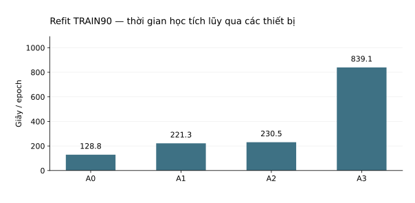
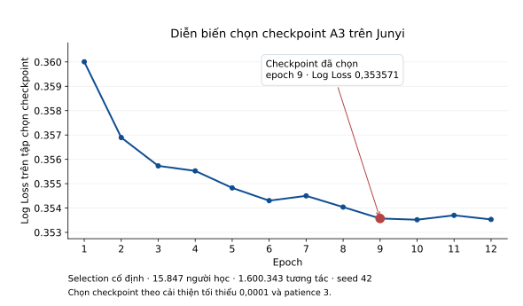

# Báo cáo tiến độ khóa luận — ngày 15/11/2026

## 16/11 — Phạm vi KLTN và phần thực nghiệm còn lại của ba RQ

Đề cương tiếp nối hai paper để giải thích nguyên nhân đồ thị chưa cải thiện thành thạo ổn định trong RQ1, xác định điều kiện hiệu lực trong RQ2 và kiểm cơ chế confidence theo cạnh cùng gate trên nền AKT trong RQ3. PDF Paper1 là nguồn lịch sử chuẩn. Góp ý GVHD do người dùng cung cấp giữ nguyên ba RQ, tập trung vào ba bẫy về quy tắc simulator, năng lực chung và thứ tự luyện Junyi. RQ3 ưu tiên mô phỏng có cạnh thật/nhiễu, với kết quả giảm hoặc tắt graph được chấp nhận. Trọng tâm hiện hành là hoàn thiện KLTN. [Đối chiếu phạm vi training và RQ](../../../reports/TRAINING_RQ_SCOPE_REVIEW_20261116.md).

RQ1 đã có lời giải có điều kiện cho zero re-entry và redundancy của retention14, cùng pilot1.080cặp thời điểm cho thấy thay đổi dự báo thường giữ nguyên lựa chọn. Bỏ ngoại lệ đủ6lần luyện trên cùng trạng thái làm đổi2.557/3.240tập sẵn sàng, nhưng trace thiếu điểm của toàn bộ ứng viên để suy hành động mới. RQ2 đã có factorial120world/10paired blocks kiểm năng lực và cơ chế phạt tiên quyết, cùng audit toàn TRAIN80 cho thấy876/976cạnh có cơ hội xuất hiện đúng thứ tự trong cửa sổ. Khoảng bất định hiện có chưa xác nhận khác biệt hiệu ứng giữa hai mức năng lực thấp. Đối chứng dự báo trực tiếp về thứ tự Junyi còn thiếu. Các kết quả chẩn đoán đã đủ nguồn để viết, còn các phép đánh giá chính cần hoàn tất trước nghiệm thu RQ. [Rà soát từng tiêu chí và artifact](../../../reports/RQ12_COMPLETION_REVIEW_20261116.md).

Training A0–A3 vẫn phục vụ trực tiếp đề cương. Bốn bản expert Junyi đã refit đủ9epoch và xuất model. Grade10 có7selectedcheckpoints, còn refit/calibration và outcome độc lập. Checkpoint mới cho phép cùng đo chất lượng dự báo, reference score/mastery, readiness, hành động và kết quả học. ModelGrade10 cần lifecycle riêng để đánh giá vòng kín. SAKT/GKT và các đối chứng matched vẫn nằm trong kế hoạch. Chưa có cơ sở nghiệm thu toàn bộ RQ hoặc đưa ra phần trăm hoàn thành chỉ từ số checkpoint. [Nghiệm thu bốn refit](../../../runs/junyi-refit-pipeline-20261114-01/exports-verified-a0-a1-a2-a3-portable-memory-cap-v1.json), [Grade10 selected-fit](../../../runs/modal-akt-graph-selected-20261112-01/batch-summary.json).

Thứ tự công việc cốt lõi còn lại được nối chung cho ba RQ.

1. Hiệu chỉnh xác suất trên nhóm riêng và đánh giá độc lập bốn modelJunyi, giữ cùng target, coverage/OOV và bootstrap theo learner. Kiểm thêm system selector đã freeze trước khi dùng fallback.
2. Hoàn thiện lifecycleGrade10 và baseline nghiên cứu, rồi kiểm calibration/reference quanh ngưỡng thành thạo. Đây là phần C04 của RQ1.
3. Chạy coreclosed-loop với controller chung và fresh paired seed blocks, ghi đủ mastery→ready→action→gain, censoring và uncertainty. Đây là phần C07 của RQ1, đồng thời kiểm phương pháp RQ3.
4. Dựng và kiểm exposure của controls đúng TRAIN80outer4, rồi so dự báo graph-free/catalog/matched-null/TRAIN-only order graph trên cùng logged targets. Đây là phần T3b của RQ2. Generator hiện mới kiểm synthetic, chưa tạo controlsJunyi thật.
5. Tái dùng model/output để kiểm delete/add/reverse, history/support/profile và nội/liên chương, giữ family thống kê/Holm đã chốt. H_dev30 còn thiếu history>50. Sau đó nối các bảng kết quả vào luận văn và demo.

Calibration, outcome độc lập và predictiveordercontrols là các phép thực nghiệm còn thiếu. Phần viết có thể tiến hành song song từ các phát hiện đã nghiệm thu. [Ma trận hoàn tất RQ1–RQ2](../../../reports/RQ12_CLOSURE_MATRIX_20261112.md), [trạng thái controlsTRAIN80](../../../runs/rq2-junyi-train80-controls-20261112-01/README.md).

## 16/11 — A0–A3 hoàn tất refit TRAIN90, model đã xuất và kiểm trên D

Bước refit khởi tạo mô hình mới và học lại trên hợp nhóm huấn luyện với nhóm đã dùng chọn số epoch. Nhóm hiệu chỉnh xác suất và nhóm đánh giá độc lập tiếp tục được giữ riêng. Đến đợt cập nhật ngày 15/11, đã nghiệm thu và xuất model refit cho 4/4 phiên bản. Mỗi phiên bản đã nghiệm thu hoàn tất 9 epoch trên TRAIN90, tổng cộng 134.529.066 lượt tương tác được dùng làm mục tiêu dự báo qua 9 vòng học, với 18.360 bước cập nhật trọng số. Mỗi tương tác được dùng một lần làm mục tiêu trong mỗi epoch.

Thời gian học A0 trung bình 128.8 giây/epoch, dao động 122.1–140.8 giây. Hai đợt H100 đã hoàn tất, có nối lại từ checkpoint. Các model và nhật ký đã được lưu, kiểm tra tính toàn vẹn và có checkpoint để tiếp tục khi cần. Các phiên bản refit tiếp theo đã nghiệm thu trên cùng quần thể và số bước cập nhật. A1 trung bình 221.3 giây/epoch. A2 trung bình 230.5 giây/epoch. A3 trung bình 839.1 giây/epoch. A3 nối các checkpoint qua H100, L4, Tesla T4 rồi H100. Thời gian A3 là tổng thời gian native tích lũy qua các thiết bị, phụ thuộc cả overhead nối lại, nên không dùng để kết luận tốc độ tương đối giữa các cơ chế đồ thị.

| Phiên bản | Thành phần | Refit TRAIN90 | Hiệu chỉnh và đánh giá độc lập |
|---|---|---|---|
| A0 | AKT không đồ thị | Đã refit 9/9 epoch, model đã xuất trên D | Còn chờ |
| A1 | Đồ thị cố định | Đã refit 9/9 epoch, model đã xuất trên D | Còn chờ |
| A2 | Độ tin cậy cạnh | Đã refit 9/9 epoch, model đã xuất trên D | Còn chờ |
| A3 | Độ tin cậy cạnh và cổng | Đã refit 9/9 epoch, model đã xuất trên D | Còn chờ |

Trung bình đủ 9 epoch của từng model đã nghiệm thu, cùng TRAIN90 với 142.621 người học, 14.947.674 mục tiêu mỗi epoch, FP32, batch 128 và seed 42. Đây là thời gian học, các bước chuẩn bị và thu artifact được theo dõi riêng. A0–A2 dùng H100, A3 nối H100/L4/T4/H100. Số liệu A3 gồm thời gian tích lũy của các lần nối lại và không dùng làm đối chứng tốc độ phần cứng đồng nhất.

Đây là hoàn tất bước học lại mô hình theo số epoch đã chọn. Hiệu chỉnh xác suất, xuất dự đoán trên nhóm đánh giá độc lập và kết luận hiệu quả đồ thị còn chờ. Thời gian trong biểu đồ là thời gian học từng epoch, gồm phần tích lũy khi nối lại; thời gian chuẩn bị, tải artifact và tổng thời gian sử dụng function được theo dõi riêng. A3 hoàn tất vào ngày 16/11 theo giờ Việt Nam, tiếp nối đợt báo cáo 15/11. Checkpoint Drive lượt 023 đã kiểm trên D ở epoch 9, bước 1.874/2.040. Lượt H100 cuối học tiếp 166 bước, giữ model, Adam, RNG và sampler. App đã xác nhận dừng trước tải artifact. Model cuối và inventory đã kiểm SHA, đủ 9 epoch và optimizer hữu hạn. Đối chiếu A0–A3 giữ các cờ số học và chỉ tách trần tài nguyên VRAM theo comparison_contract. Chưa chứng minh bitwise-equivalence giữa các kiến trúc GPU.

## 15/11 — Đối chiếu phần training còn lại với đề cương

Đối chiếu lại đề cương ngày 15/11 cho thấy yêu cầu giữ các mô hình AKT, SAKT, GKT, GAM-KT, Graph-GAM-KT và BKT tham chiếu, hai môi trường Junyi và Grade 10, cùng các đối chứng đồ thị. Đề cương cho phép kiểm độ ổn định qua nhiều phép chia dữ liệu hoặc bootstrap. Protocol development hiện hành chọn một fold Junyi; chưa có yêu cầu bắt buộc chạy đủ 5-fold cho các mô hình mới.

Bốn phiên bản AKT expert trên Junyi đã hoàn tất chọn checkpoint, cả bốn bản hoàn tất refit. Grade 10 có bảy checkpoint đã chọn cho cấu hình không đồ thị và A1–A3 với đồ thị chuyên gia hoặc học từ dữ liệu; bước refit và hiệu chỉnh còn thiếu. SAKT và GKT đã kiểm trên corpus engineering nhỏ, cần tiếp tục training và đánh giá nghiên cứu. Các kết quả BKT/GAM lịch sử được giữ theo phạm vi gốc.

Nếu giữ nguyên toàn bộ ma trận development của nhóm, sau khi hoàn tất refit A3 còn 21 phase training neural gồm selected-fit hoặc refit, phân bổ cho learned graph Junyi, SAKT/GKT và model Grade 10. Đây là số bước của thiết kế phân bổ hiện hành, đề cương không quy định số lượt này. Các bước có kích thước dữ liệu khác nhau nên cần dự toán riêng. Đề xuất thu gọn phần learned graph Junyi chưa được áp dụng.

Phần tiếp theo phải ưu tiên hiệu chỉnh, đánh giá độc lập và mô phỏng vòng kín để kết luận các RQ. Refit A3 đã hoàn tất đợt training expert Junyi hiện tại; mức hoàn tất toàn khóa luận còn phụ thuộc các đối chứng, thống kê, demo và bản thảo. Chưa có căn cứ nghiệm thu cả ba RQ hoặc toàn khóa luận từ số checkpoint đã có.

## Tiến độ đến ngày 16/11/2026

Đã có các phát hiện chẩn đoán cụ thể cho RQ1–RQ2, đồng thời hoàn tất huấn luyện và chọn checkpoint cho bốn biến thể AKT trên Junyi. Bước mới nhất là hoàn tất refit A0, A1, A2, A3 trên TRAIN90. Khóa luận đang chuyển từ xây dựng mô hình sang hoàn thiện đánh giá độc lập và nối kết quả dự báo với quyết định lộ trình.

Phần tiến bộ trong ngày 14/11 tập trung vào A2, A3, độ tin cậy cạnh và pipeline refit. Những phát hiện RQ1–RQ2 dưới đây kế thừa các thí nghiệm đã lưu từ những ngày trước.

| Hạng mục | Đã đạt đến hiện tại | Phần còn thiếu |
|---|---|---|
| RQ1 · Nguyên nhân | Đã xác định các kết quả phụ thuộc quy tắc mô phỏng và những điểm thay đổi dự báo thường chưa đổi quyết định. | Hiệu chỉnh xác suất quanh ngưỡng thành thạo và đối chứng tác động đến kết quả học trên đánh giá độc lập. |
| RQ2 · Điều kiện hiệu lực | Đã kiểm đối chứng cơ chế năng lực trên 120 thế giới mô phỏng và cơ hội quan sát cạnh trong Junyi. | Kiểm dự báo với các đối chứng thứ tự Junyi; điều kiện nhiễu cạnh, lịch sử và nhóm người học theo protocol chính. |
| RQ3 · CG-AKT | A0–A3 expertJunyi đã chọn epoch9 và refit đủ9epoch, model đã xuất. Grade10 có7selectedcheckpoints. | Hiệu chỉnh, đánh giá độc lập, ablation confidence/gate và vòng kín trên modelGrade10 phù hợp. |
| Refit Junyi | Bốn model A0–A3 đã refit đầy đủ, checkpoint/model xuất trên D được nghiệm thu. | Calibration10, evaluation độc lập và các đối chứng nghiên cứu. |

## 1. Từ hai nghiên cứu trước đến ba câu hỏi của khóa luận

Paper 1 khảo sát cấu trúc tiên quyết và chính sách chọn bài trong môi trường mô phỏng toán Grade 10. Đây là môi trường có 28 khái niệm, ngân hàng câu hỏi và trạng thái người học có thể kiểm soát. PDF Paper 1 là kết quả nghiên cứu được kế thừa.

Paper 2 đưa thông tin tiên quyết vào mô hình theo dõi kiến thức, đánh giá dự báo trên cùng luồng tương tác và kết quả khi hệ thống tự chọn bài. Dữ liệu Junyi cung cấp lịch sử học thực tế, còn mô phỏng cho phép kiểm tra các cơ chế với trạng thái thật đã biết.

Khóa luận tiếp tục tìm nguyên nhân đồ thị chưa cải thiện thành thạo nhất quán trong RQ1, các điều kiện làm ảnh hưởng thay đổi trong RQ2, và kiểm cơ chế độ tin cậy cạnh cùng cổng điều chỉnh đồ thị trên nền AKT trong RQ3. Chất lượng dự báo, quyết định chọn bài và kết quả học cần được đối chiếu qua từng bước.

## 2. Trước hết, kiểm vì sao kết quả học có thể ít thay đổi

Nhóm bắt đầu bằng việc kiểm quy tắc tạo ra kết quả. Với Paper 1, đã xác lập các điều kiện để bộ lọc liền chương bảo đảm số lần quay lại chương cũ bằng 0. Phản ví dụ có cạnh liên chương cho thấy ranh giới của kết luận. Với luật quên đồng nhất của Paper 2, phần tăng thêm về năng lực còn lại sau 14 ngày bằng khoảng 0,43171 lần phần tăng thêm lúc kết thúc. Trong điều kiện đó, hai phép đo giữ cùng thứ hạng.

Tiếp theo, nhóm giữ cùng lịch sử và đáp án để theo dõi ảnh hưởng từ mô hình đến quyết định. Pilot gồm 3 seed × 3 hồ sơ × 120 bước, tạo 1.080 cặp thời điểm. Xác suất cho câu đang xét thay đổi ở 964 cặp. Qua toàn bộ 1.080 cặp, có 90 thời điểm đổi quyết định thành thạo, 60 thời điểm đổi tập khái niệm đủ điều kiện và 22 thời điểm đổi lựa chọn khái niệm thăm dò. Các số đếm dùng các định nghĩa riêng và được đọc theo thứ tự thực thi của controller.

Nhóm cũng kiểm một đường mở bài khác trong Paper 2. Hệ thống cho phép học tiếp sau khi tiên quyết đã được chọn đủ 6 lần. Trong 2.740 hành động có tiên quyết cần xét, 2.041 hành động cần dùng ngoại lệ này. Khi bỏ riêng ngoại lệ trên cùng trạng thái đã lưu, tập đủ điều kiện thay đổi ở 2.557/3.240 thời điểm. Ảnh hưởng đến hành động cuối và kết quả học còn cần đối chứng qua thời gian.

Các kết quả đã cung cấp lời giải thích có điều kiện cho hai ý trong RQ1, gồm chính sách có thể hấp thụ thay đổi trạng thái và simulator có thể làm một số chỉ tiêu ít phân biệt các phương án. Pilot so toàn gói Graph-GAM với cấu hình không đồ thị, nên tác động riêng của cạnh vẫn cần tách thêm. Phần xác suất có được hiệu chỉnh tốt quanh ngưỡng thành thạo hay không tiếp tục là nội dung còn mở.

## 3. Sau đó, tách điều kiện người học và cơ hội sử dụng đồ thị

Để kiểm sự lẫn giữa lợi ích đồ thị và năng lực chung, nhóm tạo 10 khối khởi tạo mới. Mỗi khối giữ cùng trạng thái nền và nguồn ngẫu nhiên giữa các nhánh, thay nguồn đồ thị, bật/tắt cơ chế phạt thiếu tiên quyết và xét 3 mức năng lực ban đầu. Tổng cộng 120 thế giới, mỗi thế giới 120 bước, đã chạy xong.

Ở mức khởi tạo 1300, phần tương tác với cơ chế phạt bằng 0 trong cả 10 khối, trong khi chênh lệch trực tiếp giữa hai đồ thị vẫn có thể khác 0. Như vậy, chênh lệch theo đồ thị còn đi qua các đường khác của hệ thống. Ở các mức thấp hơn, dấu hiệu thay đổi giữa các khối; khoảng bất định hiện có chưa đủ để kết luận hiệu ứng khác nhau giữa hai mức năng lực.

Với Junyi, nhóm kiểm xem đồ thị thật và đồ thị đối chứng có thực sự tạo ra lịch sử tiên quyết khác nhau cho người học hay không. Trong pilot dùng chung quần thể, ba đối chứng chỉ đổi mức tiếp xúc ở lần lượt 1, 7 và 1 trong 239 người học. Tiếp đó, kiểm toàn TRAIN80 cho thấy 876/976 cạnh từng có tình huống tiên quyết xuất hiện trước trong cửa sổ AKT. Các cạnh còn lại cần được diễn giải cùng mức phủ bài tập và thứ tự quan sát.

Đã làm rõ vì sao thay nhiều cạnh chưa bảo đảm tạo được đối chứng có sức phân biệt, và vì sao cần kiểm soát năng lực cùng cơ chế mô phỏng. Dương tính giả trên chất lượng dự báo Junyi còn là giả thuyết cần kiểm trực tiếp. Các kết luận về hiệu quả học tập trên người học thật còn cần thiết kế thực nghiệm tương ứng.

## 4. Từ các chẩn đoán đến bốn mô hình AKT đã huấn luyện

Bốn phiên bản tạo thành chuỗi đối chứng cho RQ3. A0 là AKT NonRasch không đồ thị. A1 thêm đồ thị tiên quyết cố định. A2 dùng trọng số độ tin cậy cho từng cạnh. A3 bổ sung cổng học để điều chỉnh ảnh hưởng của đồ thị. Độ tin cậy Junyi biểu diễn sự ổn định dự báo có điều kiện, được ước lượng từ TRAIN80.

Đến ngày 14/11, bốn phiên bản đều hoàn tất bước huấn luyện để chọn checkpoint trên Junyi Development outer fold 4. Mỗi epoch dùng 126.774 người học với 13.347.331 tương tác. Nhóm chọn checkpoint gồm 15.847 người học, 1.600.343 tương tác. Các lượt dự đoán được kiểm theo người học, thứ tự thời gian và bài tập; model đã xuất gọn trên ổ D.

Log Loss được dùng để chọn checkpoint vì đánh giá mức phù hợp của xác suất dự báo với đáp án, gồm cả độ tự tin khi dự báo sai. Điểm giữa các phiên bản rất gần nhau. So sánh kết luận cần tập đánh giá độc lập và khoảng bất định. A0 chọn epoch lịch sử bằng validation batch 1; riêng checkpoint epoch 9 đã chấm lại bằng batch 128. Thứ hạng toàn bộ epoch A0 theo batch 128 còn chưa được kiểm lại.

| Phiên bản | Thành phần đồ thị | Epoch đã chạy | Epoch chọn | Log Loss trên nhóm chọn checkpoint |
|---|---|---|---|---|
| A0 | Không đồ thị | 12 | 9 | 0,353580 |
| A1 | Đồ thị cố định | 12 | 9 | 0,353562 |
| A2 | Độ tin cậy từng cạnh | 12 | 9 | 0,353567 |
| A3 | Độ tin cậy cạnh và cổng học | 12 | 9 | 0,353571 |

## 5. Bước mới nhất trong ngày 14/11 — chuẩn bị học lại trên TRAIN90

Sau khi chọn số epoch, mỗi mô hình được khởi tạo mới và học lại trên hợp nhóm train và nhóm chọn checkpoint. Đây là bước refit. Tập TRAIN90 gồm 142.621 người học và 14.947.674 tương tác mỗi epoch, với 717 bài tập. Số epoch đã được cố định ở 9 cho từng mô hình, tổng cộng 36 epoch. Nhóm hiệu chỉnh xác suất và nhóm đánh giá độc lập được giữ riêng.

Đã dựng xong cache cửa sổ tương tác và cache đồ thị cho cả A1–A3 trên CPU. Bốn bộ đầu vào đã được kiểm khớp về quần thể, mã hóa và mục tiêu dự đoán. Đồ thị và độ tin cậy cạnh giữ bản TRAIN80 theo thiết kế đã chốt. Việc chuẩn bị cache diễn ra trước khi thuê GPU.

Pipeline refit đã có lưu checkpoint từng epoch, trạng thái optimizer và nguồn ngẫu nhiên, phục hồi khi ngắt, giới hạn thời gian/tài nguyên và xuất model gọn. Kiểm tổng hợp trên CPU xác nhận model, Adam và trạng thái ngẫu nhiên khớp giữa chạy liên tục và nối lại cho cả bốn phiên bản. Source hiện tại đạt 2.667 ca kiểm Linux, với 0 lỗi và 0 ca bỏ qua. Snapshot A0 đã được đóng gói và kiểm đầu vào trên local; A1–A3 đã có đặc tả đóng gói.

Tại bản chốt ngày 14/11, refit dữ liệu thật còn chờ. Ngày 15/11 đã sửa/kiểm guard Volume và allocator CUDA, hoàn tất refit A0 trên H100. Đến cập nhật16/11, cả A0–A3 đã refit đủ9epoch và xuất model. Kết quả kiểm phần mềm được dùng làm điều kiện thực thi; kết luận RQ3 cần hiệu chỉnh và đánh giá mô hình độc lập sau refit.

## 6. Tài nguyên, mô hình đã lưu và công việc tiếp theo

Ở mốc selected-fit ngày14/11, các lượt huấn luyện Junyi đã dùng Modal, đồng thời các phép kiểm kỹ thuật đã tận dụng T4 Colab. Riêng A3 selected-fit có tổng52,25phút trong functionGPU qua hai lượt, thời gian train trung bình khoảng200,2giây/epoch. Trung bình các mẫu đo mức sử dụngGPU là28,82%, VRAM đỉnh khoảng5,65GiB. Các số liệu này thuộc selected-fit lịch sử. Thời gian refit cập nhật16/11 được trình bày ở đầu báo cáo.

Checkpoint, dự đoán, telemetry và figure của các lượt đã nghiệm thu được giữ trên ổ D. A3 đã phục hồi được từ checkpoint giữa epoch 7 khi kết nối local gián đoạn. Các App được xác nhận dừng trước bước tải và nén artifact.

Hai lượt kiểm Linux cho pipeline refit dùng CPU, mỗi lượt có trần dự phòng 0,15 USD. Lượt đầu phát hiện fixture đóng gói thiếu file điều phối refit; đã sửa fixture và chạy lại đạt. Log cả hai lượt được lưu. Snapshot metering lúc 23:05 ngày 14/11 ghi nhận khoảng 22,59 USD toàn workspace và billed 0 USD; metering có thể cập nhật trễ. Trần cho toàn KLTN tiếp tục là 30 USD.

| Thứ tự tiếp theo | Mục tiêu | Bằng chứng cần có |
|---|---|---|
| 1. Hiệu chỉnh và đánh giá Junyi | Tận dụng bốn model refit đã nghiệm thu, kiểm dự báo độc lập. | Raw/calibrated LL, Brier, AUC, ECE, coverage và khoảng bất định theo learner. |
| 2. Hoàn thiện lifecycle Grade10 | Tận dụng7selectedcheckpoints và tiếp tục baseline nghiên cứu. | Epoch/freeze, refit, calibration riêng và đủ84reference items/28concepts. |
| 3. Nối với hệ thống chọn bài | Kiểm chuỗi quyết định và outcome trên fresh paired blocks. | Reference/mastery/ready/action traces, net gain, censoring, ablation và uncertainty. |
| 4. Khép điều kiện và ordercontrols | Kiểm noise/history/support/profile cùng đối chứng thứ tự Junyi. | Controls có exposure hợp lệ, cùng target, thống kê theo family và bảng coverage. |

## 7. Điều đã có thể báo cáo và giới hạn kết luận

RQ1–RQ2 đã có phần đóng góp chẩn đoán có thể trình bày trong luận văn, với cơ chế, phản ví dụ và số liệu đi kèm. Phần còn lại tập trung vào hiệu chỉnh xác suất, các đối chứng dự báo đúng quần thể và kiểm điều kiện hiệu lực theo thiết kế chính.

RQ3 đã vượt qua bước cài đặt đơn thuần: bốn phiên bản đã học trên Junyi, xuất checkpoint và dự đoán có thể kiểm lại. Tuy nhiên, hiệu quả của CG-AKT so với đồ thị cố định và không đồ thị vẫn cần đánh giá độc lập, các đối chứng cổng và kết quả vòng kín. Model Junyi và model Grade 10 dùng từ vựng khác nhau; việc đánh giá vòng kín cần model được huấn luyện trong môi trường tương ứng.

Nguồn đối chiếu của bản chốt gồm PDF Paper 1, PDF Paper 2, tổng hợp năm phát hiện RQ1–RQ2 ngày 12/11, hồ sơ nghiệm thu selected-fit A0–A3 và hồ sơ pipeline refit ngày 14/11. Báo cáo này tổng hợp tiến độ đã có bằng chứng; kết quả nghiên cứu mới sẽ được bổ sung sau khi từng bước thực nghiệm được nghiệm thu.

