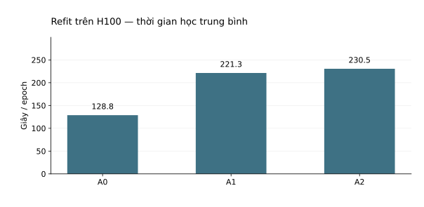

# Báo cáo tiến độ khóa luận — ngày 15/11/2026

## 15/11 — A0, A1, A2 hoàn tất refit; tiếp tục các phiên bản còn lại

Bước refit khởi tạo mô hình mới và học lại trên hợp nhóm huấn luyện với nhóm đã dùng chọn số epoch. Nhóm hiệu chỉnh xác suất và nhóm đánh giá độc lập tiếp tục được giữ riêng. Đến đợt cập nhật ngày 15/11, đã nghiệm thu và xuất model refit cho 3/4 phiên bản. Mỗi phiên bản đã nghiệm thu hoàn tất 9 epoch trên TRAIN90, tổng cộng 134.529.066 lượt tương tác được dùng làm mục tiêu dự báo qua 9 vòng học, với 18.360 bước cập nhật trọng số. Mỗi tương tác được dùng một lần làm mục tiêu trong mỗi epoch.

Thời gian học A0 trung bình 128.8 giây/epoch, dao động 122.1–140.8 giây. Hai đợt H100 đã hoàn tất, có nối lại từ checkpoint. Các model và nhật ký đã được lưu, kiểm tra tính toàn vẹn và có checkpoint để tiếp tục khi cần. Các phiên bản refit tiếp theo đã nghiệm thu trên cùng quần thể và số bước cập nhật. A1 trung bình 221.3 giây/epoch. A2 trung bình 230.5 giây/epoch.

| Phiên bản | Thành phần | Refit TRAIN90 | Hiệu chỉnh và đánh giá độc lập |
|---|---|---|---|
| A0 | AKT không đồ thị | Đã refit 9/9 epoch, model đã xuất trên D | Còn chờ |
| A1 | Đồ thị cố định | Đã refit 9/9 epoch, model đã xuất trên D | Còn chờ |
| A2 | Độ tin cậy cạnh | Đã refit 9/9 epoch, model đã xuất trên D | Còn chờ |
| A3 | Độ tin cậy cạnh và cổng | Đã lưu checkpoint sau 3/9 epoch; chờ tiếp tục | Còn chờ |

Trung bình đủ 9 epoch của từng model đã nghiệm thu, cùng TRAIN90 với 142.621 người học, 14.947.674 mục tiêu mỗi epoch, FP32, batch 128 và seed 42. Đây là thời gian học, các bước chuẩn bị và thu artifact được theo dõi riêng.

Đây là hoàn tất bước học lại mô hình theo số epoch đã chọn. Hiệu chỉnh xác suất, xuất dự đoán trên nhóm đánh giá độc lập và kết luận hiệu quả đồ thị còn chờ. Thời gian trong biểu đồ là thời gian học từng epoch, gồm phần tích lũy khi nối lại; thời gian chuẩn bị, tải artifact và tổng thời gian sử dụng function được theo dõi riêng. A3 đã nghiệm thu đủ 3/9 epoch, còn 6 epoch. Đang chuẩn bị Colab để tiếp tục bằng GPU miễn phí và lưu checkpoint trên Drive. Gói phục hồi gồm source, cache và checkpoint đã kiểm trên D. Cơ chế sao lưu và phục hồi đã kiểm bằng dữ liệu tổng hợp; kiểm trên Drive thật và training tiếp còn chờ. Giữ nguyên cấu hình số học, chia tập và confidence TRAIN80. Chưa có kết quả đánh giá độc lập mới.

## Tiến độ đến ngày 15/11/2026

Đã có các phát hiện chẩn đoán cụ thể cho RQ1–RQ2, đồng thời hoàn tất huấn luyện và chọn checkpoint cho bốn biến thể AKT trên Junyi. Bước mới nhất là hoàn tất refit A0, A1, A2 trên TRAIN90. Khóa luận đang chuyển từ xây dựng mô hình sang hoàn thiện đánh giá độc lập và nối kết quả dự báo với quyết định lộ trình.

Phần tiến bộ trong ngày 14/11 tập trung vào A2, A3, độ tin cậy cạnh và pipeline refit. Những phát hiện RQ1–RQ2 dưới đây kế thừa các thí nghiệm đã lưu từ những ngày trước.

| Hạng mục | Đã đạt đến hiện tại | Phần còn thiếu |
|---|---|---|
| RQ1 · Nguyên nhân | Đã xác định các kết quả phụ thuộc quy tắc mô phỏng và những điểm thay đổi dự báo thường chưa đổi quyết định. | Hiệu chỉnh xác suất quanh ngưỡng thành thạo và đối chứng tác động đến kết quả học trên đánh giá độc lập. |
| RQ2 · Điều kiện hiệu lực | Đã kiểm đối chứng cơ chế năng lực trên 120 thế giới mô phỏng và cơ hội quan sát cạnh trong Junyi. | Kiểm dự báo với các đối chứng thứ tự Junyi; điều kiện nhiễu cạnh, lịch sử và nhóm người học theo protocol chính. |
| RQ3 · CG-AKT | Đã có A0–A3 Junyi, mỗi bản chạy 12 epoch và chọn epoch 9; checkpoint và dự đoán đã lưu. | Hoàn tất refit A3, hiệu chỉnh xác suất, so sánh độc lập và kết quả vòng kín của mô hình mới. |
| Chuẩn bị refit | Đã kiểm bốn bộ đầu vào thật; cache CPU hoàn tất; source đạt 2.667 ca kiểm Linux. | A0 đã refit đủ 9 epoch; tiếp tục A3 và đánh giá độc lập. |

## 1. Từ hai nghiên cứu trước đến ba câu hỏi của khóa luận

Paper 1 khảo sát cấu trúc tiên quyết và chính sách chọn bài trong môi trường mô phỏng toán Grade 10. Đây là môi trường có 28 khái niệm, ngân hàng câu hỏi và trạng thái người học có thể kiểm soát. PDF Paper 1 là kết quả nghiên cứu được kế thừa.

Paper 2 đưa thông tin tiên quyết vào mô hình theo dõi kiến thức, đánh giá dự báo trên cùng luồng tương tác và kết quả khi hệ thống tự chọn bài. Dữ liệu Junyi cung cấp lịch sử học thực tế, còn mô phỏng cho phép kiểm tra các cơ chế với trạng thái thật đã biết.

Khóa luận tiếp tục tìm nguyên nhân đồ thị chưa cải thiện thành thạo nhất quán trong RQ1, các điều kiện làm ảnh hưởng thay đổi trong RQ2, và kiểm cơ chế độ tin cậy cạnh cùng cổng điều chỉnh đồ thị trên nền AKT trong RQ3. Chất lượng dự báo, quyết định chọn bài và kết quả học cần được đối chiếu qua từng bước.

## 2. Trước hết, kiểm vì sao kết quả học có thể ít thay đổi

Nhóm bắt đầu bằng việc kiểm quy tắc tạo ra kết quả. Với Paper 1, đã xác lập các điều kiện để bộ lọc liền chương bảo đảm số lần quay lại chương cũ bằng 0. Phản ví dụ có cạnh liên chương cho thấy ranh giới của kết luận. Với luật quên đồng nhất của Paper 2, phần tăng thêm về năng lực còn lại sau 14 ngày bằng khoảng 0,43171 lần phần tăng thêm lúc kết thúc. Trong điều kiện đó, hai phép đo giữ cùng thứ hạng.

Tiếp theo, nhóm giữ cùng lịch sử và đáp án để theo dõi ảnh hưởng từ mô hình đến quyết định. Pilot gồm 3 seed × 3 hồ sơ × 120 bước, tạo 1.080 cặp thời điểm. Xác suất cho câu đang xét thay đổi ở 964 cặp. Qua toàn bộ 1.080 cặp, có 90 thời điểm đổi quyết định thành thạo, 60 thời điểm đổi tập khái niệm đủ điều kiện và 22 thời điểm đổi lựa chọn khái niệm thăm dò. Các số đếm dùng các định nghĩa riêng và được đọc theo thứ tự thực thi của controller.

Nhóm cũng kiểm một đường mở bài khác trong Paper 2. Hệ thống cho phép học tiếp sau khi tiên quyết đã được chọn đủ 6 lần. Trong 2.740 hành động có tiên quyết cần xét, 2.041 hành động cần dùng ngoại lệ này. Khi bỏ riêng ngoại lệ trên cùng trạng thái đã lưu, tập đủ điều kiện thay đổi ở 2.557/3.240 thời điểm. Ảnh hưởng đến hành động cuối và kết quả học còn cần đối chứng qua thời gian.

Các kết quả đã cung cấp lời giải thích có điều kiện cho hai ý trong RQ1, gồm chính sách có thể hấp thụ thay đổi trạng thái và simulator có thể làm một số chỉ tiêu ít phân biệt các phương án. Pilot so toàn gói Graph-GAM với cấu hình không đồ thị, nên tác động riêng của cạnh vẫn cần tách thêm. Phần xác suất có được hiệu chỉnh tốt quanh ngưỡng thành thạo hay không tiếp tục là nội dung còn mở.

## 3. Sau đó, tách điều kiện người học và cơ hội sử dụng đồ thị

Để kiểm sự lẫn giữa lợi ích đồ thị và năng lực chung, nhóm tạo 10 khối khởi tạo mới. Mỗi khối giữ cùng trạng thái nền và nguồn ngẫu nhiên giữa các nhánh, thay nguồn đồ thị, bật/tắt cơ chế phạt thiếu tiên quyết và xét 3 mức năng lực ban đầu. Tổng cộng 120 thế giới, mỗi thế giới 120 bước, đã chạy xong.

Ở mức khởi tạo 1300, phần tương tác với cơ chế phạt bằng 0 trong cả 10 khối, trong khi chênh lệch trực tiếp giữa hai đồ thị vẫn có thể khác 0. Như vậy, chênh lệch theo đồ thị còn đi qua các đường khác của hệ thống. Ở các mức thấp hơn, dấu hiệu thay đổi giữa các khối; khoảng bất định hiện có chưa đủ để kết luận hiệu ứng khác nhau giữa hai mức năng lực.

Với Junyi, nhóm kiểm xem đồ thị thật và đồ thị đối chứng có thực sự tạo ra lịch sử tiên quyết khác nhau cho người học hay không. Trong pilot dùng chung quần thể, ba đối chứng chỉ đổi mức tiếp xúc ở lần lượt 1, 7 và 1 trong 239 người học. Tiếp đó, kiểm toàn TRAIN80 cho thấy 876/976 cạnh từng có tình huống tiên quyết xuất hiện trước trong cửa sổ AKT. Các cạnh còn lại cần được diễn giải cùng mức phủ bài tập và thứ tự quan sát.

Đã làm rõ vì sao thay nhiều cạnh chưa bảo đảm tạo được đối chứng có sức phân biệt, và vì sao cần kiểm soát năng lực cùng cơ chế mô phỏng. Dương tính giả trên chất lượng dự báo Junyi còn là giả thuyết cần kiểm trực tiếp. Các kết luận về hiệu quả học tập trên người học thật còn cần thiết kế thực nghiệm tương ứng.

## 4. Từ các chẩn đoán đến bốn mô hình AKT đã huấn luyện

Bốn phiên bản tạo thành chuỗi đối chứng cho RQ3. A0 là AKT NonRasch không đồ thị. A1 thêm đồ thị tiên quyết cố định. A2 dùng trọng số độ tin cậy cho từng cạnh. A3 bổ sung cổng học để điều chỉnh ảnh hưởng của đồ thị. Độ tin cậy Junyi biểu diễn sự ổn định dự báo có điều kiện, được ước lượng từ TRAIN80.

Đến ngày 14/11, bốn phiên bản đều hoàn tất bước huấn luyện để chọn checkpoint trên Junyi Development outer fold 4. Mỗi epoch dùng 126.774 người học với 13.347.331 tương tác. Nhóm chọn checkpoint gồm 15.847 người học, 1.600.343 tương tác. Các lượt dự đoán được kiểm theo người học, thứ tự thời gian và bài tập; model đã xuất gọn trên ổ D.

Log Loss được dùng để chọn checkpoint vì đánh giá mức phù hợp của xác suất dự báo với đáp án, gồm cả độ tự tin khi dự báo sai. Điểm giữa các phiên bản rất gần nhau. So sánh kết luận cần tập đánh giá độc lập và khoảng bất định. A0 chọn epoch lịch sử bằng validation batch 1; riêng checkpoint epoch 9 đã chấm lại bằng batch 128. Thứ hạng toàn bộ epoch A0 theo batch 128 còn chưa được kiểm lại.

| Phiên bản | Thành phần đồ thị | Epoch đã chạy | Epoch chọn | Log Loss trên nhóm chọn checkpoint |
|---|---|---|---|---|
| A0 | Không đồ thị | 12 | 9 | 0,353580 |
| A1 | Đồ thị cố định | 12 | 9 | 0,353562 |
| A2 | Độ tin cậy từng cạnh | 12 | 9 | 0,353567 |
| A3 | Độ tin cậy cạnh và cổng học | 12 | 9 | 0,353571 |

## 5. Bước mới nhất trong ngày 14/11 — chuẩn bị học lại trên TRAIN90

Sau khi chọn số epoch, mỗi mô hình được khởi tạo mới và học lại trên hợp nhóm train và nhóm chọn checkpoint. Đây là bước refit. Tập TRAIN90 gồm 142.621 người học và 14.947.674 tương tác mỗi epoch, với 717 bài tập. Số epoch đã được cố định ở 9 cho từng mô hình, tổng cộng 36 epoch. Nhóm hiệu chỉnh xác suất và nhóm đánh giá độc lập được giữ riêng.

Đã dựng xong cache cửa sổ tương tác và cache đồ thị cho cả A1–A3 trên CPU. Bốn bộ đầu vào đã được kiểm khớp về quần thể, mã hóa và mục tiêu dự đoán. Đồ thị và độ tin cậy cạnh giữ bản TRAIN80 theo thiết kế đã chốt. Việc chuẩn bị cache diễn ra trước khi thuê GPU.

Pipeline refit đã có lưu checkpoint từng epoch, trạng thái optimizer và nguồn ngẫu nhiên, phục hồi khi ngắt, giới hạn thời gian/tài nguyên và xuất model gọn. Kiểm tổng hợp trên CPU xác nhận model, Adam và trạng thái ngẫu nhiên khớp giữa chạy liên tục và nối lại cho cả bốn phiên bản. Source hiện tại đạt 2.667 ca kiểm Linux, với 0 lỗi và 0 ca bỏ qua. Snapshot A0 đã được đóng gói và kiểm đầu vào trên local; A1–A3 đã có đặc tả đóng gói.

Tại bản chốt ngày 14/11, refit dữ liệu thật còn chờ. Ngày 15/11 đã sửa/kiểm guard Volume và allocator CUDA, hoàn tất refit A0 trên H100. Tiếp tục A3 và đối soát ngân sách. Kết quả kiểm phần mềm được dùng làm điều kiện thực thi; kết luận RQ3 cần kết quả đánh giá mô hình sau các bước này.

## 6. Tài nguyên, mô hình đã lưu và công việc tiếp theo

Các lượt huấn luyện Junyi đã dùng Modal, đồng thời các phép kiểm kỹ thuật đã tận dụng T4 Colab. Riêng A3 có tổng 52,25 phút trong function GPU qua hai lượt, thời gian train trung bình khoảng 200,2 giây/epoch. Trung bình các mẫu đo mức sử dụng GPU là 28,82%, VRAM đỉnh khoảng 5,65 GiB. Mức sử dụng GPU trung bình trên 50% còn chưa đạt.

Checkpoint, dự đoán, telemetry và figure của các lượt đã nghiệm thu được giữ trên ổ D. A3 đã phục hồi được từ checkpoint giữa epoch 7 khi kết nối local gián đoạn. Các App được xác nhận dừng trước bước tải và nén artifact.

Hai lượt kiểm Linux cho pipeline refit dùng CPU, mỗi lượt có trần dự phòng 0,15 USD. Lượt đầu phát hiện fixture đóng gói thiếu file điều phối refit; đã sửa fixture và chạy lại đạt. Log cả hai lượt được lưu. Snapshot metering lúc 23:05 ngày 14/11 ghi nhận khoảng 22,59 USD toàn workspace và billed 0 USD; metering có thể cập nhật trễ. Trần cho toàn KLTN tiếp tục là 30 USD.

| Thứ tự tiếp theo | Mục tiêu | Bằng chứng cần có |
|---|---|---|
| 1. Kiểm CUDA refit ngắn | Xác nhận đường chạy mới hoạt động và đo chi phí xử lý thực tế. | Checkpoint có thể nạp lại, số mục tiêu/bước học, thời gian, VRAM và xác nhận dừng GPU. |
| 2. Refit A0–A3 | Học lại từng phiên bản đúng 9 epoch, cùng dữ liệu và recipe số học. | Checkpoint cuối, đủ quần thể mỗi epoch, inventory và model xuất trên D. |
| 3. Hiệu chỉnh và đánh giá độc lập | Đánh giá dự báo và độ tin cậy quanh ngưỡng thành thạo. | AUC, Log Loss, Brier, calibration và khoảng bất định trên đúng tập đã giữ riêng. |
| 4. Nối với hệ thống chọn bài | Kiểm khi nào cải thiện dự báo làm thay đổi quyết định và kết quả học. | Nhật ký thành thạo, tập sẵn sàng, lựa chọn, gain và retention trong mô phỏng phù hợp. |

## 7. Điều đã có thể báo cáo và giới hạn kết luận

RQ1–RQ2 đã có phần đóng góp chẩn đoán có thể trình bày trong luận văn, với cơ chế, phản ví dụ và số liệu đi kèm. Phần còn lại tập trung vào hiệu chỉnh xác suất, các đối chứng dự báo đúng quần thể và kiểm điều kiện hiệu lực theo thiết kế chính.

RQ3 đã vượt qua bước cài đặt đơn thuần: bốn phiên bản đã học trên Junyi, xuất checkpoint và dự đoán có thể kiểm lại. Tuy nhiên, hiệu quả của CG-AKT so với đồ thị cố định và không đồ thị vẫn cần đánh giá độc lập, các đối chứng cổng và kết quả vòng kín. Model Junyi và model Grade 10 dùng từ vựng khác nhau; việc đánh giá vòng kín cần model được huấn luyện trong môi trường tương ứng.

Nguồn đối chiếu của bản chốt gồm PDF Paper 1, PDF Paper 2, tổng hợp năm phát hiện RQ1–RQ2 ngày 12/11, hồ sơ nghiệm thu selected-fit A0–A3 và hồ sơ pipeline refit ngày 14/11. Báo cáo này tổng hợp tiến độ đã có bằng chứng; kết quả nghiên cứu mới sẽ được bổ sung sau khi từng bước thực nghiệm được nghiệm thu.

