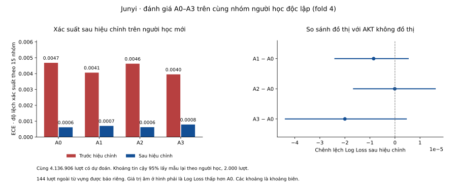
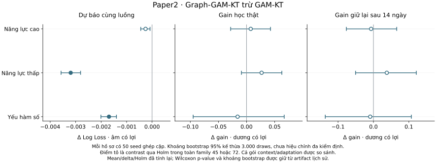
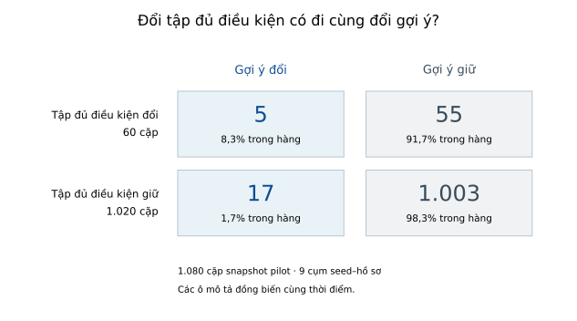

BÁO CÁO KẾT QUẢ VÀ TIẾN ĐỘ KLTN · Cập nhật 17/11/2026 · Số liệu đến 17/11

# Đã giải quyết được gì trong ba câu hỏi nghiên cứu?

KLTN nghiên cứu cách chọn bài phù hợp với từng người học bằng sơ đồ kiến thức tiên quyết, tức kiến thức cần học trước–sau. **Paper 1** cho thấy bộ chọn bài giữ liên tục trong chương giúp giảm điều hướng phân mảnh, còn đồ thị mở rộng chưa đem lại lợi ích nhất quán. **Paper 2** ghi nhận cải thiện dự báo nhỏ ở một số nhóm, nhưng kết quả học vòng kín chưa có khác biệt sau hiệu chỉnh nhiều phép so sánh. Trên phần phát triển Junyi của Paper 2, cấu hình được chọn tắt toàn bộ gói bổ sung đồ thị.

Từ đó, KLTN đặt ba bước tiếp nối. RQ1 tìm mắt xích khiến dự báo khác chưa chuyển thành tiến bộ học tập. RQ2 kiểm điều kiện khiến lợi ích đồ thị xuất hiện hoặc biến mất. RQ3 thử độ tin cậy theo từng cạnh và cổng điều tiết trên AKT để xử lý những điều kiện ấy.

**Mốc đã đạt** gồm các chẩn đoán RQ1–RQ2 và chuỗi chọn vòng, học lại, hiệu chỉnh, đánh giá dự báo độc lập của bốn mô hình Junyi. **Mốc còn thiếu** tập trung ở các đối chứng bắt buộc, điều kiện hiệu lực, quyết định lộ trình và mô phỏng vòng kín Grade10, cùng luận văn và demo hoàn chỉnh.

## Quá trình nghiên cứu đến hiện tại

1. **Kế thừa hai paper.** Giữ kết quả đã công bố làm điểm xuất phát, rồi đặt câu hỏi vì sao dự báo tốt hơn chưa đi cùng kết quả học tốt hơn.
2. **07–12/11 — kiểm cơ chế và dựng đối chứng.** Đã kiểm quy tắc quay lại chương, luật quên, quan hệ giữa dự báo và lựa chọn, tác động năng lực và mức đồ thị thực sự được nhìn thấy trên Junyi. Đây là phần phát hiện chẩn đoán trình bày ở RQ1–RQ2 bên dưới.
3. **12–16/11 — tạo các mô hình để kiểm giải pháp.** Đã chọn bản cho bảy điều kiện Grade10 và hoàn tất chọn bản/học lại bốn phiên bản Junyi. Bước kế tiếp dùng các mô hình này để tạo bảng đánh giá độc lập và kết quả vòng kín dùng chung ba RQ.
4. **17/11 — kiểm chéo các lịch sử đã lưu.** Đã đối chiếu bảng thay đổi quyết định và chuỗi quan sát của pilot. Ở mức khởi tạo 1150, mức tăng năng lực ẩn đổi khi bật phạt trong khi chuỗi câu hỏi, đáp án và xác suất KT giữ nguyên. Đây là phân tích lại các thí nghiệm đã có.
5. **17/11 — đưa mô hình đã học vào bước hiệu chỉnh thực tế.** Cả A0–A3 đã tính đủ 1.621.484 xác suất dự báo mỗi mô hình trên cùng phần hiệu chỉnh Junyi. A0 và A1 đã hoàn tất hiệu chỉnh và kiểm lại artifact trên Drive. Dự báo A2/A3 đã được lưu đầy đủ trên Drive; hai mô hình còn bước fit hệ số hiệu chỉnh, sau đó cả bốn cần đánh giá trên nhóm người học độc lập.
6. **17/11 — hoàn tất hiệu chỉnh A2 trên CPU local.** A2 đã được đối chiếu đầy đủ trên cùng 1.621.484 tương tác và nghiệm thu artifact trên Drive. Mốc hiệu chỉnh đạt 3/4 mô hình. A3 đang xử lý tiếp; so sánh hiệu quả dự báo còn cần nhóm đánh giá độc lập.
7. **17/11 — hoàn tất hiệu chỉnh A3 và khép bước calibration Junyi.** Kết quả của cả bốn mô hình đã được đọc lại trên Drive để kiểm đúng model và nhóm dữ liệu. Mốc hiệu chỉnh đạt 4/4. Chặng tiếp theo là đánh giá dự báo trên nhóm người học độc lập.

## 17/11 — Kết quả dự báo trên người học mới

Sau khi có mô hình và hệ số hiệu chỉnh, bước tiếp theo là kiểm tra trên người học mới. Mục tiêu là xem đồ thị có giúp dự báo đáp án tốt hơn hay chủ yếu làm thay đổi mức tự tin. Cả A0–A3 được đánh giá trên cùng 39.616 người học thuộc Development fold 4, nằm ngoài các khâu học tham số, chọn vòng và fit hệ số hiệu chỉnh của AKT.

Mỗi mô hình xử lý đủ 4.137.050 lượt. Bộ chỉ số được tính trên cùng 4.136.906 lượt có bài đã xuất hiện trong nhóm huấn luyện. Có 144 lượt ngoài từ vựng được ghi riêng. Log Loss và Brier đo mức sai của xác suất, AUC đo khả năng phân biệt đúng/sai, ECE đối chiếu độ tự tin với tỷ lệ đúng quan sát.

| Mô hình | Log Loss gốc | Log Loss hiệu chỉnh | AUC hiệu chỉnh | Brier hiệu chỉnh | ECE hiệu chỉnh |
|---|---:|---:|---:|---:|---:|
| A0 | 0,360604 | 0,360453 | 0,80477 | 0,110202 | 0,000614 |
| A1 | 0,360559 | 0,360444 | 0,80478 | 0,110199 | 0,000703 |
| A2 | 0,360597 | 0,360453 | 0,80477 | 0,110201 | 0,000621 |
| A3 | 0,360542 | 0,360433 | 0,80478 | 0,110192 | 0,000789 |

Ở xác suất gốc, A1 và A3 có sai số thấp hơn A0 ở mức chênh lệch tuyệt đối nhỏ. Phân tích lấy mẫu lại theo người học và hiệu chỉnh Holm ghi nhận khác biệt ở cả Log Loss và Brier. Sau khi hiệu chỉnh xác suất bằng nhóm người học riêng, các phép so A1/A2/A3 với A0 trên hai chỉ số chính đều chưa đạt ngưỡng 0,05 sau Holm.

Với A3, chênh lệch Log Loss so với A0 đi từ −0,000062 trước hiệu chỉnh đến −0,000020 sau hiệu chỉnh. Khoảng tin cậy sau hiệu chỉnh từ −0,000044 đến +0,000005 vẫn chứa 0. Kết quả đặt ra yêu cầu kiểm soát mức tự tin khi đánh giá lợi ích đồ thị. Cần thí nghiệm riêng để quy sự thay đổi này cho một cơ chế cụ thể.

Mốc này bổ sung bằng chứng cho nhánh dự báo và hiệu chỉnh của RQ1, cùng phép đối chứng Junyi của RQ3. Tác động tới quyết định chọn bài và kết quả học cần tiếp tục kiểm trong Grade10 với cạnh thật/nhiễu. Các điều kiện về lịch sử, hồ sơ người học và chất lượng đồ thị của RQ2 còn phần thực nghiệm riêng.

Phân tích giới hạn ở một fold phát triển và một lần khởi tạo huấn luyện. Danh sách 24 phép so chính cùng cách tính p được khóa sau suy luận GPU, trước khi xem chỉ số đánh giá, với mốc thời gian được giữ trong hồ sơ. Bootstrap cho p xấp xỉ theo cụm người học. Các kết luận thống kê được trình bày ở mức thăm dò với ngoại lệ quy trình này.

[Số liệu đầy đủ](../../../runs/junyi-outer-real-20261117-01/OUTER_METRICS01.csv) và [24 phép so chính](../../../runs/junyi-outer-real-20261117-01/OUTER_PAIRED_PRIMARY01.csv).

## Các mốc đã khép theo từng phần

Các tỷ lệ dưới đây đếm mốc có tiêu chí và mẫu số cụ thể. Hai hàng chẩn đoán chỉ đếm các phát biểu hẹp đã đủ nguồn; RQ1 còn mastery/hiệu chỉnh và kết quả học, RQ2 còn đối chứng dự báo thứ tự cùng các điều kiện nhiễu/lịch sử. Tỷ lệ hoàn thành toàn RQ hoặc toàn KLTN cần một thang nghiệm thu riêng.

| Mốc trong phạm vi đã nêu | Đã khép / tổng | Tỷ lệ của mốc |
| --- | ---: | ---: |
| RQ1 · phát biểu chẩn đoán hẹp | 5/7 | 71,4% |
| RQ2 · phát biểu hẹp của ba bẫy | 6/7 | 85,7% |
| Junyi · chọn vòng A0–A3 | 4/4 | 100% |
| Junyi · học lại A0–A3 | 4/4 | 100% |
| Junyi · suy luận trên phần hiệu chỉnh | 4/4 | 100% |
| Junyi · fit hệ số hiệu chỉnh đã nghiệm thu | 4/4 | 100% |
| Junyi · suy luận outer độc lập | 4/4 | 100% |
| Junyi · bảng chỉ số outer đã nghiệm thu | 4/4 | 100% |
| Grade10 · chọn vòng các mô hình hiện đại | 7/9 | 77,8% |

Các hàng Junyi giới hạn ở A0–A3 với đồ thị chuyên gia, outer fold4. Hàng Grade10 gồm bảy cấu hình AKT/CG-AKT đã chọn vòng và hai đối chứng SAKT/GKT còn thiếu ở quy mô nghiên cứu. Hai mô hình này hiện mới có kết quả kiểm kỹ thuật nhỏ.

## RQ1 — Vì sao đồ thị chưa giúp người học tiến bộ?

Cần phân biệt ba khả năng — dự báo chưa đủ tốt, xác suất chưa phù hợp với ngưỡng thành thạo, hoặc bộ chọn bài làm suy giảm ảnh hưởng của đồ thị.

**Đã kiểm lại nền số liệu của Paper 2.** Để biết dự báo tốt hơn có đi cùng việc học tốt hơn hay không, đã tính lại trung bình, chênh lệch ghép cặp và hiệu chỉnh Holm cho 117 phép so sánh từ kết quả mô phỏng đã lưu, với 50 hạt giống cho mỗi hồ sơ. Các bảng khớp nguồn lịch sử. Gói bổ sung đồ thị cải thiện dự báo rõ ở nhóm năng lực thấp và yếu hàm số. Các phép so về tiến bộ và duy trì kiến thức ở cả ba nhóm vẫn chưa đạt tiêu chí thống kê sau hiệu chỉnh nhiều phép so. Đã chạy nguyên các hàm nguồn để tính lại Wilcoxon, khoảng ước lượng bootstrap và Holm. Cả 1.170 giá trị số của 117 phép so khớp chính xác hồ sơ Paper 2. Các hàm gốc dùng 3.000 lần lấy mẫu lại cho mỗi phép so. Môi trường hiện hành tái lập đúng số liệu; phiên bản thư viện lịch sử còn thiếu hồ sơ xác nhận. Phần này tái lập thống kê từ kết quả mô phỏng đã lưu. Phần tách riêng tác động của cạnh tiếp tục thuộc chương trình chẩn đoán.

### Thành quả đã có

**Đã giải thích được một số kết quả do quy tắc mô phỏng chi phối.** Với đồ thị nội chương và các điều kiện đã kiểm, số lần quay lại chương bằng **0** được bảo đảm bởi bộ chọn bài. Dưới luật quên đồng nhất, phần tăng điểm năng lực trung bình còn **43,17%** sau 14 ngày nếu không luyện thêm và phần tăng của từng khái niệm không âm. Điều kiện quay lại chương bằng 0 gồm đồ thị nội chương không chu trình, kiến thức đã đạt ngưỡng giữ trạng thái đạt và bộ chọn bài tiếp tục trong chương còn bài đủ điều kiện. Tỷ lệ 43,17% áp dụng cho phần tăng điểm năng lực trung bình. Cách đếm khái niệm thành thạo có thể thay đổi thứ tự so sánh khi qua ngưỡng, nên từng chỉ số duy trì cần được kiểm riêng.

**Đã đối chiếu khác biệt dự báo với khác biệt gợi ý chủ đề.** Pilot GAM-KT và gói bổ sung đồ thị gồm 3 bộ hạt giống × 3 hồ sơ × 120 bước. Mỗi cặp dùng cùng trạng thái người học, các bước trong cùng lượt có liên hệ với nhau.

| Thay đổi được ghi nhận | Số cặp / 1.080 | Tỷ lệ |
| --- | --- | --- |
| Xác suất dự báo đáp án | 964 | 89,3% |
| Đánh giá ít nhất một khái niệm đã thành thạo | 90 | 8,3% |
| Tập chủ đề đủ điều kiện học | 60 | 5,6% |
| Gợi ý chủ đề xem trước | 22 | 2,0% |

Bốn số đo được đếm riêng trên cùng 1.080 cặp. Trong 964 cặp đổi xác suất, 944 cặp vẫn giữ gợi ý chủ đề. Trong 22 cặp đổi gợi ý, 17 cặp giữ nguyên tập chủ đề đủ điều kiện. Các đối chiếu cho thấy bộ xếp hạng và các phần khác của gói bổ sung cũng cần được tách riêng khi giải thích tác động. Gợi ý xem trước và kết quả học vòng kín còn là hai đầu ra cần nối bằng thực nghiệm. Trong thiết kế Paper 2, câu học được chọn trước khi tính xác suất trả lời câu đó. Bảng này mô tả sự đồng biến, còn việc xác định bước nào gây thay đổi bước nào cần kiểm tiếp.

**Đã trả lời được một phần nguyên nhân** — một số chỉ số bị thiết kế chi phối, và phần lớn cặp có dự báo khác nhau trong pilot giữ nguyên gợi ý học. Phép so sánh GAM-KT lịch sử còn trộn tác động cạnh với các phần bổ sung khác của mô hình, cần đối chứng để tách đóng góp.

**Còn thiếu để kết thúc RQ1** — hiệu chỉnh để độ tự tin dự báo khớp tỷ lệ trả lời đúng, đặc biệt quanh ngưỡng thành thạo, kiểm đánh giá thành thạo so với trạng thái thật trong mô phỏng, rồi nối quyết định chọn bài với mức tiến bộ trên các lượt đánh giá độc lập.

## RQ2 — Đồ thị hữu ích, trung tính hoặc có hại trong điều kiện nào?

Cần xét chất lượng đồ thị, lượng lịch sử đã quan sát và đặc điểm người học, đồng thời tránh nhầm lợi ích của đồ thị với năng lực hoặc thứ tự luyện sẵn có.

### Đã tách thử ảnh hưởng của năng lực và cơ chế tiên quyết

Đã hoàn tất **120 lượt mô phỏng, mỗi lượt 120 bước**, gồm 10 bộ khởi tạo ghép cặp. Trong mỗi bộ, lần lượt đổi ba mức năng lực ban đầu, hai nguồn đồ thị và bật/tắt cơ chế phạt thiếu kiến thức tiên quyết.

Phép đo lấy chênh lệch giữa đồ thị chuyên gia và đồ thị học từ dữ liệu, rồi so chênh lệch đó khi bật/tắt cơ chế tiên quyết. Ở mức khởi tạo trung bình, phần tác động bổ sung dương trong **8/10 bộ** và âm trong **2/10 bộ**. Đối chứng mức cao cho tác động bổ sung bằng **0 trong cả 10/10 bộ**.

Ở mức khởi tạo trung bình, kiểm tiếp 20 cặp bật/tắt phạt cho thấy câu hỏi, đáp án và xác suất KT đã ghi đều giữ nguyên suốt 120 bước, trong khi mức tăng năng lực thật do mô phỏng tính giảm ở cả 20 cặp. Núm phạt nằm trong công thức tăng kiến thức của bộ mô phỏng. Vì vậy, phần tác động bổ sung dương kể trên chưa cho thấy mô hình hoặc bộ chọn bài đã điều chỉnh tốt hơn khi bật cơ chế. Đây là phân tích lại lịch sử đã lưu.

Đơn vị độc lập là 10 bộ khởi tạo, với một đồ thị học được cố định và 120 bước mỗi lượt. Đối chiếu trên chỉ kiểm các trường đã ghi, chưa bao quát mọi trạng thái nội bộ của mô hình/bộ chọn bài. Kết quả thăm dò còn biến động, chưa xác nhận nhóm năng lực nào hưởng lợi hơn. Chênh lệch trực tiếp giữa hai đồ thị vẫn có thể tồn tại khi cơ chế tiên quyết bị tắt.

### Đã xác định giới hạn quan sát đồ thị trên Junyi

Kiểm **13.347.331 tương tác** của **126.774 người học** trong phần huấn luyện cho thấy trong 976 quan hệ tiên quyết, có 876 quan hệ từng gặp kiến thức cha trước câu hỏi con trong cửa sổ đầu vào, còn **100 quan hệ** thiếu điều kiện đó. Trong 100 quan hệ, 86 có ít nhất một bài nằm ngoài danh mục xuất hiện trong tập huấn luyện và 14 có đủ bài nhưng thiếu thứ tự phù hợp.

**Thành quả hiện có** — đã thiết lập đối chứng năng lực trong mô phỏng và kiểm độ mạnh của phép thay đồ thị trên Junyi. Trong pilot chung 239 người học, ba đồ thị đối chứng chỉ đổi mức quan sát kiến thức cha ở lần lượt 1, 7 và 1 người. Cần bảo đảm việc thay cạnh tạo được thay đổi đầu vào đủ rõ, rồi mới đo chênh lệch dự báo. Chưa có kết quả đánh giá dự báo chính xác nhận dương tính giả do thứ tự luyện.

**Còn thiếu để kết thúc RQ2** — đối chứng dự báo Junyi kiểm soát thứ tự luyện, thí nghiệm nhiễu thêm/xóa/đảo cạnh, lịch sử ngắn/dài, khái niệm ít dữ liệu, nhóm người học và quan hệ nội/liên chương, kèm bất định thống kê trên đánh giá chính.

## RQ3 — CG-AKT có cải thiện dự báo và kết quả học?

Giải pháp dùng độ tin cậy cho từng quan hệ và một cổng điều tiết để giảm hoặc tắt ảnh hưởng của đồ thị khi cần.

### Đã cài đặt và huấn luyện các biến thể cần so sánh

| Phiên bản | Vai trò nghiên cứu |
| --- | --- |
| A0 | AKT không đồ thị, làm đối chứng |
| A1 | AKT kết hợp đồ thị cố định |
| A2 | AKT kết hợp trọng số tin cậy từng cạnh |
| A3 · CG-AKT | Độ tin cậy cạnh và cổng điều tiết có thể tắt đồ thị |

Mỗi biến thể Junyi đã chạy 12 vòng để chọn bản mô hình, chọn vòng 9 rồi học lại đủ 9 vòng trên **142.621 người học**, với **14.947.674 tương tác mục tiêu mỗi vòng**. Các bản lưu mô hình và nhật ký đã được lưu và nghiệm thu. Phạm vi hiện có là một phép chia dữ liệu phát triển, một lần khởi tạo huấn luyện và nhóm đồ thị chuyên gia.

### Từ chọn vòng học đến kết luận trên dữ liệu độc lập

**Chọn vòng** xác định số vòng huấn luyện phù hợp bằng nhóm phát triển dành cho lựa chọn. **Học lại** dùng số vòng đã chọn để huấn luyện lại mạng KT trên nhóm người học lớn hơn. **Hiệu chỉnh** tìm mức điều chỉnh độ tự tin dự báo trên một nhóm riêng. **Đánh giá độc lập** mới kiểm chất lượng trên nhóm người học hoặc lượt mô phỏng dành riêng để đánh giá.

| Bước | Junyi · bốn mô hình A0–A3 với đồ thị chuyên gia | Grade10 · bảy điều kiện mô hình/đồ thị |
| --- | --- | --- |
| Chọn vòng | Đã chọn vòng 9 cho cả bốn mô hình | Đã chọn vòng 4 hoặc 5 |
| Học lại | Đã hoàn tất 9 vòng mỗi mô hình | Còn phải học lại theo số vòng đã chọn |
| Hiệu chỉnh | Dự báo đủ 4/4. A0–A3 đã hiệu chỉnh và xác minh artifact | Còn hiệu chỉnh trên nhóm mô phỏng riêng |
| Đánh giá độc lập | Đã có bảng chỉ số A0–A3 và so sánh theo người học trên fold 4 | Còn dự báo, quyết định và kết quả vòng kín trên các lượt đánh giá mới |

### Cả bốn mô hình đã tính đủ dự báo để hiệu chỉnh xác suất

Trước khi kiểm độ tự tin của mô hình, cần đối chiếu xác suất dự báo với đáp án trên một nhóm người học riêng, tách khỏi các nhóm dùng để huấn luyện và chọn vòng học. Mỗi mô hình A0–A3 đã tính đủ **1.621.484 xác suất cho cùng 15.847 người học**, với **0 tương tác ngoài danh mục đã học**. Nhóm này chiếm 10% người học trong phần dữ liệu dành xây dựng mô hình của phép chia fold4 và được dành riêng để hiệu chỉnh. Ngày 17/11 sử dụng bốn bản mô hình đã học lại xong để tính dự báo và tìm mức hiệu chỉnh. Bốn lượt dùng cùng dữ liệu, phép chia, danh mục bài và cấu hình xử lý đã ghim. Kết quả số, mô hình nguồn và nhật ký đã được lưu. Cả bốn mô hình đã fit hệ số và được nghiệm thu trên Drive.

Lượt A0 dùng H100 mất khoảng **58 giây**, còn A1/A2/A3 lần lượt khoảng **42/42/48 giây**. Trong lượt A0, phần chấm và ghi dự báo trong vòng xử lý chính mất khoảng 12 giây, riêng tính xác suất mất 6,88 giây. Theo 55 mẫu đo toàn lượt A0, mức sử dụng GPU trung bình **6,2%**, cao nhất **43%** và mốc 50% chưa đạt. Các bước chuẩn bị, nạp và kiểm dữ liệu đã được bổ sung phép đo riêng ở các lượt sau.

**Bước hiệu chỉnh đã hoàn tất cho cả bốn mô hình.** Cả A0–A3 đã có hệ số hiệu chỉnh được nghiệm thu trên Drive. Bảng so sánh dự báo trên nhóm người học độc lập đã hoàn tất ở mốc kết quả phía trên.

Benchmark BKT/GAM-KT qua 5 phép chia ở Sprint 2 cần được lấy ra phần dự đoán tương ứng với cùng người học và tương tác đánh giá trước khi đối chiếu với AKT. Phạm vi AKT hiện có là một phép chia phát triển.

**Grade10** là môi trường Toán 10 riêng, có 28 khái niệm và biết trạng thái người học. Đã chọn bản mô hình cho **7 điều kiện** trên bộ 60 người học mô phỏng. Junyi và Grade10 dùng danh mục bài riêng và được huấn luyện riêng. Các mô hình Grade10 còn bước học lại và hiệu chỉnh để chạy đánh giá vòng kín.

**Thành quả RQ3 hiện tại gồm mô hình đã triển khai, các bản huấn luyện đã lưu và benchmark dự báo A0–A3 trên Junyi Development fold 4.** Điểm tin cậy cạnh được ước lượng từ dữ liệu huấn luyện. Mô phỏng biết cạnh thật/nhiễu sẽ kiểm xem điểm ấy có giúp điều tiết đồ thị đúng chỗ hay không. Bảng dự báo độc lập Junyi đã có. Lựa chọn bài và kết quả học cần tiếp tục đánh giá trong mô phỏng.

### Hiệu chỉnh đã hoàn tất cho bốn mô hình Junyi

Mỗi mô hình dùng cùng 1.621.484 tương tác thuộc nhóm hiệu chỉnh riêng. Bước này tìm một hệ số để mức tự tin dự báo phù hợp hơn với đáp án đã quan sát.

| Mô hình | Temperature | Log Loss trước | Log Loss sau |
| --- | ---: | ---: | ---: |
| A0 | 1,03018 | 0,358459 | 0,358315 |
| A1 | 1,02635 | 0,358434 | 0,358324 |
| A2 | 1,02953 | 0,358448 | 0,358311 |
| A3 | 1,02561 | 0,358413 | 0,358310 |

Các giá trị trước và sau được đo trên chính nhóm dùng tìm hệ số. So sánh trên nhóm độc lập Junyi đã hoàn tất trong mốc phía trên. Kiểm chuẩn quanh ngưỡng thành thạo trong Grade10 còn chờ thực hiện. Bộ hệ số A0–A3 đã được nghiệm thu trên Drive trong giao thức Junyi fold4 hiện hành.

**Còn thiếu để kết thúc RQ3** — đối chiếu các baseline trong cùng giao thức, học lại và hiệu chỉnh mô hình Grade10, so A0–A3 trên cạnh thật/nhiễu, tách đóng góp độ tin cậy/cổng và đo kết quả học vòng kín. Kết quả cổng tắt đồ thị vẫn được chấp nhận nếu có bằng chứng.

## Đối chiếu sáu sprint trong đề cương

Đã đối chiếu lại trực tiếp đề cương PDF, đặc biệt phương pháp ở trang 3–4 và đầu ra/sáu sprint ở trang 5. Các sprint đang được thực hiện đan xen. Hoàn tất huấn luyện khép một phần yêu cầu của Sprint 2 và Sprint 4.

| Sprint theo đề cương | Đầu ra đã có đến 17/11 | Đầu ra bắt buộc còn phải nghiệm thu |
| --- | --- | --- |
| 1 · Khảo sát và tái lập | Có hai paper, đề cương và quy trình. Đã tái lập đúng cả trung bình, chênh lệch, Wilcoxon, bootstrap và Holm cho 117 phép so Paper2. Các kiểm cơ chế ở [diễn tiến](#history). | Khép đối chiếu/tái lập các kết quả chính của hai paper trên phạm vi đã chốt, kèm bằng chứng và giới hạn của từng bảng. |
| 2 · Dữ liệu và mô hình đối chứng | Junyi/Grade10 và phép chia đã chuẩn hóa. BKT/GAM-KT có benchmark 5-fold với 20.706.014 dự đoán ghép tương ứng. [AKT](#rq3) có mô hình đã học. SAKT/GKT có mã và bản chọn mô hình trên 84 tương tác kiểm kỹ thuật. Đường đọc dự báo và tính cùng bộ chỉ số đã kiểm. Đánh giá SAKT/GKT và ghép cùng quần thể với các baseline còn chờ. | Khép đánh giá SAKT, GKT, GAM-KT, Graph-GAM-KT và AKT trên phạm vi đối chứng đã chốt, dùng cùng quần thể so sánh và giới hạn thông tin. |
| 3 · Chẩn đoán nguyên nhân | [RQ1](#rq1) đã có giải thích cơ chế và bảng dự báo/quyết định. | Hiệu chỉnh quanh ngưỡng thành thạo, kiểm đúng/sai của đánh giá thành thạo và nối tới quyết định chọn bài, kết quả học trên lượt độc lập. |
| 4 · Phát triển phương pháp | [A0–A3](#rq3) đã triển khai. Junyi đã học lại, hiệu chỉnh và đánh giá A0–A3 trên một fold độc lập. Grade10 có 7 bản mô hình đã chọn. | Khép học lại/hiệu chỉnh và đánh giá Grade10, kiểm riêng đóng góp cạnh/trọng số/cổng, độ ổn định chọn cấu hình và phương án chuyển về A0. |
| 5 · Điều kiện hiệu lực | [RQ2](#rq2) có 120 lượt đối chứng và phân tích thứ tự/độ phủ Junyi. | Đồ thị chuyên gia/học/nhiễu thêm–xóa–đảo cạnh, lịch sử ngắn/dài, ít/nhiều dữ liệu, hồ sơ người học, nội/liên chương. Cần kết quả vòng kín, khoảng tin cậy và hiệu chỉnh Holm cho các phép so chính. |
| 6 · Hoàn thiện | Có bản thảo phương pháp/kết quả, báo cáo và demo xem lại dự báo của 7 mô hình Grade10 trên cùng 1.260 tương tác. Đã kiểm giao diện desktop/mobile và chế độ GAM-KT hiện có. | Nối trạng thái thành thạo đã hiệu chỉnh, log cổng theo bước và hành động vòng kín của AKT vào demo. Cần luận văn hoàn chỉnh, mã/cấu hình/seed/gói tái lập, phản hồi GVHD và chuẩn bị bảo vệ. |

**Phân loại phạm vi.** Các đầu ra ở bảng là yêu cầu của đề cương. BKT đóng vai trò tham chiếu để kiểm tra tính hợp lý và tiếp tục được kế thừa theo protocol đã lưu. Dataset bổ sung và các kiến trúc mở rộng là phần có thể hoãn. Việc bỏ SAKT/GKT hoặc một nhóm thí nghiệm, demo hay đầu ra bắt buộc cần GVHD xác nhận. Bản thảo bài báo có trong deliverables đề cương, công bố sau KLTN và phạm vi nghiệm thu cần GVHD xác nhận.

Để đánh giá dự báo, Log Loss và Brier Score đo mức sai của xác suất. AUC kiểm khả năng phân biệt đáp án đúng/sai. ECE đối chiếu độ tự tin với tỷ lệ đúng thực tế. Đánh giá vòng kín tiếp tục kiểm tăng thành thạo, duy trì 14 ngày, số tương tác đạt ngưỡng, vi phạm tiên quyết và chuyển/quay lại chương. Khoảng tin cậy theo người học hoặc bộ khởi tạo mô phỏng và hiệu chỉnh Holm giúp hạn chế kết luận nhầm khi so sánh nhiều cấu hình.

**Các mốc hoàn tất rõ nhất** gồm dữ liệu/phép chia, baseline BKT/GAM-KT, một số chẩn đoán cơ chế, cài đặt CG-AKT và huấn luyện bốn bản Junyi với đồ thị chuyên gia. Những mốc nghiệm thu còn thiếu tập trung ở đánh giá của Sprint 3–5 và phần hoàn thiện Sprint 6.

## Công việc ưu tiên tiếp theo

1. **Khép đối chiếu baseline và chuyển sang Grade10.** Benchmark Junyi A0–A3 hiện hành đã hoàn tất. Tiếp tục giữ cùng quần thể và giới hạn thông tin khi ghép các baseline; học lại/hiệu chỉnh Grade10 để kiểm lựa chọn bài và kết quả học.
2. **Hoàn thiện huấn luyện/hiệu chỉnh Grade10 và chạy đánh giá dùng chung ba RQ**, theo dõi dự báo, thành thạo, chọn bài và mức tiến bộ trên các lượt mô phỏng ghép cặp.
3. **Thực hiện đối chứng thứ tự Junyi và các điều kiện RQ2**, rồi tổng hợp thống kê, demo và luận văn.

**Cơ sở báo cáo** · Đề cương KLTN trang 5 về sáu sprint, kết luận hai paper RIVF 2026, các thí nghiệm chẩn đoán 07–12/11, nghiệm thu huấn luyện 12–16/11 và đầu ra dự báo A0–A3 ngày 17/11/2026. Kết quả thăm dò, huấn luyện và hiệu chỉnh được ghi theo phạm vi thực tế. Báo cáo chưa kết luận CG-AKT cải thiện kết quả học.

Nguồn chi tiết ở [tổng hợp RQ1–RQ2](../../../reports/RQ12_EXISTING_EVIDENCE_20261117.md), [đối chiếu training](../../../reports/TRAINING_RQ_SCOPE_REVIEW_20261116.md) và [đề cương PDF đã duyệt, trang 3–5](<../../../../paper2/DC KLTN0127 23520355&23521338_LeVanTuan.pdf>). Bản HTML chứa sẵn PDF để tải về khi đọc độc lập. Nguồn cập nhật gồm [tái lập thống kê Paper2](../../../runs/paper2-statistical-reproduction-20261117-02/attempt01/RESULT.json), [hiệu chỉnh A0/A1](../../../runs/junyi-calibration-real-20261117-01/POSTSTOP_CALIBRATION_METADATA_ACCEPTANCE01.json) và [cách đếm các mốc](../../../runs/thesis-results-discussion-writing-20261117-01/PUBLIC_MILESTONES_20261117.json).

Hai công trình làm nền gồm “Separating Graph and Policy Effects in Adaptive Mathematics Sequencing: A Simulation Study” (Paper 1) và “Auditing Prerequisite Context in Online Knowledge Tracing: Shared-Stream Prediction, Development Gating, and Closed-Loop Simulation” (Paper 2).

Nguồn mốc A2 tại [biên bản nghiệm thu trên Drive](../../../runs/junyi-calibration-real-20261117-01/LOCAL_A2_FIT_ACCEPTANCE100.json).

Nguồn mốc A3 tại [biên bản nghiệm thu trên Drive](../../../runs/junyi-calibration-real-20261117-01/LOCAL_A3_FIT_ACCEPTANCE101.json).
